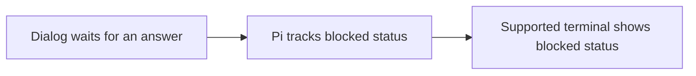

# UI and Modes

Read installed `docs/extensions.md` sections `Custom UI` (user interface) and
`Mode Behavior`; follow `docs/tui.md` for terminal user interface (TUI) components
and `docs/rpc-extension-ui.md` for remote procedure call (RPC) user interfaces.
Example paths below are relative to `examples/extensions/`.

| Mode | Gate | Supported surface |
|---|---|---|
| Interactive | `ctx.mode === "tui"` | Full terminal UI |
| RPC | `ctx.hasUI` is true | Supported protocol UI, not custom terminal components |
| JSON/print | `ctx.hasUI` is false | No dialogs; define non-UI behavior |

A dangerous operation requiring confirmation must block when confirmation is
unavailable, unless an explicit safe non-UI policy authorizes it. Do not use
`hasUI` alone for overlays, custom editors, or terminal input.

## Smallest surface first

| Need | Choice | Example |
|---|---|---|
| Dialog or notification | Standard `ctx.ui` controls | `timed-confirm.ts`, `rpc-demo.ts` |
| Persistent chrome | Status/widget/title/editor text | `status-line.ts`, `widget-placement.ts` |
| Transcript formatting | Message/tool/entry renderer | `message-renderer.ts`, `entry-renderer.ts`, `todo.ts` |
| Custom terminal interaction | `custom()` / `CustomEditor` | `overlay-test.ts`, `modal-editor.ts` |
| Autocomplete composition | Existing composition API | `github-issue-autocomplete.ts` |

- Select storage by semantics, not appearance: `sendMessage` affects model
  context; `appendEntry` stores non-model data. Add a renderer only when useful.
- Keep rendering synchronous and free of input/output operations. Bound width
  with Pi TUI helpers and theme tokens. Reuse components, layout, and highlighting
  until their inputs change; include content, width, theme, and loaded grammars
  in the relevant cache inputs. Clear caches in `invalidate()` and request
  rendering after state changes. See `Keep rendering responsive` in `docs/tui.md`.
- Use injected `context.keyHint()` and `context.keyText()` in tool renderers,
  and `options.keyHint()` / `options.keyText()` in message and entry renderers.
  Package-level imports can see a different package instance and miss configured
  keys. Custom component factories receive a keybinding manager: use it for
  matching and key lookup; imported `rawKeyHint()` can format a literal key.
  Extend `CustomEditor`, forward unowned input, and compose with prior factories.
- Markdown transformers receive optional persisted `messageId` and `timestamp`
  fields; both are undefined during live rendering. In Pi 1.5.1 and later, the
  optional `messageTypes` selects surfaces: defaults are user, assistant, and
  thinking; opt in to `custom`, `summary`, or `changelog` as needed. Keep
  transformers synchronous and inexpensive. They change display only, not stored
  messages or model context.
- Clear timers and UI state on completion/shutdown. Keep business logic separate
  so non-interactive modes remain functional.
- Test the affected mode: RPC startup does not verify TUI layout, keyboard input,
  overlays, or non-UI confirmation policy. Report untested behavior explicitly.

## Blocked status

For a component that waits for an answer, use
`ctx.ui.custom(factory, { blocked: { kind: "question", message: "Pick a color" } })`.
The allowed kinds are `question`, `permission`, and `auth` (authentication).
Inline components report blocked status while visible. In Pi 1.5.1 and later,
blocked overlays report it until `done()`, even when hidden; older Pi versions
ignore this option for overlays. Only terminals with program-status support show
it. Do not mark loaders or other non-blocking components as blocked.

Standard dialogs already report this status. Prefer native dialog handling over
custom stacking or editor-replacement workarounds. This terminal status does not
replace application-specific event-bus notifications or authorization checks;
verify their consumers before removing a bridge.
