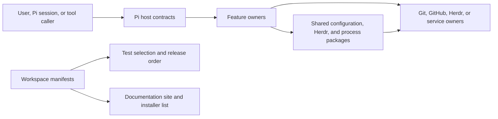

# Architecture and state ownership

Use this map to locate the owner before you change a rule or add a dependency. The [context map](../../CONTEXT-MAP.md) links each domain glossary and names its shared events. The [dependency diagram](../extension-dependencies.html) shows runtime and peer edges. Workspace manifests also declare development dependencies.

## State and data

| State or data | Authority | Consumer boundary |
| --- | --- | --- |
| Extension settings, defaults, and validation | Each extension owns its schema and settings. `pi-config-store` owns config paths, loading, replacement, and issue reporting. | Use the owner interface or event. Follow [the config home decision](../adr/018-extension-config-homes.md) for shared and generated state. |
| Models and task assignments | Pi owns available models. Consumers own task definitions. `pi-task-models` owns assignments, profiles, and shared route resolution. | Resolve through the task owner and effective Pi registries. See [the task routing decision](../adr/017-consumer-owned-task-model-routing.md). |
| Conversation and branch records | The Pi session tree owns conversation history. `pi-goal`, `pi-advisor`, `pi-add-dir`, `pi-footer`, `pi-multi-codex`, `pi-herdr-tools`, and `pi-pr` interpret their own entry types. | Use the Pi session interface and the relevant entry owner. `pi-undo` changes the active branch. `pi-auto-compact` reduces active model context. |
| External directories, questions, and dialogs | `pi-add-dir` owns directory scope. Pi owns the dialog lifecycle. `pi-ask-question` owns the question and answer contract. | Use the documented tools and native dialog events. `pi-herdr-tools` projects dialog state to Herdr. |
| GitHub pull requests and workflow progress | GitHub owns pull request state and merge policy. Git owns checkout and ref state. `pi-pr` owns workflow authority, observations, and recovery records. | Use the guarded tools and scope documented by [Pi PR](../../extensions/pi-pr/README.md). Refresh external state at the mutation boundary. |
| Herdr panes, checkout admission, and background commands | Herdr owns pane state. `pi-herdr` supplies transport and checkout locking. `pi-herdr-tools` owns command claims, outputs, and completion delivery. | Use the [Herdr package](../../packages/pi-herdr/README.md) and [workflow contracts](../../extensions/pi-herdr-tools/README.md). A process identifier alone cannot prove command ownership. |
| Durable facts, searchable evidence, and worktree reminders | `pi-memory` owns facts and review state. `pi-session-recall` owns the rebuildable session index. `pi-notes` owns reminders for one worktree instance. | Use the applicable tool. Read [the knowledge tier decision](../adr/005-knowledge-tier-model.md) for where to record project knowledge. |
| Checkout readiness | `pi-deps` owns opt-in dependency preparation. `pi-codegraph` owns each checkout's index setup and refresh. | Read the relevant status independently. See [Pi Deps](../../extensions/pi-deps/README.md) and [Pi CodeGraph](../../extensions/pi-codegraph/README.md). |
| Quota, delivery, and status | `pi-multi-codex` owns account selection and failover. Magpie supplies quota readings to `pi-magpie`. `pi-bark` owns push rules. `pi-footer` owns the terminal projection. | Use each provider's own contract. Read owner events for terminal status projections. |
| Packages, docs, and release state | The manifests own package identity and dependency declarations. pnpm owns their graph. The npm registry owns published versions. | [Testing](testing.md) uses graph selection. [Release tooling](../releasing.md) uses dependency order and registry versions. The site and installer read package metadata. |

## Implementation boundaries

| Area | Existing implementation | Rule for changes |
| --- | --- | --- |
| Pi interface and event flow | The host provides tool and command registration, terminal rendering, dialog lifecycle, and session events. Extensions own their input and output contracts. | Use the installed host declarations and relevant package context. Keep domain decisions in the feature owner. |
| External commands and services | `pi-process` bounds process execution. Herdr has a transport client. Git and GitHub workflows validate their own inputs and responses. `pi-rtk-test` delegates output filtering to RTK. | Reuse process primitives for matching contracts. Keep cancellation, output limits, authentication, and retry policy with the operation that defines them. |
| Persistence and cache | Session entries follow the active branch. Settings and journals use owner files. Session search uses a rebuildable SQLite index. CodeGraph owns its checkout index format. | Preserve existing storage semantics. Keep the source and its projection distinct when you add a data consumer. |
| Failures and diagnostics | Config issues use the shared reporter. Guarded workflows retain owner diagnostics and recovery records. Feature owners emit their status projections. | Keep error handling at a boundary that can respond. Preserve protected content and distinguish command failure from uncertain completion. |
| Builds, tests, and documentation | TypeScript and Node.js support package builds and tests. pnpm schedules workspace work. The documentation site renders package metadata and source guide files. | Use the [repository checks](../../AGENTS.md#checks) and package scripts. Declare cross-package tests as development dependencies. |

## Known boundary decisions

Pull request actions and Herdr checkout writers currently use separate locks. Pull request actions partition by Pi agent directory. Herdr uses the checkout path across sessions and retains a descriptor across child execution. A single checkout lock would change the tested behavior of independent agent directories and the platform requirements of pull request workflows. Preserve both contracts until a migration defines how these workflows coordinate across installed versions. See [the pull request lock](../../extensions/pi-pr/extensions/pr-execution.ts) and [the Herdr lock contract](../../packages/pi-herdr/README.md).

The Git call sites have distinct callers and execution constraints. Herdr mutations inherit lock descriptors. Session inventory bounds output and supports cancellation. Memory clears Git-local environment overrides to identify a repository. Share primitives only when callers can retain these constraints.
