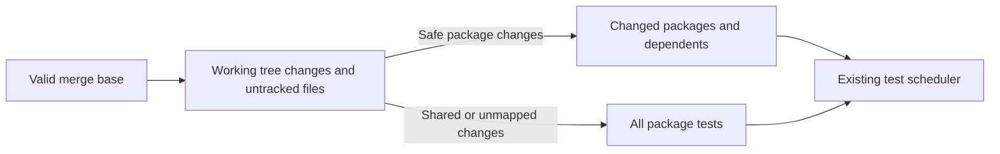

# Run repository tests

For local work, prefer affected tests or the tests for the packages you change. Use `pnpm test` only when the full suite is necessary. It runs all root script tests, evaluation harness tests, and package test scripts. It can take a long time and use much CPU (central processing unit) capacity. It does not call a model.

## Test affected packages

You can run affected tests before committing. The command compares the merge base with the current working tree and adds nonignored untracked files. This includes committed, staged, and unstaged changes. Selection does not change the index or your source files. Test scripts can create build output. Ignored build output does not select more tests.

```bash
pnpm run test:affected
pnpm run test:affected origin/release
```

The first command uses the merge base of `origin/main` and `HEAD`. The second uses the specified revision instead of `origin/main`. Fetch the base before you run the command. A missing base, unrelated history, or more than one merge base causes a failure. An error from pnpm also causes a failure.

Both commands always run root script tests and evaluation harness tests. The workspace selector maps changed paths to packages. It then uses pnpm's `...<package-name>` filter for each package to select it and all packages that depend on it. This also covers untracked files; selection does not depend on pnpm's changed-since filter. Development dependencies are included. Each selected package runs its existing `test` script. The scheduler runs at most three package scripts at a time and keeps the existing priority order.



The selector prints the merge base, any full-suite reason, and the package test scripts to run. It can run all package tests when a safe selection is not possible. With no changes, it runs no package tests. Root tests still run.

## Version-only manifest changes

An existing workspace's `package.json` can change only its top-level `version` without selecting all tests. The selector compares the parsed merge-base and working-tree manifests after removing only that field. All other fields, including nested version fields, must be equal.

A version change can remove an edge from pnpm's package graph. This can occur with an exact dependency range or a minor change to a `0.x` version. The selector therefore also selects every current direct consumer by dependency name, regardless of its declared range. It checks `dependencies`, `devDependencies`, `optionalDependencies`, and `peerDependencies`. pnpm then selects these consumers and their transitive dependents, along with all changed packages.

Name-based ranges, including name-based `workspace:` ranges, are supported. Aliases, paths, catalogs, and other reference forms use the full suite because they can hide consumers. This check covers all current workspace manifests, including unchanged manifests.

## Full-suite fallback

Run all package test scripts when the comparison includes:

- Any manifest change beyond the version-only exception above. Added, removed, nested, and root `package.json` files always use the full suite.
- A manifest comparison that fails because a file cannot be read, parsed, or read from Git. Invalid base revisions still fail before selection. Invalid current manifests can also prevent the full suite from running.
- An unsupported dependency reference during version-only selection.
- A removed or renamed file, a file type change, or an unresolved merge. These changes can also make the current dependency graph insufficient.
- A file outside a current `extensions/*` or `packages/*` workspace. This includes the lockfile, workspace settings, root configuration, shared scripts, evaluation files, and website files.
- An affected `@henryqw/pi-subagent` or `@henryqw/pi-ask-question` package, including changes to its dependencies. Tests in `pi-pr` and `pi-herdr-tools` read these packages without a declared dependency edge.

Keep these cross-package test exceptions in `scripts/affected-workspaces.mjs` until the package dependency graph includes them. Add a safe fallback before adding any other cross-package test access that pnpm cannot see.

## Pull requests and main

Continuous integration runs affected tests for pull requests. It checks out the pull request head with full Git history and passes the actual pull request base commit to the selector. Pushes to `main` run `pnpm test`.

Website validation, type checks, and package checks remain unfiltered in continuous integration. For local website validation, run `pnpm run docs:validate`; neither test command replaces it.

## Test the selector

Run `node --test scripts/affected-workspaces.test.mjs`. These tests use temporary Git repositories and the installed pnpm executable. They do not install dependencies or use the network.
