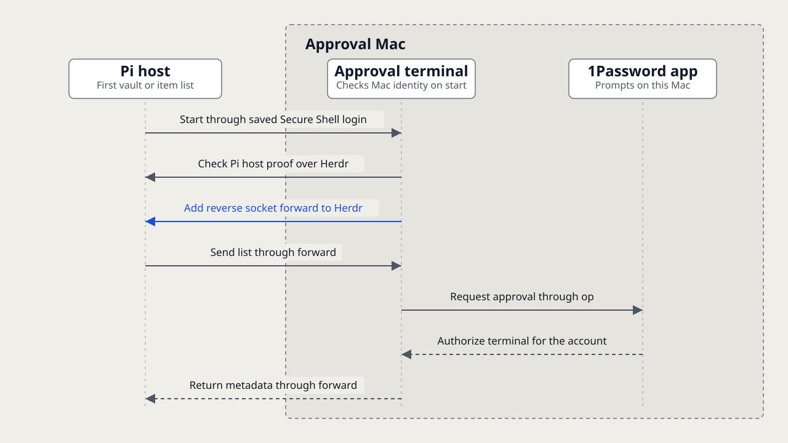

# `@henryqw/pi-1password`

Approve 1Password requests on the Mac in front of you while Pi runs on another computer. Pi can list vault and item metadata and run approved actions.

## Install

```bash
pi install npm:@henryqw/pi-1password
```

Use Node.js 22.19.0 or later. For remote approval, install [Herdr](https://herdr.dev/) on the Pi host. On the Approval Mac, enable [1Password desktop integration](https://1password.dev/cli/app-integration/). Install the 1Password command line interface (`op`) in `/opt/homebrew/bin` or `/usr/local/bin`. Make `npx` available on the Approval Mac.

### Approve from the Mac in front of you

The **Pi host** runs Pi. The **Approval Mac** shows the 1Password prompt.

**Use on-demand approval only if you trust the Pi host with the Approval Mac’s desktop account.** The saved Secure Shell (SSH) login can run commands as that account. The on-demand approval terminal limits its own requests to metadata lists.

| Computer | Requirement |
| --- | --- |
| Pi host | Save the Approval Mac in Herdr. The saved SSH login must reach the Approval Mac’s desktop account without a password prompt. |
| Approval Mac | Open the Pi host in Herdr 0.9.5 or later. Keep the Herdr connection open. |
| SSH server on the Pi host | Allow reverse Unix socket forwarding for the Pi host account. |

1. In Pi, run `/1password` and select the Approval Mac.

Ask Pi for a vault or item list. If 1Password prompts on the Approval Mac, approve with Touch ID.

Pi starts the approval terminal only when a list needs it. It uses your existing SSH keys and starts no login service. If the prompt does not appear, [start approval in Terminal](#start-approval-in-terminal).

### Start approval in Terminal

Use this procedure for named action grants, a separate login for discovery, or a missing Herdr connection.

1. In Pi, run `/1password pair`.
2. Select the Approval Mac if Pi shows the picker.
3. Paste the command from Pi into Terminal on the Approval Mac and run it.
4. Keep Terminal open while you use Pi.

The command checks SSH aliases and known hosts for the Pi host. If detection fails, run `/1password pair <pi-host-alias>`. Use the alias or `user@hostname` that works from the Approval Mac.

Both routes use `npx` to fetch the companion at the version Pi uses. The `--yes` option skips the package prompt. The `--ignore-scripts` option skips package install scripts.

## Use

Select the Approval Mac in each Pi process. Select it again when you move to another Mac. For lists on the Pi host itself, run `/1password local` on macOS.

| Surface | Type | Purpose |
| --- | --- | --- |
| `/1password [select]` | Pi command | Open the picker for reachable Herdr Macs with `op`. It includes the Pi host if local approval is available. A vault or item list starts approval for an idle Mac. |
| `/1password <machine>` | Pi command | Select a saved Herdr machine by label or profile ID. Use `/1password local` to select the macOS Pi host. |
| `/1password select <machine>` | Pi command | Select a saved Herdr machine even if its label matches a command word. |
| `/1password pair [<pi-host-alias>]` | Pi command | Get the command to start approval in Terminal. Supply an alias to bypass detection. |
| `/1password status` | Pi command | Check the selection and the tunnel. Show whether the approval terminal is busy and how many action grants it has. For a local selection, check the signed `op` command. |
| `onepassword_list` | Pi tool | List vaults or items. Set `account` to select an account and `vault` to limit an item list. |
| `onepassword_actions` | Pi tool | List the names of the action grants on the selected remote Mac. Ask Pi which actions are available. |
| `onepassword_action` | Pi tool | Run an approved action by name on the selected remote Mac. Pi receives only its status. |
| `op` | Pi skill | Select the correct account and handle 1Password data safely. |
| `pi-1password serve <ssh-host> <remote-socket> [--actions-file <absolute-path>]` | Shell command | Start a foreground connection from the Approval Mac. `--actions-file` loads named grants there. |

Type `/1password s` to see the `status` and `select` suggestions. Choose `select` to open the picker or add a Herdr machine label or profile ID.

Status and action discovery use the open tunnel without a 1Password prompt.

If you use more than one account, give Pi the account sign-in address when you request a list. Pi includes vault and item names in its context. Use a specific vault to limit item names.

### Verify a fresh approval

1. Lock 1Password on the selected Approval Mac to end its existing approvals.
2. In Pi, ask for a vault list for one account. Check the account in the prompt on the Approval Mac and approve it.
3. Ask for a second list for the same account within 10 minutes. Both lists must succeed. The second request should reuse the approval if the app stayed unlocked.

### Approve an action

An action makes a Hypertext Transfer Protocol Secure (HTTPS) GET request from a remote Approval Mac. It sends one credential to one configured URL. Pi receives completion status for a 2xx response. Redirects fail, and the response body stays on the Approval Mac.


1. Create a file on the Approval Mac with mode `0600`. Keep it outside synced directories and paths that the Pi host can change.
2. Add each action to the file. Use vault and item identifiers in `reference` when possible. Store the reference only.

   ```json
   {
     "check-service": {
       "account": "example.1password.com",
       "reference": "op://vault-id/item-id/credential",
       "url": "https://api.example.com/status",
       "header": "bearer"
     }
   }
   ```

   | Field | Value |
   | --- | --- |
   | Action name | Start with a lowercase letter. Use up to 64 lowercase letters, digits, or hyphens. |
   | `account` | 1Password sign-in address or account identifier on the Approval Mac. |
   | `reference` | Exact 1Password field reference. |
   | `url` | Exact HTTPS destination. Use a service you trust with this credential. |
   | `header` | `bearer` sends `Authorization: Bearer <value>`. `x-api-key` sends `X-API-Key: <value>`. |

3. Close the existing approval terminal if one is open.
4. In the setup command, add `--actions-file` followed by the absolute path to the file.
5. Run the command in Terminal on the Approval Mac.
6. Ask Pi to run `check-service`.

Any process under the Pi host user can list action names and invoke grants while the tunnel is open. Use action names that are safe to include in Pi context. To load changes, close the approval terminal and start it again.

Use a separate, unprivileged login in the Pi host’s Herdr profile for action grants. Keep the grant file and the Approval Mac’s desktop account outside the Pi host’s control.

### End approval

Lock 1Password to end its approvals. Exit Pi to close the approval terminal that Pi started. For a foreground connection, close the approval terminal on the Approval Mac. The shared Herdr connection stays open.

If your pairing uses a launcher key, follow these steps to remove that pairing.

1. On the Approval Mac, remove the pairing key from `~/.ssh/authorized_keys`. Use the `pi-1password-` key label from the original pairing output.
2. On the Pi host, remove `launchUser` from that target in the config file. If the target has no socket override, remove the whole target entry.
3. In Pi, select the Mac again. Run `/1password status` and check for `On-demand tunnel idle`.

## Flow



| Connection | Direction | Purpose |
| --- | --- | --- |
| Saved SSH login | Pi host to Approval Mac | Start the approval terminal under the desktop account. The terminal checks the selected Mac’s hardware identifier. |
| Open Herdr SSH connection | Approval Mac to Pi host | Check the Pi host proof and add a reverse socket forward. Pi sends lists and receives metadata through that forward. |

The approval terminal stops when Pi exits or after 10 minutes without a request. It removes its forward and leaves the Herdr connection open.

1Password authorizes each account in the approval terminal separately. Authorization expires after 10 minutes of inactivity. It also expires 12 hours after the initial approval. Lock 1Password to revoke its approvals. [1Password approval rules](https://1password.dev/cli/app-integration-security/)

## Config

Package-owned path `~/.pi/agent/config/pi-1password/config.json`

| Name | Description | Values | Default |
| --- | --- | --- | --- |
| `targets` | Route settings by Herdr machine profile ID. | Copy the ID from `/1password` or `herdr machine list --json`. The `--json` flag requests structured output. | Empty |
| `targets.<id>.socket` | Optional socket path override on the Pi host. | Unique absolute path of at most 100 bytes. Use letters, digits, dots, slashes, underscores, and hyphens. | A path for the selected profile under `~/.pi-1password/` |
| `targets.<id>.launchUser` | Desktop account for an existing on-demand pairing. | Existing pairings use their original launcher key. | Saved SSH login for lists |

For example, use `{"targets":{"example-profile-id":{"socket":"/home/user/.pi-1password/work.sock"}}}` and replace `example-profile-id` with the saved profile ID. Create a private directory with mode `0700` for a custom socket.

Edit the file on the Pi host. The next request uses the new values. A config issue blocks requests until you fix it. [Config files](https://pi.henry.wang/overview#config-files)

## Limits and recovery

| What you see | What to check |
| --- | --- |
| Mac missing from the picker | Enable its Herdr profile. Check SSH access, macOS, and the signed `op` installation. Discovery needs no account access. |
| `private 0700 directory` | Create the custom socket directory if it is missing. It must belong to your user and have mode `0700`. |
| `without extra access grants` | On macOS, check access grants on the socket directory and its parents. |
| `Set targets.<id>.socket` | The default path is too long or contains an unsupported character. Set a short path in [Config](#config). |
| `No active Herdr SSH tunnel` | From the Approval Mac, open the Pi host in Herdr. Request the list again. |
| `Secure Shell setup failed` | Check the SSH alias, host trust, and the permissions on the socket and its parent directory. |
| `Cannot find a trusted SSH route` | Run `/1password pair <pi-host-alias>` with the alias you use on the Approval Mac. |
| `Cannot verify the Pi host` | Check the alias you use on the Approval Mac. Run `/1password pair` again on the Pi host. |
| `Cannot start the approval terminal` | Check that the saved SSH login reaches the desktop account and that `npx` is available. Use `/1password pair` to start it in Terminal. |
| `Status is unavailable` | Check the selected socket route. If it is correct, update the companion command and restart its approval terminal. The previous companion still supports vault lists, item lists, and named actions. |
| Route changed or wrong Mac | Check the profile and socket path. Select the Mac again with `/1password`. The bridge checks the Mac's hardware identifier before each request. |
| Approval did not complete | Check for a 1Password prompt on the selected Mac. If no prompt appears, [start approval in Terminal](#start-approval-in-terminal). |
| Approval Mac busy | Wait for the current request to finish. Each approval terminal handles one request at a time. |
| Approved action failed | Check the account and field reference on the Approval Mac. Check that the configured service returns a 2xx response. |

- Use a distinct socket path for each Mac. The Pi user must own the private socket directory (`0700`) and socket (`0600`).
- Use a path without symbolic links. Parent directories must belong to the Pi user or root and prevent other users from replacing entries.
- If an old socket remains, verify that its tunnel has stopped before you remove it.
- A request can take up to 60 seconds on the Approval Mac.
- The action file and its parent directories must have no extra access grants.
- Unset `NODE_OPTIONS` and start the companion without Node.js flags or a debugger. This blocks heap snapshots and Transport Layer Security (TLS) key logging. The companion disables signal-triggered debugging before it enables actions.
- Unset `NODE_EXTRA_CA_CERTS` and `NODE_USE_SYSTEM_CA` before you enable actions. This prevents those settings from adding more trusted certificate authorities.
- Disable the `http`, `https`, and `stream` categories in `NODE_DEBUG` before you enable actions.
- A list can return up to 1 mebibyte. Select one vault if the item list exceeds the limit.
- Run other `op` commands directly on the Mac with desktop integration.
- If Pi already loads a skill named `op`, keep one copy active to avoid a name conflict.
