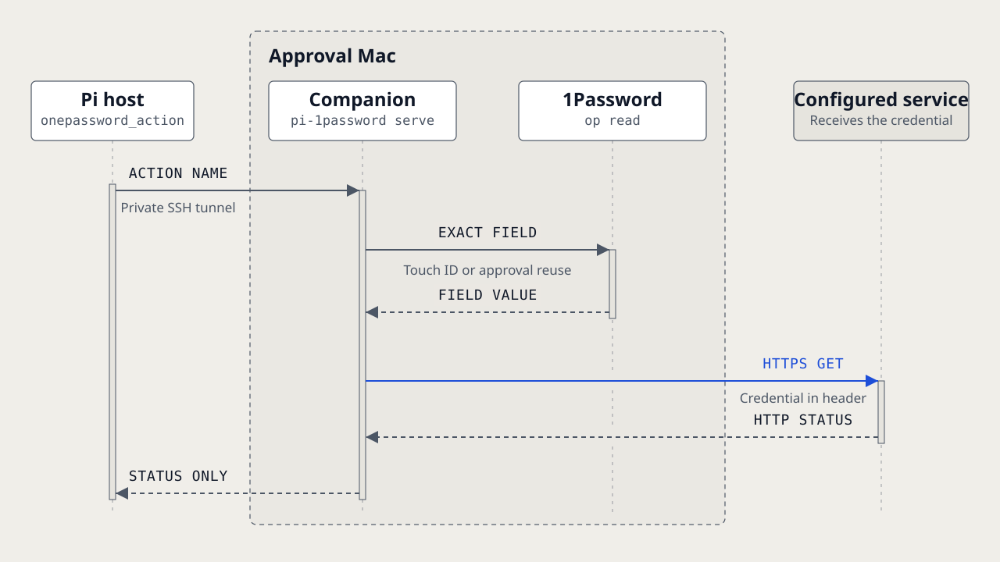

# `@henryqw/pi-1password`

Approve 1Password requests on the Mac in front of you while Pi runs on another computer. Pi can list vault and item metadata and run approved actions.

## Install

```bash
pi install npm:@henryqw/pi-1password
```

Use Node.js 22.19.0 or later. On the Approval Mac, use the `npx` command that comes with npm. Install [Herdr](https://herdr.dev/) on the Pi host to discover remote Macs. On each Approval Mac, enable [1Password desktop integration](https://1password.dev/cli/app-integration/) and put `op` in `/opt/homebrew/bin` or `/usr/local/bin`.

### Pair another Mac

The **Pi host** runs your Pi session. The **Approval Mac** runs `op` and displays the 1Password prompt.

| Secure Shell (SSH) connection | Purpose |
| --- | --- |
| Pi host to Approval Mac | Herdr supplies the address for discovery. A dedicated key starts the paired approval terminal. |
| Approval Mac to Pi host | The approval terminal opens the reverse tunnel. Requests travel through a private socket on the Pi host. |

Enable Remote Login for the desktop account on the Approval Mac. Use a direct address for that Mac in Herdr. Both connections need working SSH host trust. The Pi host must allow reverse Unix socket forwarding.

1. In Pi, run `/1password` and select the Approval Mac.
2. Run `/1password pair <mac-login> <pi-host-alias>`. Use the desktop account name on the Approval Mac and the SSH alias it uses for the Pi host.
3. Paste the displayed block in Terminal or iTerm2 on the Approval Mac. It installs the companion and authorizes its dedicated key after it verifies the Pi host.
4. Ask Pi for a vault list for your account. If 1Password prompts, approve the request on the Approval Mac.

The launcher key can start only the fixed companion command. It cannot start a shell or forward connections. The companion starts on the first vault list, item list, or named action. It closes after 10 idle minutes or when the Pi session that started it ends.

### Start a manual tunnel

When an unpaired Mac is disconnected, Pi shows a start command. Replace `PI_HOST_SSH_ALIAS` with the address or alias for the Pi host. Run it in a local terminal on the Approval Mac. Keep that terminal open and use `/1password status` to check the connection.

The start command uses `npx` to fetch the companion. `--yes` skips the install confirmation. `--ignore-scripts` skips package install scripts.

1Password sets the process name in its approval prompt. A companion that starts through SSH can show `sshd`, the SSH server process. A companion you start in Terminal or iTerm2 can show that app name. [1Password approval prompts](https://1password.dev/cli/app-integration-security/)

## Use

Select the Approval Mac in each Pi process. Select it again when you move to another Mac. For lists on the Pi host itself, run `/1password local` on macOS.

| Surface | Type | Purpose |
| --- | --- | --- |
| `/1password [select]` | Pi command | Show the current selection and open the picker. It lists reachable, enabled Herdr Macs with `op`. It includes the local Mac if `op` is available. |
| `/1password <machine>` | Pi command | Select a saved Herdr machine by label or profile ID. Use `/1password local` to select the macOS Pi host. |
| `/1password select <machine>` | Pi command | Select a saved Herdr machine even if its label matches a command word. |
| `/1password pair <mac-login> <pi-host-alias>` | Pi command | Prepare on-demand approval for the selected Mac. Copy the authorization block that Pi shows. |
| `/1password status` | Pi command | Check the selection and the tunnel. Show whether the approval terminal is busy and how many action grants it has. For a local selection, check the signed `op` command. |
| `onepassword_list` | Pi tool | List vaults or items. Set `account` to select an account and `vault` to limit an item list. |
| `onepassword_actions` | Pi tool | List the names of the action grants on the selected remote Mac. Ask Pi which actions are available. |
| `onepassword_action` | Pi tool | Run an approved action by name on the selected remote Mac. Pi receives only its status. |
| `op` | Pi skill | Select the correct account and handle 1Password data safely. |
| `pi-1password serve <ssh-host> <remote-socket> [--actions-file <absolute-path>]` | Shell command | Start a reverse Secure Shell (SSH) connection from the Approval Mac. `--actions-file` loads named grants there. |

Type `/1password s` to see the `status` and `select` suggestions. Choose `select` to open the picker or add a Herdr machine label or profile ID.

Status and action discovery need no 1Password approval. They use an open tunnel. Run a vault list to start an idle paired tunnel.

If you use more than one account, give Pi the account sign-in address when you request a list. Pi includes vault and item names in its context. Use a specific vault to limit item names.

### Verify a fresh approval

1. Lock 1Password on the selected Approval Mac to end its existing approvals.
2. In Pi, ask for a vault list for one account. Check the account in the prompt on the Approval Mac and approve it.
3. Ask for a second list for the same account within 10 minutes. Both lists must succeed. The second request should reuse the approval if the app stayed unlocked.

### Approve an action

An action makes an HTTPS GET request from a remote Approval Mac. It sends one credential to one configured URL. Pi receives completion status for a 2xx response. Redirects fail, and the response body stays on the Approval Mac.

1. Create a file on the Approval Mac with mode `0600`. Keep it outside synced directories and paths that the Pi host can change.
2. Add each action to the file. Use vault and item identifiers in `reference` when possible. Store the reference only.

   ```json
   {
     "check-service": {
       "account": "example.1password.com",
       "reference": "op://vault-id/item-id/credential",
       "url": "https://api.example.com/status",
       "header": "bearer"
     }
   }
   ```

   | Field | Value |
   | --- | --- |
   | Action name | Start with a lowercase letter. Use up to 64 lowercase letters, digits, or hyphens. |
   | `account` | 1Password sign-in address or account identifier on the Approval Mac. |
   | `reference` | Exact 1Password field reference. |
   | `url` | Exact HTTPS destination. Use a service you trust with this credential. |
   | `header` | `bearer` sends `Authorization: Bearer <value>`. `x-api-key` sends `X-API-Key: <value>`. |

3. Stop the existing approval terminal if it is open.
4. For a paired Mac, add `--actions-file "$HOME/.config/pi-1password/actions.json"` to the local `authorize` command. Remove the old key entry before you run it again with the new file path.
5. For a manual tunnel, add the same option to the `serve` command. Start it on the Approval Mac.
6. Ask Pi to run `check-service`.

Any process under the Pi host user can list action names and invoke grants while the tunnel is open. A process with the paired key can also restart the tunnel. Use action names that are safe to include in Pi context. Restart the companion to load changes to the file.

Keep the Approval Mac's desktop account outside the Pi host's control. Use a separate, unprivileged login for Herdr discovery. The dedicated launcher key can use the desktop account for the fixed companion command.

### Revoke a pairing

On the Approval Mac, remove the key from `~/.ssh/authorized_keys`. Match the `pi-1password-` label that the pairing command showed. Lock 1Password and close the active approval terminal. If Pi started it, exit the Pi session that owns it. This ends that connection and prevents a new start with the removed key.

## Flow

For a remote action, Pi sends an action name and gets status back. The Approval Mac sends the credential in a header to the configured service.



| Step | Computer | Action |
| --- | --- | --- |
| Select | Pi host | Select a Mac with `op` from the saved Herdr machines or select the local Mac. |
| Request | Pi host | Send a list request or action name through the private socket and reverse SSH connection. |
| Approve | Approval Mac | Run native `op`. The 1Password app prompts there when it needs authorization. |
| Use | Approval Mac | For an action, send the credential to the configured HTTPS service. |
| Return | Pi host | Return list metadata or action status to Pi. |

1Password authorizes each account in the approval terminal separately. Authorization expires after 10 minutes of inactivity. It also expires 12 hours after the initial approval. Lock 1Password to revoke its approvals. Close the approval terminal to disconnect Pi. [1Password approval rules](https://1password.dev/cli/app-integration-security/)

## Config

Package-owned path `~/.pi/agent/config/pi-1password/config.json`

| Name | Description | Values | Default |
| --- | --- | --- | --- |
| `targets` | Route settings by Herdr machine profile ID. | Copy the ID from `/1password` or `herdr machine list --json`. The `--json` flag requests structured output. | Empty |
| `targets.<id>.socket` | Optional socket path override on the Pi host. | Unique absolute path of at most 100 bytes. Use letters, digits, dots, slashes, underscores, and hyphens. | A path for the selected profile under `~/.pi-1password/` |
| `targets.<id>.launchUser` | Desktop account for on-demand approval. | `/1password pair` sets this field and creates the private key on the Pi host. | Manual start |

For example, use `{"targets":{"example-profile-id":{"socket":"/home/user/.pi-1password/work.sock"}}}` and replace `example-profile-id` with the saved profile ID. Create a private directory with mode `0700` for a custom socket.

Edit the file on the Pi host. The next request uses the new values. A config issue blocks requests until you fix it. [Config files](https://pi.henry.wang/overview#config-files)

## Limits and recovery

| What you see | What to check |
| --- | --- |
| Mac missing from the picker | Enable its Herdr profile. Check SSH access, macOS, and the signed `op` installation. Discovery needs no account access. |
| `private 0700 directory` | Create the custom socket directory if it is missing. It must belong to your user and have mode `0700`. |
| `without extra access grants` | On macOS, check access grants on the socket directory and its parents. |
| `Set targets.<id>.socket` | The default path is too long or contains an unsupported character. Set a short path in [Config](#config). |
| Mac disconnected | Pair the Mac for on-demand approval or run the manual start command on the Approval Mac. |
| `Cannot verify this Pi host` | Check the return SSH alias from the Approval Mac. Copy a fresh pairing block from the current Pi host. |
| `Cannot start the paired approval terminal` | Check Remote Login, the desktop account name, the authorized key, and the two SSH connections. Pair again after a route change. |
| `Status is unavailable` | Check the selected socket route. If it is correct, update the companion command and restart its approval terminal. The previous companion still supports vault lists, item lists, and named actions. |
| Route changed or wrong Mac | Check the profile and socket path. Select the Mac again with `/1password`. The bridge checks the Mac's hardware identifier before each request. |
| Approval did not complete | Check the selected Mac for a 1Password prompt. Check desktop integration and the account if no prompt appears. |
| Approval Mac busy | Wait for the current request to finish. Each approval terminal handles one request at a time. |
| Approved action failed | Check the account and field reference on the Approval Mac. Check that the configured service returns a 2xx response. |

- Use a distinct socket path for each Mac. The Pi user must own the private socket directory (`0700`) and socket (`0600`).
- Use a path without symbolic links. Parent directories must belong to the Pi user or root and prevent other users from replacing entries.
- If an old socket remains, verify that its tunnel has stopped before you remove it.
- A request can take up to 60 seconds on the Approval Mac.
- The action file and its parent directories must have no extra access grants.
- Unset `NODE_OPTIONS` and start the companion without Node.js flags or a debugger. This blocks heap snapshots and Transport Layer Security (TLS) key logging. The companion disables signal-triggered debugging before it enables actions.
- Unset `NODE_EXTRA_CA_CERTS` and `NODE_USE_SYSTEM_CA` before you enable actions. This prevents those settings from adding more trusted certificate authorities.
- Disable the `http`, `https`, and `stream` categories in `NODE_DEBUG` before you enable actions.
- A list can return up to 1 mebibyte. Select one vault if the item list exceeds the limit.
- Run other `op` commands directly on the Mac with desktop integration.
- If Pi already loads a skill named `op`, keep one copy active to avoid a name conflict.
