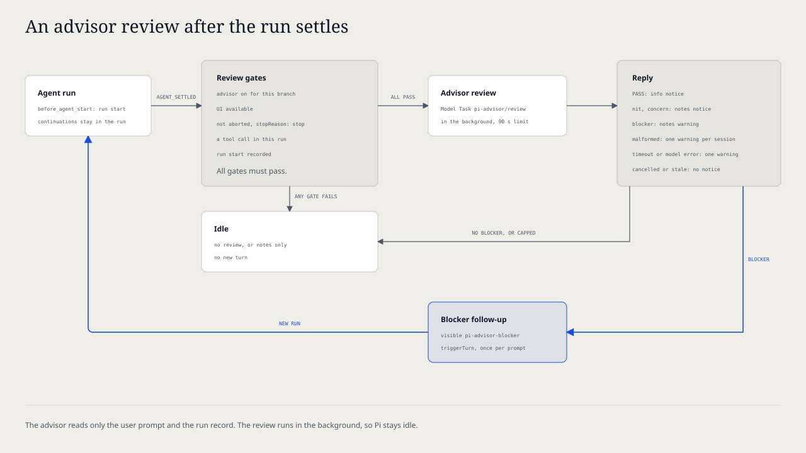

# `@henryqw/pi-advisor`

Let a second model examine the tool calls and results of each agent run after Pi settles the run. The advisor returns graded notes. A blocker sends one follow-up message that makes the agent fix it.

## Install

```bash
pi install npm:@henryqw/pi-advisor
```

The advisor uses the `pi-advisor/review` Model Task. Its default Task Profile is `balanced`. Run `/task-models` to configure a route for that profile before you turn the advisor on.

## Works with

| Package | Relationship | Purpose |
| --- | --- | --- |
| [`@henryqw/pi-goal`](https://pi.henry.wang/extensions/pi-goal) | Improves | Goal continuations stay in one run. The advisor examines all of that work after the run settles. |
| [`@henryqw/pi-task-models`](https://pi.henry.wang/extensions/pi-task-models) | Required | Provides the advisor model route. |

## Use

Run `/advisor on`. Then send a prompt that makes the agent use tools. When the run settles, the advisor examines it in the background, and Pi shows the result.

| Surface | Type | Purpose |
| --- | --- | --- |
| `/advisor on` | command | Turn the advisor on for this conversation branch. |
| `/advisor off` | command | Turn the advisor off for this conversation branch. |
| `/advisor status` | command | Show whether the advisor is on for this conversation branch. |
| `Advisor reviewing…` | ui | Footer status while the review runs. |

The advisor is off by default.

### Results

| Reply | What Pi shows | Continuation |
| --- | --- | --- |
| `PASS` | The `Advisor: PASS` notice. | No |
| Only `nit` notes | One notice with all notes. | No |
| A `concern` note | One warning with all notes. | No |
| A `blocker` note | One warning with all notes. | One follow-up for each user prompt |
| Malformed reply, or a reply longer than 8,000 characters | One warning, one time in each session. | No |

## Flow



1. A user prompt or a triggering custom message starts a run. Pi Advisor records where the run starts on the branch.
2. Other extensions can continue the run. All of their turns stay in the same run.
3. Pi settles the run. Pi Advisor does no review for a run without tool calls, an unfinished run, or a session without UI.
4. Pi Advisor sends one tool-free request to the advisor model in the background. The request contains the latest user prompt and the run record.
5. Pi shows the notes. For a `blocker` note, Pi Advisor sends a visible `pi-advisor-blocker` follow-up message. The message starts a new run that fixes the blockers.
6. The advisor also examines that new run. It shows the notes, but it sends no other follow-up until the next user prompt.

## State and storage

Pi Advisor keeps no files. `/advisor on` and `/advisor off` append a `pi-advisor` custom entry to the conversation. The latest entry on the current branch sets the state, so branch navigation, `/tree`, forks, and rewinds show the state of the selected branch.

Each blocker follow-up is a visible `pi-advisor-blocker` message on the branch. Its `details` contain the notes.

## Limits and recovery

| Limit | Behavior | Recovery |
| --- | --- | --- |
| Interactive only | The advisor does not run in print mode or other modes without UI. | Examine the run manually. |
| No route | Pi shows a warning that names `/task-models`. The advisor does not use the session model. | Run `/task-models` and set a route for the `pi-advisor/review` profile. |
| Time limit | The review stops after 90 seconds and Pi shows a warning. Pi shows no notes. | Send the next prompt. |
| Cancel | A new prompt, a new run, branch navigation, `/advisor off`, or session exit cancels the review. Pi shows no notice. Escape in an idle session does not cancel it. | Send a prompt to cancel the review. |
| Old reply | When the branch changes or Pi starts work before the reply arrives, Pi Advisor ignores the reply. | Send a prompt to start a new run. |
| Model error | Pi shows a warning. Pi shows no notes. | Run `/task-models` to examine the route, or send the next prompt. |
| Run record size | Each item is truncated to 4,000 characters, and the prompt to 8,000. The record keeps the newest 48,000 characters and marks earlier items as omitted. | Ask for a smaller run when early steps must be examined. |
| One follow-up | A blocker sends one follow-up message for each user prompt. | Send a prompt to fix the remaining blockers. |
| Advice only | The advisor sees only the run record. Its notes can be wrong. | Examine each note before you accept it. |
