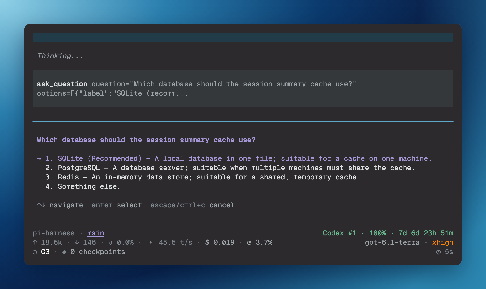

# `@henryqw/pi-ask-question`

Pause Pi until the user selects one of up to three question options or enters a custom answer. The user selects with the keyboard, so agents and extensions get an explicit answer and do not parse free-form chat.



## Install

```bash
pi install npm:@henryqw/pi-ask-question
```

Requires Pi 1.1.0 or later in the 1.x series.

## Use

In an interactive TUI session, call `ask_question` with a question and one to three question options. Pi pauses until the user answers. Then it returns the selected option or the custom answer.

| Surface | Type | Purpose |
| --- | --- | --- |
| `ask_question` | tool | For agents: pauses execution so the user can select an option or enter a custom answer. |

```json
{
  "question": "Which database should we use?",
  "options": [
    { "label": "PostgreSQL", "description": "Shared server database" },
    { "label": "SQLite", "description": "Local, embedded storage" },
    { "label": "File", "description": "Plain file storage" }
  ]
}
```

- Supply one to three options in preference order.
- The UI marks the first option `(Recommended)`.
- The UI adds `Something else.`, which opens a text input for a custom answer.

While an interactive TUI question is open, the tool publishes `herdr:blocked` with the `Input required` label. It clears the status after completion, cancellation, or failure.

## API

Import these exports from the package root, `@henryqw/pi-ask-question`.

| Surface | Type | Purpose |
| --- | --- | --- |
| `askQuestion(params, ctx, signal)` | function | Runs the validated question flow for another extension. |
| `AskQuestionOption` | type | Describes a question option. |
| `AskQuestionRequest` | type | Describes a question request. |
| `AskQuestionResult` | type | Describes the flow result. |

The answer is `null` if the user cancels or submits an empty custom answer. It is also `null` if the request is invalid or the context is not in TUI mode. For invalid requests and non-TUI contexts, the result has an optional `error`.

## Limits and recovery

Questions must not be blank. Supply one to three question options. Each label must not be blank and must be unique, without regard to case. `Something else.` is reserved for the custom answer option. Invalid questions return an error.

The tool requires an interactive TUI. In non-interactive sessions, the tool returns `UI not available (running in non-interactive mode)`. In these sessions, ask in plain assistant text. If the tool is aborted, it closes the pending question. If the user cancels the prompt or submits an empty custom answer, the result has no answer.
