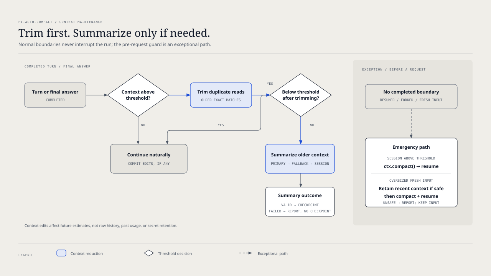

# `@henryqw/pi-auto-compact`

Trim repeated reads before compaction of long Pi sessions. Completed tool turns continue normally, and compaction after a final answer does not start another turn. Your threshold keeps free context space.

## Install

```bash
pi install npm:@henryqw/pi-task-models
pi install npm:@henryqw/pi-auto-compact
```

Requires Pi 1.1.0 or later in the 1.x series.

Install `@henryqw/pi-task-models` first. Run `/task-models`. Configure the `fast` profile. Open `/task-models` again to verify that `fast` no longer says `not configured`.

Disable Pi's built-in compaction in `~/.pi/agent/settings.json`:

```json
{
  "compaction": {
    "enabled": false
  }
}
```

Restart Pi after you install the package or change settings. Trusted `.pi/settings.json` files must not set `compaction.enabled` back to `true`.

## Works with

| Package | Relationship | Purpose |
| --- | --- | --- |
| [`@henryqw/pi-task-models`](https://pi.henry.wang/extensions/pi-task-models) | Required | Provides shared compaction routes. |

Task Models owns the shared `~/.pi/agent/config/pi-task-models/config.json` file. By default, the `pi-auto-compact/autoCompact` task of this extension uses the `fast` profile. A task entry is an explicit user override.

## Use

Run `/auto-compact` with no arguments. Enter a threshold from 25% to below 100%. Pi confirms it as `Auto-compact threshold set to <value>%.` The default is 70%. The read trim has no separate switch. To opt out, disable or remove this extension.

| Surface | Type | Purpose |
| --- | --- | --- |
| `/auto-compact` | command | For users: set the context-use threshold interactively. |
| `pi-auto-compact/autoCompact` | task | For Task Models users: configure compaction model routes. |

## Flow



- The extension measures context use the same way as Pi's status bar. It adds the provider-reported usage of the latest response to estimates for later messages. Before usage data exists, and after compaction, the extension estimates each message at about four characters per token. Estimates include replayed reasoning that some providers do not bill. Thus, estimates can be too high until the next response.
- At completed `turn_end` and `agent_before_settle` boundaries, the extension replaces older successful, text-only `read` results. It does this only when an identical later full read is in the protected recent context. Tool name, arguments, and text must match. Failed, changed, image-bearing, or already edited results stay intact. If the read trim decreases context below the threshold, no summary request runs.
- If the read trim is not sufficient, the extension summarizes older effective context. It tries the primary route of the `fast` profile, then the fallback route, then the current session model. Pi commits context-edit and compaction entries. This does not interrupt a normal tool turn or start a final answer again. A failed summary does not become a checkpoint.
- Resumed or forked sessions and oversized fresh input can need an emergency `ctx.compact()` before a completed boundary exists. This exceptional path interrupts the current task and then resumes it.

## Config

Package-owned: `~/.pi/agent/config/pi-auto-compact/config.json`

| Name | Description | Values | Default |
| --- | --- | --- | --- |
| `autoCompactThreshold` | Sets the context-use percentage that triggers compaction. | Number from 25 inclusive to below 100. | `70` |

The extension ignores unknown fields. Legacy model fields are obsolete. `/auto-compact` writes this file.

If the file is missing, the extension uses 70%. A read does not create the file. If the file is malformed or invalid, the extension shows a failure at session start and uses 70%. The file stays unchanged.

Only `/auto-compact` writes this file. Its write is atomic.

## State and storage

Context edits and compaction entries change only the projected context of the active session. They keep raw session history, export, UI display, and historical usage. They decrease only the estimated future context. Providers do not refund earlier tokens. An edit to an older prefix can also decrease provider cache reuse. This does not erase secrets.

## Limits and recovery

- The extension does not activate unless effective `compaction.enabled` is `false`. If activation fails, disable built-in compaction in Pi settings. Then check trusted project settings.
- If the extension cannot safely decrease a fresh request, it reports the limit and does not discard the request. Make the new input shorter, or run `/compact`.
- If the shared Task Models config is malformed, the extension reports it and does not change it. Compaction then uses the current session model. If configured routes fail, compaction uses the current session model. If summary attempts fail, the extension saves no checkpoint. Check model routes and authentication. Then run `/compact` to try again manually.
