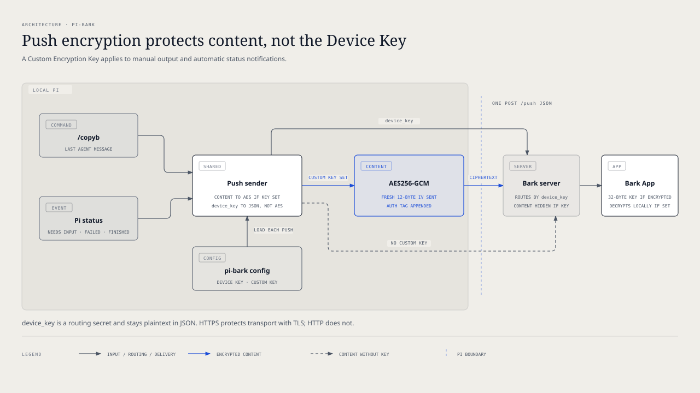

# `@henryqw/pi-bark`

Get [Bark](https://bark.day.app) push notifications when Pi finishes, fails, or needs your input. Use `/copyb` to send the latest Pi response to your device.

## Install

Requires Pi 1.1.0 or later in the 1.x series.

```bash
pi install npm:@henryqw/pi-bark
```

### Setup

1. Open the Bark App and copy its test URL.
2. Get the Device Key from the URL.
3. Run `/set-bark` in Pi.

For Bark's public server:

```text
/set-bark your-device-key
```

For a self-hosted Bark server:

```text
/set-bark your-device-key https://bark.example.com
```

A test URL such as `https://api.day.app/your-device-key/Test` contains the Device Key after the host. Do not include sample push content such as `/Test`.

Treat the Device Key as a secret. Anyone with it can send push notifications to your device.

## Works with

| Package | Relationship | Purpose |
| --- | --- | --- |
| [`@henryqw/pi-herdr-tools`](https://pi.henry.wang/extensions/pi-herdr-tools) | Improves | Adds the same Pi session title to automatic Bark status notifications. |

## Use

Run `/copyb` with no arguments. It copies the latest Pi response to your clipboard and sends it to your Bark device.

| Surface | Type | Purpose |
| --- | --- | --- |
| `/bark <on\|off\|inherit> \| default <on\|off>` | command | Set a notification override for the current CWD or change the default. |
| `/copyb` | command | Copy the last agent message and send a Bark push notification. |
| `/set-bark <device-key> [server-url]` | command | Save the Device Key and Bark server URL. |
| `pi-bark-key [--force \| --disable]` | command | Terminal command to generate, replace, or disable the Custom Encryption Key. |

The `/` commands are for people who use Pi. Run `pi-bark-key` in a terminal.

`/copyb` copies the last agent message to your clipboard. It then sends a Bark V2 push request to `<serverUrl>/push`.

Without Push Encryption, the JSON request uses the standard Bark parameter names:

```json
{
  "device_key": "your-device-key",
  "body": "the last agent message"
}
```

The `body` value is the same text that the Pi `/copy` command selects. `/copyb` removes leading and trailing whitespace from the combined response. Markdown, code blocks, internal spacing, and line breaks do not change.

### Automatic status notifications

After setup, pi-bark sends these status notifications:

- **Pi needs input** when Pi opens a blocking user prompt, including `ask_question`.
- **Pi failed** when the agent has fully settled, will not continue automatically, and the run ended in an unrecovered failure.
- **Pi finished** when the agent has fully settled, will not continue automatically, and the run completed normally.

The outcome follows the Pi run status. The last agent response of the run decides it. A provider error means failure, and a later successful retry clears that failure. A failed context compaction during the run, including overflow recovery, also means failure. Each new run starts with a clean outcome. Earlier runs and other branches do not affect it. A failed `/compact` while Pi is idle sends no push notification.

A cancelled run (for example, with Escape) or a cancelled compaction sends no settled notification. Input notifications and explicit `/copyb` stay available. If a new run starts before pi-bark sends a settled notification, pi-bark cancels that notification.

Each status notification includes the current Pi session name. Herdr shows the same name when `pi-herdr-tools` is active. pi-bark does not call Herdr or read Herdr state.

An unset session name shows as `Unnamed`. Status notifications do not include prompts, agent output, or error messages. pi-bark sends no push notification when a prompt closes.

Automatic notifications are enabled by default. Disable them only in the current CWD:

```text
/bark off
```

Use `on` to enable the current CWD explicitly. Use `inherit` to remove its CWD override. The CWD then follows the notification default.

Change the notification default for all CWDs without a CWD override:

```text
/bark default off
```

These settings do not affect `/copyb`. CWD overrides are in the global pi-bark config, not in project files.

## Flow



## Config

Package-owned: `~/.pi/agent/config/pi-bark/config.json`

| Name | Description | Values | Default |
| --- | --- | --- | --- |
| `serverUrl` | Base URL of the Bark server that accepts push requests. | HTTP or HTTPS URL with an optional path and no query or fragment. | Required. `/set-bark` writes `"https://api.day.app"` when you do not give a server URL. |
| `deviceKey` | Identifies the Bark App installation that receives the push notification. | Non-empty string. | Required |
| `encryption` | Custom Encryption Key and matching Bark encryption settings. | AES256-GCM settings object or `null`. | Required. `null` disables Push Encryption. The commands write `null` to a new file. |
| `statusNotifications` | Controls automatic status notifications by CWD. | Global boolean default and absolute-CWD boolean overrides. | Enabled with no overrides. |

Config changes take effect on the next command or status event. You do not need to restart Pi. A status notification that is already in the queue uses the settings that pi-bark read when its event occurred.

### Push encryption

Push Encryption is optional. It prevents the Bark server and Apple Push Notification service from reading push content.

After you configure it, pi-bark encrypts every push that it sends. This includes `/copyb` and all automatic status notifications.

#### Set up encryption

1. Configure your Bark Device Key with `/set-bark`.
2. Generate and save a Custom Encryption Key:

   ```bash
   npx --yes --package=@henryqw/pi-bark -- pi-bark-key
   ```

   `npx` temporarily downloads the package and runs its `pi-bark-key` executable. The command saves the key to the pi-bark config and prints it one time.

3. Open **Bark App → Push Encryption**.
4. Enter these settings:

   | Setting | Value |
   | --- | --- |
   | Algorithm | `AES256` |
   | Mode | `GCM` |
   | Padding | `noPadding` |
   | Key | The generated 32-character key |

   The generated ASCII key is 32 characters and 32 bytes.

5. If Bark requires an IV, enter any 12 ASCII characters, such as `000000000000`.
6. Save the Bark settings.
7. Run `/copyb` in Pi. Bark should show the exact last agent message instead of `Decryption Failed`.

The saved IV is only a placeholder for older Bark versions. pi-bark creates a new 12-byte IV for each push and sends it with the Ciphertext. Bark uses that per-push IV, not the saved value.

Do not paste the command output into shared logs. The Custom Encryption Key can decrypt your push content.

pi-bark appends the GCM authentication tag to the Ciphertext before Base64 encoding, as Bark requires.

#### Replace or disable the key

The command does not overwrite an existing key. Replace the key only when you also update the Bark App:

```bash
npx --yes --package=@henryqw/pi-bark -- pi-bark-key --force
```

To disable Push Encryption in pi-bark, run:

```bash
npx --yes --package=@henryqw/pi-bark -- pi-bark-key --disable
```

Also disable Push Encryption in the Bark App. If you do not, its settings do not match pi-bark.

The config file has this shape:

```json
{
  "serverUrl": "https://api.day.app",
  "deviceKey": "your-device-key",
  "encryption": {
    "algorithm": "AES256",
    "mode": "GCM",
    "padding": "noPadding",
    "key": "your-32-character-custom-key"
  },
  "statusNotifications": {
    "defaultEnabled": true,
    "cwdOverrides": {
      "/srv/quiet-project": false
    }
  }
}
```

Set `encryption` to `null` when Push Encryption is disabled.

- A missing config file stays missing until a command or the key script writes it.
- `/set-bark` preserves Push Encryption and status notification settings.
- `pi-bark-key` can run before `/set-bark`. It then writes `"deviceKey": null`, and pi-bark stays disabled until you run `/set-bark`.
- The Server URL must use HTTP or HTTPS. It cannot contain a query or fragment delimiter. Use HTTPS when possible. HTTP sends the Device Key over the network without encryption. Without Push Encryption, HTTP also sends the push content without encryption. Push Encryption does not protect the Device Key.
- Config writes are private and atomic.
- Pi commands never print the Device Key, Server URL, or Custom Encryption Key.

## Limits and recovery

Bark and Apple Push Notification service limit the payload size of a push notification. This extension does not truncate push content. Bark returns an error when a message is too large.

`/copyb` waits for a maximum of 15 seconds for the Bark server. If the push request fails after the clipboard copy, your clipboard still contains the message.

pi-bark checks its config when Pi starts and each time it reads the config. It does not change the file. Each problem shows one time in each session:

| Problem | Result |
| --- | --- |
| Unknown key, or invalid `statusNotifications` value | A warning shows. pi-bark ignores the key or uses the default for that value, and continues to send. |
| Missing config file | An error shows, and pi-bark is disabled. It sends no push notifications. Run `/set-bark` to create the file. |
| Missing or invalid `deviceKey` | An error shows, and pi-bark is disabled. Run `/set-bark` to repair it. |
| Missing or invalid `serverUrl`, including a misspelled key such as `serverURL` | An error shows, and pi-bark is disabled. pi-bark does not use the public server, because that server would receive your Device Key. Run `/set-bark` with the correct server URL. |
| Missing or invalid `encryption`, including a misspelled key such as `encyption` | An error shows, and pi-bark is disabled. pi-bark does not send without encryption. Run `pi-bark-key --force` or `pi-bark-key --disable`. |
| Malformed JSON or a non-object file | An error shows, and pi-bark is disabled. Fix or move the file. |

`/set-bark` and `pi-bark-key` work while pi-bark is disabled. `/bark` does not: while pi-bark is disabled, it shows the problem and does not change the file, because a notification setting cannot make pi-bark send. Before a write, the commands they show each new problem in the file: the Pi commands show a notification, and `pi-bark-key` writes to stderr. If the file has a problem, they replace the whole file. They remove unknown keys and invalid `statusNotifications` entries. They hold the file lock while they compare the file with the version that they read. If another session changed the file in the meantime, they stop, show the error, and do not change the file. Run the command again.

They do not change a malformed file, or a file with a missing or invalid `serverUrl`, `deviceKey`, or `encryption` that the command does not set. `/set-bark` sets `serverUrl` and `deviceKey`. `pi-bark-key --force` and `pi-bark-key --disable` set `encryption`. In that case, they show the problem and stop. Fix the file, or run the command that sets the key.

See Bark's [Push Encryption documentation](https://github.com/Finb/Bark/blob/master/docs/en-us/encryption.md) for the encryption model.
