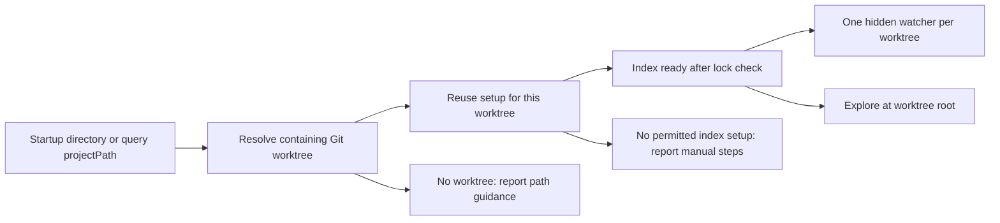
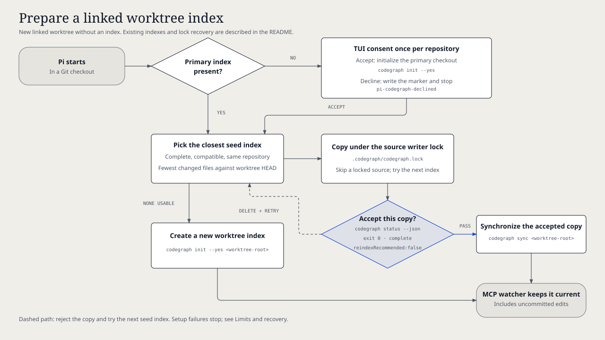

# `@henryqw/pi-codegraph`

Use separate [CodeGraph](https://github.com/colbymchenry/codegraph) indexes for explicitly selected Git worktrees in one Pi session. Agents use `codegraph_explore` to get relevant source and call paths. Each selected worktree has its own file watcher.

## Install

The `-g` option installs CodeGraph globally.

```bash
npm install -g @colbymchenry/codegraph
pi install npm:@henryqw/pi-codegraph
```

Put the `codegraph` executable on Pi's `PATH`. Keep Pi's built-in Model Context Protocol (MCP) support enabled for automatic index updates. The extension registers its MCP servers; no MCP configuration is necessary.

## Works with

| Package | Relationship | Purpose |
| --- | --- | --- |
| [`@colbymchenry/codegraph`](https://github.com/colbymchenry/codegraph) | Required | Builds indexes and answers `codegraph explore` queries. |
| [`@henryqw/pi-footer`](https://pi.henry.wang/extensions/pi-footer) | Improves | Shows index status, setup progress, and direct tool activity. |

## Use

Start `pi` in a linked worktree or in a directory that contains several repositories. Set `projectPath` to select another repository. Pi does not search child directories for repositories.

For a linked worktree without an index, the text user interface (TUI) asks for indexing consent if the primary checkout has no index. It asks once per repository. Accept to run `codegraph init --yes` there; `--yes` accepts CodeGraph setup prompts. Alternatively, run this command in the primary checkout yourself:

```bash
codegraph init --yes
```

In the status display, `CG` means CodeGraph. In server names, `root-hash` identifies the canonical worktree root.

| Surface | Type | Purpose |
| --- | --- | --- |
| `codegraph_explore` | tool | For agents: returns relevant symbol source grouped by file, with call paths. |
| `pi-codegraph` and `pi-codegraph-<root-hash>` | mcp server | One hidden server per selected worktree. Runs `codegraph serve --mcp --path <worktree-root>`; `--mcp` selects MCP mode and `--path` selects the worktree root. |
| CodeGraph setup status | ui | Shows users `✓ CG` for indexed, `○ CG` for missing, or a dim spinner with elapsed setup time. Errors include recovery instructions. |

`codegraph_explore` accepts `query`, optional `maxFiles` (default 12), and optional `projectPath` (default: Pi's working directory). A nested directory selects its containing Git worktree, not a separate nested index. Relative paths use Pi's working directory. Symbolic links to the same worktree share setup and one watcher.

The tool runs `codegraph explore --path <worktree-root> --max-files <maxFiles> <query>` and returns unchanged output. The `--max-files` option limits the source files in the result. A command error or runtime above 120 seconds fails the exploration and shows the end of the error output. Setup can take longer.

For example, a session in `/workspace` can query two repositories:

```javascript
await tools.codegraph_explore({ query: "authentication", projectPath: "/workspace/api/src" });
await tools.codegraph_explore({ query: "navigation", projectPath: "/workspace/web" });
```

Without `projectPath`, a non-Git session directory produces an error that asks you to select a worktree. Missing directories and paths to files produce an invalid-directory error. A missing index produces manual setup instructions if automatic setup is not permitted. Selecting an unindexed primary checkout does not create its index or ask for consent.

Works with `codemode`, including `codemode.mode` set to `only`. Scripts call `tools.codegraph_explore({ query })` and receive a string.

## Flow





Setup starts with Pi for its session worktree. A query starts setup for another explicitly selected worktree. Git worktree creation does not start setup. In the TUI, startup setup runs in the background. Remote procedure call (RPC), print, and JavaScript Object Notation (JSON) modes do not ask for consent. RPC waits for startup setup before it can accept an answer.

If you decline or press Escape, the extension writes `pi-codegraph-declined` in the Git common directory. Delete that file to permit another consent request. Automatic worktree setup requires a primary index. The extension does not initialize non-Git directories or offer to index bare repositories.

The MCP file watcher updates each selected checkout's separate index, including uncommitted edits. Selecting another repository does not stop earlier watchers. Pi starts watcher connections asynchronously; a successful query does not prove that a watcher is ready or that all edits are indexed. Sessions share one CodeGraph daemon per checkout. It stops five minutes after its last connection closes.

### Index status

During setup, the footer shows a dim status such as `⠋ CG · indexing 8s`. It shows `waiting for index` while another session initializes the index. Only the TUI animates the spinner. Setup ends with the indexed or missing badge, without a success notice. Non-Git directories have no badge.

Missing prerequisites and setup failures remain visible as `! CG: prerequisites missing` or `! CG: setup failed`. Each has a theme-colored `!` icon and a notice with recovery instructions. With `pi-footer`, status stays on the third line. Direct `codegraph_explore` calls temporarily show `● CG`.

Concurrent queries to one worktree share setup and watcher registration. Worktrees in the same repository share consent and pending primary initialization, but keep separate worktree locks. Accepted consent is not saved after primary setup ends. A failed or interrupted consent request does not record a decline. Cancelling one query stops its wait, not the shared setup.

Creating, resuming, or forking a session waits for active initialization. Pi closes watcher connections and recreates the extension. In a non-Git workspace, query each selected worktree again to start its watcher in the new session. Selections do not persist across sessions.

Quitting or reloading Pi cancels setup and removes all owned watcher registrations. Interrupted initialization requires explicit lock recovery.

## State and storage

Each checkout owns `.codegraph/codegraph.db`. The extension can read other indexes to prepare it, but does not change them. It writes `pi-codegraph-init.lock` in the worktree's Git metadata and `pi-codegraph-declined` in the Git common directory.

| Setup rule | Requirement or result |
| --- | --- |
| Seed index | Complete index of the same repository, built by the installed CodeGraph version, with matching `codegraph.json` contents. |
| Selection | Fewest changed files compared to the worktree `HEAD`. |
| Copy | Holds the source writer lock `.codegraph/codegraph.lock`. Skips a source that another writer locks. |
| Status check | Uses `codegraph status --json`; `--json` selects JSON output. Accepts the copy only with exit code 0, `index.state:"complete"`, and `index.reindexRecommended:false`. |
| Accepted copy | Runs `codegraph sync <worktree-root>` after the status check. |
| Rejected copy | Deletes the copy and tries the next index. |
| No usable index | Runs `codegraph init --yes <worktree-root>`. |

The extension does not add ignore rules, delete indexes, or prune worktrees. Add `.codegraph/` to your ignore rules if necessary. Pi Subagent retains ignored files to prevent data loss, so indexed worker worktrees can require manual cleanup.

## Limits and recovery

The `--version` option prints the CodeGraph version. If the startup check `codegraph --version` fails, Pi warns, reports `prerequisites missing`, and skips setup. Install or fix the executable, then restart Pi or run `/reload`. The extension never installs prerequisites automatically.

Failed or interrupted initialization keeps `pi-codegraph-init.lock` to block use of a partial database. To recover:

1. Make sure that no initializer runs.
2. Run `codegraph index` from the affected worktree root, not a nested directory or another checkout.
3. After success, use `rmdir` to remove the lock directory at the path in the error message.
4. Run `/reload`.

For example:

```bash
cd /path/to/affected-worktree-root && codegraph index && rmdir /path/to/pi-codegraph-init.lock
```

For a primary-checkout failure, use the primary checkout and its lock. The error shows both paths.

Do not remove an active lock or run manual `codegraph init` commands during initialization. The lock does not control manual commands. Existing indexes without an extension-owned lock receive no health check.

Only Git worktree-root indexes in the default `.codegraph` directory are supported. Nested monorepo indexes do not initialize automatically. Keep the primary checkout indexed for automatic opt-in detection.

Each selected worktree can start a daemon that uses approximately 230 megabytes of memory. Selecting more worktrees increases resource use until the session ends or Pi reloads.

The `--no-mcp` option disables Pi's built-in MCP support. Without MCP, queries can use existing indexes, but automatic updates do not run. Run `codegraph sync` in each checkout to update its index. Pi can also report that no MCP handler connects the registered servers.

The session worktree keeps the server name `pi-codegraph`. Other worktrees use `pi-codegraph-<root-hash>`. These names stay the same across reloads. A server in `mcp.json` with the same name replaces that extension registration. Use `/mcp` to inspect names, overrides, and connection status.
