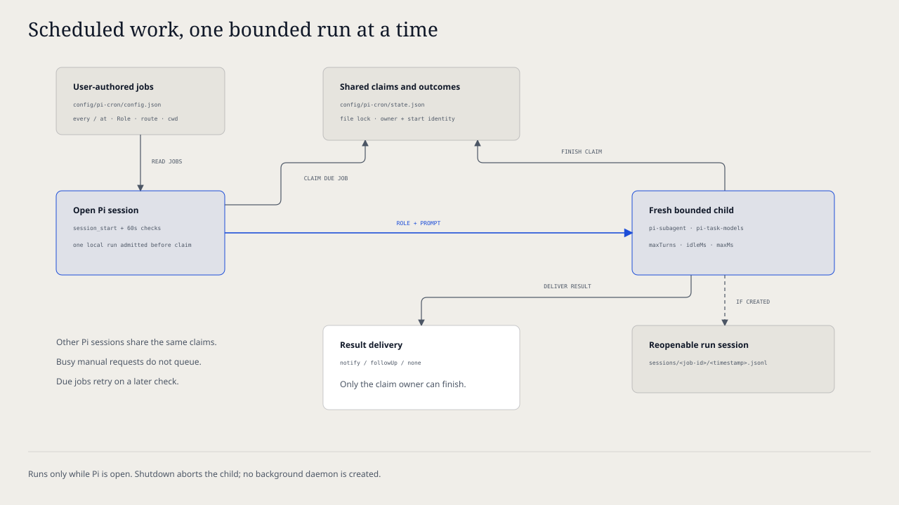

# `@henryqw/pi-cron`

Run a prompt on a schedule in a fresh Pi session. Each job selects its Role, model, and thinking level. Jobs run while any Pi session with this extension is open, and you can open each created run session file again.

## Install

Requires Pi 1.1.0 or later in the 1.x series. Older Pi releases are no longer supported.

```bash
pi install npm:@henryqw/pi-task-models
pi install npm:@henryqw/pi-subagent
pi install npm:@henryqw/pi-cron
```

Run `/task-models`. Configure the profiles that your jobs use. Create at least one job in the config file below. Then run `/cron` to see its next run time.

## Works with

| Package | Relationship | Purpose |
| --- | --- | --- |
| [`@henryqw/pi-subagent`](https://pi.henry.wang/extensions/pi-subagent) | Required | Provides Roles, launch policy, and the bounded child executor that runs each job. |
| [`@henryqw/pi-task-models`](https://pi.henry.wang/extensions/pi-task-models) | Required | Resolves `modelClass` and explicit model routes. |

## Use

Add a job and keep a Pi session open. The job runs at its next slot. Its `notify` setting selects the delivery: a UI notice, a follow-up message and turn, or no notice for successful runs.

| Surface | Type | Purpose |
| --- | --- | --- |
| `/cron` | command | List jobs with next run and last outcome. Then run one now, enable or disable it, or show its last result. Without a TUI, it only prints the list. |
| `/cron run <job-id>` | command | Start one job immediately. The result arrives the same way as for a scheduled run. |

A job is a Role plus a prompt. The Role decides which tools, extensions, Skills, and MCP servers the run can use, the same as for `delegate_task`. Any configured Role is permitted, including write-capable Roles, because you write the job entry. Keep the prompt instructions and the Role tools as narrow as the task needs.

Each run starts a new Pi process in `cwd`. The process gets the Role resources and the prompt as its single task. It also gets the job environment variables on top of the current session environment. Pi persists the run session under the home of this extension. You can open it later with `pi --session <file>`.

## Flow



1. At session start and every minute after that, the extension checks the configured jobs. Before it admits each job, it reads the config again. Thus, edits, disablement, and removal that you made during an earlier run take effect.
2. When the extension sees a job for the first time, it only records the anchor. The job first runs at its next slot. Use `/cron run` for an immediate run.
3. The extension admits the run locally before it claims the due job in shared state. Thus, run claims never wait in a child queue. A fresh run claim excludes other Pi sessions. A missed slot gives one catch-up run, not a backlog. For example, a slot is missed while no Pi session is open.
4. `limits` bounds the run: turn count, idle timeout, and maximum runtime. The extension records the outcome, a bounded output summary, and the run session path (when a file exists).
5. Delivery follows `notify`. `notify` shows a one-line notice only when a session UI is active. `followUp` sends output, including failures, into the current conversation and starts a turn. It shows no notice unless `sendMessage` throws synchronously. In that case, an active UI shows a recovery notice. `none` is silent on success. It shows failures only when a session UI is active. The extension saves the outcome before delivery. After a synchronous delivery error, use `/cron` → Show last run to recover it.

## Config

Package-owned: `~/.pi/agent/config/pi-cron/config.json`

```json
{
  "jobs": [
    {
      "id": "digest",
      "at": "07:30",
      "timezone": "Asia/Hong_Kong",
      "role": "digest",
      "modelClass": "balanced",
      "cwd": "/Users/me/.config/miniflux",
      "promptFile": "/Users/me/.config/miniflux/digest.md"
    }
  ]
}
```

| Name | Description | Values | Default |
| --- | --- | --- | --- |
| `jobs` | Scheduled jobs. | Array of job objects with unique `id`. | No jobs. |
| `jobs[].id` | Job name used in `/cron` and state. | Lowercase letters, digits, and hyphens, up to 64 characters. | — |
| `jobs[].every` | Interval schedule. Exactly one of `every` or `at` is required. | `<n>m`, `<n>h`, or `<n>d` between `1m` and `7d`. | — |
| `jobs[].at` | Daily wall-clock schedule. | `HH:MM` in 24-hour time. | — |
| `jobs[].timezone` | Zone for `at`. Only valid with `at`. | IANA name such as `Asia/Hong_Kong`. | The system time zone. |
| `jobs[].role` | pi-subagent Role to run. | Name of a built-in or user Role. | — |
| `jobs[].modelClass` | Shared task-models profile. Not allowed with `model`. | `fast`, `balanced`, `frontier`, or `fav`. | The Role's `modelClass`, else the `pi-cron/job` task assignment (`fast`). |
| `jobs[].model` | Explicit model. Requires `thinking`. | `provider/model` available in the current session. | — |
| `jobs[].thinking` | Thinking level for `model`. | `off`, `minimal`, `low`, `medium`, `high`, `xhigh`, or `max`. | — |
| `jobs[].cwd` | Working directory of the run. | Absolute path. | — |
| `jobs[].env` | Extra environment variables for the run. | Object of variable name to string. | No extra variables. |
| `jobs[].prompt` | Inline task text. Exactly one of `prompt` or `promptFile` is required. | Non-empty text. | — |
| `jobs[].promptFile` | File whose contents are the task. Read at each run. | Absolute path to a UTF-8 file up to 256 KiB. | — |
| `jobs[].enabled` | Whether the scheduler considers the job. | `true` or `false`. | `true` |
| `jobs[].notify` | How a result reaches you. | `notify`, `followUp`, or `none`. | `notify` |
| `limits.maxTurns` | Provider-turn limit per run. | Safe integer ≥ 1. | `50` |
| `limits.idleMinutes` | Minutes without child activity before the run is stopped. | Positive number; converted milliseconds must be ≤ 2,147,483,647. | `10` |
| `limits.maxMinutes` | Hard runtime cap per run. | Greater than `idleMinutes`; converted milliseconds must be ≤ 2,147,483,647. | `30` |

Only you edit this file. The exception: after you choose Enable or Disable, `/cron` toggles the `enabled` flag of that job. Changes apply before the next scheduled admission, and you do not restart Pi. Newly added jobs wait until the next check. A job that already runs keeps its admitted definition and limits.

A bad job does not stop the other jobs. The extension ignores a job that has a problem and shows a warning. Job problems include an unknown key, both or neither schedule, an unknown time zone, a relative path, an invalid route, and a repeated `id`. The other jobs continue to run. The extension also ignores an unknown top-level key or `limits` key, and shows a warning. An invalid limit uses its default. If `limits.maxMinutes` is not greater than the effective `limits.idleMinutes`, all limits use their defaults. If the file is malformed JSON, no jobs run until you fix the file.

Each warning gives the file path and the reasons. It shows one time in each session; later checks and `/cron` do not show it again. Without a UI, the warning goes to stderr. The extension never rewrites the file to recover. While the file has a problem, the Enable and Disable choices of `/cron` do not change the file.

Do not put secrets in this file. The run inherits the environment of the current session. Thus, point `env` at a private file, or export the variable in the shell that starts Pi.

## State and storage

`~/.pi/agent/config/pi-cron/state.json` records data for each job: first sighting, last start, last outcome, a bounded output summary, the last run session path, and any active run claim. If you delete it, all anchors reset, and every job waits for its next slot again. The extension reports invalid version 1 state, including malformed job records or run claims, and does not change it. A repeated state or scheduling error shows one time until a job schedules successfully. A state write above 1 MiB fails before it replaces the existing readable file. To make space, close Pi and remove inactive job records from `state.json`. Completion updates require the same claim owner and start time. Thus, a stale run cannot overwrite the run claim or outcome of its replacement.

`~/.pi/agent/config/pi-cron/sessions/<job-id>/<timestamp>.jsonl` holds the run session of each run. These files contain the prompt and the model output. Delete them when you do not need them.

## Limits and recovery

Jobs run only while a Pi session with this extension is open. There is no background daemon.

At session start and when a job starts, pi-cron also shows problems in the pi-subagent `roleDefaults` and in the shared task-model config. Each problem shows one time in each session, also when pi-subagent or Task Models shows it. A slot missed while Pi was closed runs one time at the next check.

A run cannot answer approval prompts or questions. Thus, a Role that needs interactive confirmation stays blocked until the idle timeout. A failed or timed-out run records `failure` with the error text. If the run created a run session file, open it. Pre-launch failures have no run session, and `/cron` says `Session: none created`. Use `/cron run <job-id>` to retry.

Each run claim stores its expiration at admission: the original `limits.maxMinutes` plus five minutes after its start. A Pi session can reclaim it only when that deadline occurs. Lower limits do not expire an active run claim early. Each Pi session starts runs one at a time. When another local job is active, `/cron run` reports busy and does not queue the run. The extension examines due scheduled jobs again on a later check. Shutdown aborts pending preparation and the active child, even if another Pi session starts in the same process. The extension still records results, but it does not deliver them into a session that shuts down. Use `/cron` → Show last run to recover a result that the extension could not deliver.
