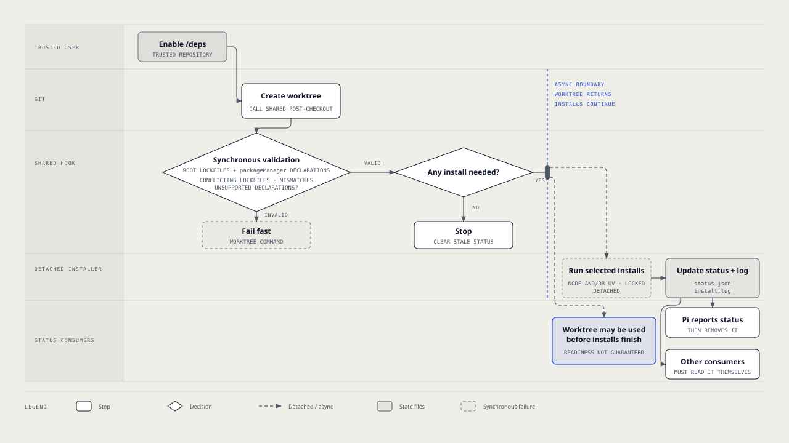

# `@henryqw/pi-deps`

Start locked Node and uv dependency installs when Git creates a worktree for an opted-in repository. Developers who use several worktree tools get one shared hook, and the hook adds no work to each Pi startup.

## Install

```bash
pi install npm:@henryqw/pi-deps
```

Requires Pi 1.1.0 or later in the 1.x series.

## Use

Run `/deps` in a trusted repository to enable preparation. Create a worktree through Git so that its `post-checkout` hook runs. Then open Pi in TUI mode in that worktree to see quiet install progress. Run `/deps` again to disable future preparation.

| Surface | Type | Purpose |
| --- | --- | --- |
| `/deps` | command | For humans: enable or disable preparation for future Git worktrees in this repository. |
| Pi footer status | ui | For humans in TUI mode: show a dim spinner and elapsed time while dependencies install. Clears silently on success. Failures show a visible error and log path. |

- The shared `post-checkout` hook applies to every worktree in the repository. Run `/deps` from any worktree to toggle it.
- The extension never overwrites or removes a hook that does not have the marker of this package.
- After you update the package, run `/deps` two times in each opted-in repository. This replaces the copied hook with the current version.

## Flow



- When the hook runs, worktree creation returns and does not wait for dependency installation.
- The hook validates lockfiles synchronously. Conflicting Node lockfiles, `packageManager` mismatches, and unsupported declarations still fail the worktree command fast.
- A detached installer runs frozen installs in the background.
- A Pi TUI session in the worktree watches install progress. At startup, it does not wait for completion. It shows a dim footer status such as `⠋ deps · installing 12s`, and it clears the status without a success message. It reports the failures that it sees during its ten-minute wait, including missing executables. RPC, JSON, and print sessions do not show or consume this status.

Node and uv both run when both lockfile types exist.

## State and storage

The installer stores its result in `<worktree gitdir>/pi-deps/status.json`. Command output is in the adjacent `install.log`.

After a Pi TUI session reports the status file, the session removes it. Other tools that create worktrees get the same background install only when they invoke the Git `post-checkout` hook. Tools that do not run the hook do not prepare dependencies. This includes tools that create detached worktrees without a checkout. Non-Pi consumers must read the status file themselves.

## Limits and recovery

Dependency installation can execute repository-controlled build and install scripts. Enable only repositories that you trust.

- A configured `core.hooksPath` replaces the shared hooks directory. `/deps` refuses to install the hook where Git would ignore or share it.
- Pi Deps examines only Git-root lockfiles.
- Root npm and uv workspaces stay package-manager concerns. Pi Deps does not scan nested independent projects.
- An existing `node_modules` skips Node installs. An existing `.pnp.cjs` skips only Yarn installs. An existing `.venv` skips uv installs.
- Worktrees created with `git worktree add --no-checkout` never run `post-checkout`, so they are not prepared. `git worktree add --detach` with a checkout does run the hook.
- Installs finish after creation returns. A consumer can use a worktree before dependencies are ready.
- If the status is still `running` after ten minutes, the TUI watcher removes it and clears the footer status. It also shows an error with the log path. This stops only the watcher, not the installer. Examine the adjacent `<worktree gitdir>/pi-deps/install.log` for installer command output and any `pi-deps:` failure message. The log stays available after the status file is removed. If you open Pi again, Pi does not restore a status that the watcher removed.
- When you close Pi, Pi stops its progress watcher and animation. It does not cancel the detached installer or consume its pending result.

The root lockfile selects the manager and command in the table below. A matching `packageManager` declaration selects the same command for all declared versions. The hook does not compare versions with the installed executable. Explicit `yarn@1.x` declarations fail fast because Yarn Classic is not supported. If only `yarn.lock` exists and there is no `packageManager`, the hook assumes modern Yarn and runs `--immutable`. If the executable is Yarn Classic, installation fails in the background.

| Manager | Command | Lockfile |
| --- | --- | --- |
| npm | `npm ci` | `package-lock.json`, `npm-shrinkwrap.json` |
| pnpm | `pnpm install --frozen-lockfile` | `pnpm-lock.yaml` |
| Yarn | `yarn install --immutable` | `yarn.lock` (Yarn Classic 1.x is not supported) |
| Bun | `bun install --frozen-lockfile` | `bun.lock`, `bun.lockb` |
| uv | `uv sync --locked` | `uv.lock` |
