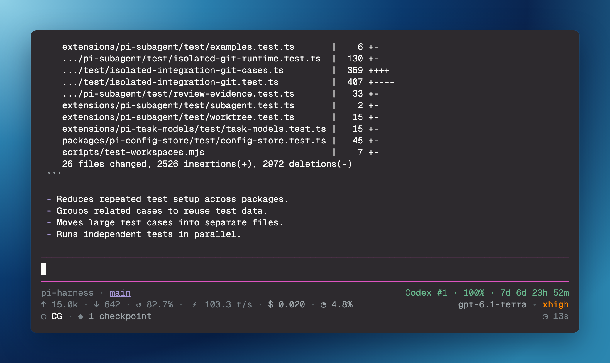

# `@henryqw/pi-footer`

Keep footer identity, model usage, agent-work time, and extension status visible while you work in Pi. Use `/open` to open the current working directory. `/open` uses VS Code by default, or another configured command. You can enable the footer and the open commands independently.



## Install

```bash
pi install npm:@henryqw/pi-footer
```

This package requires Pi 1.1.0 or later in the 1.x series.

Version 3 replaces `@henryqw/pi-open-in`. If it is installed, remove it before you upgrade. This prevents duplicate `/open` and `/set-open-in` commands:

```bash
pi remove npm:@henryqw/pi-open-in
pi install npm:@henryqw/pi-footer
```

For project-local installs, use `--local` on both commands. Also remove manually configured paths to the old package. Then restart Pi. The existing open-command config stays at `config/pi-open-in/config.json`. Do not move it.

Both entry points load by default. To use `/open` without the custom footer, use Pi's native package resource filter in `settings.json`:

```json
{
  "packages": [
    {
      "source": "npm:@henryqw/pi-footer",
      "extensions": ["extensions/open.ts"]
    }
  ]
}
```

To use only the footer, select `extensions/footer.ts` instead. You can also use `pi config` to toggle either resource. You do not need package activation config.

## Works with

| Package | Relationship | Purpose |
| --- | --- | --- |
| [`@henryqw/pi-codegraph`](https://pi.henry.wang/extensions/pi-codegraph) | Improves | Shows CodeGraph index status, quiet setup progress, and direct tool activity when loaded. |
| [`@henryqw/pi-config-store`](https://pi.henry.wang/extensions/pi-config-store) | Required | Owns config-home resolution and storage. |
| [`@henryqw/pi-multi-codex`](https://pi.henry.wang/extensions/pi-multi-codex) | Improves | Adds active Codex subscription quota and reset status. |
| [`@henryqw/pi-pr`](https://pi.henry.wang/extensions/pi-pr) | Improves | Adds current-branch pull-request status. |

## Use

After installation, start a Pi TUI session. The footer shows checkout, usage, model, thinking, and extension statuses. Run `/open` to open the current working directory in VS Code by default. `/open` also works while the agent is busy.

| Surface | Type | Purpose |
| --- | --- | --- |
| Footer | ui | Shows footer identity, usage, model, agent-work time, and extension statuses. |
| `/open` | command | Opens the current working directory with the configured command. |
| `/set-open-in <command>` | command | Sets the command used by `/open`. |

Run `/set-open-in <command>` to choose another command, such as `cursor --reuse-window`. `/open` runs `<command> <current-working-directory>`.

```text
pi-harness · clear-field-f8d2 [+2 ~3 ?1 ↑2] · PR #123 · approved    Codex #1 · 50% · 7d 1d 1h 22m
↑ 12.4k · ↓ 2.1k · ↺ 84.3% · ⚡ 87.4 t/s · $ 0.127 · ◔ 36.8%    gpt-5.6-luna • high
✓ CG · ●  🐴 ponytail: ⚡ FULL                                          ◷ 12m 34s
```

- The first line shows the repository, branch, Git state, and `pi-pr` pull request status beside the footer identity. The `pi-multi-codex` quota status, when non-empty, occupies the right side. Linked-worktree branches drop the generated `worktree/` prefix.
- The second line shows cumulative input tokens, output tokens, latest cache-hit rate, and tokens per second for the most recent assistant response. The rate is timed from the first streamed content of the response to the last. Thus, the rate excludes request latency, time to first token, and provider work after the stream ends (such as the Claude bridge shutdown of Claude Code). A response that arrives without streamed content, or all at once, shows `—`. It also shows estimated cost and context usage. Totals include reported tool usage and finished `pi-subagent` background workflows. The active model and thinking level are right-aligned. Under a virtual model, the physical model and thinking level of the latest successful response follow an arrow, for example `auto • high → gpt-5.6-luna • medium`. This matches Pi's built-in footer.
- The third line shows CodeGraph's icon and `CG` first: `✓ CG` when indexed, `○ CG` when a Git repository has no index, or a dim spinner and elapsed time such as `⠋ CG · indexing 8s` during setup. Non-Git directories show no index badge. Other extension statuses follow, such as `⠋ deps · installing 12s`. Dependency preparation statuses disappear when work completes. Persistent CodeGraph failures keep their theme-colored `!` icon and meaningful text. During direct `codegraph_explore` calls, `● CG` temporarily replaces the CodeGraph status. The status returns when the call finishes. A middle dot separates statuses. Cumulative agent-work time stays on the right, below the active model.

Git badges appear only when action is needed:

| Badge | Meaning |
| --- | --- |
| `+2` | Two staged paths |
| `~3` | Three unstaged tracked paths |
| `?N` | `N` untracked porcelain status entries |
| `!1` | One unresolved path |
| `↑2` | Two commits ahead of the upstream branch |
| `↓1` | One commit behind the upstream branch |

`?N` counts porcelain status entries. In `--untracked-files=normal` mode, Git can collapse a whole untracked directory to one entry.

Active operations appear first, such as `REBASE 3/7`, `MERGING`, or `CHERRY-PICKING`. Detached HEAD uses the short commit form `@a1b2c3d`.

The extension reads local Git data with `git status --porcelain=v2 --branch --untracked-files=normal`. It refreshes after each agent run and branch change. It does not make an LLM call or fetch a remote. Ahead and behind counts use the last fetched upstream state.

Unavailable values render as `—` without a misleading percent sign.

`off` uses the same dim grey as the model name. Active levels use an ANSI-256 gradient: green `minimal`, yellow-green `low`, lime `medium`, yellow `high`, orange `xhigh`, and red `max`.

`ultra` renders as a rainbow when the active Pi runtime supplies that thinking level. Unsupported levels never appear.

Only the non-empty `pi-multi-codex` quota status occupies the right side of the first line. The `pi-pr` pull-request status stays beside footer identity, and CodeGraph index status, setup progress, or tool activity appears separately on the third line.

Statuses from other extensions, including Ponytail and `pi-rewind`, share the left side of the third line. They are sorted by key. Colors, links, glyphs, and interior spacing are preserved. Leading and trailing whitespace is trimmed, line breaks become spaces, and long statuses can be clipped to fit the footer. Only direct `codegraph_explore` tool calls trigger the `● CG` badge. The footer does not show CodeGraph queries from inside scripted tools.

## Config

Package-owned: `~/.pi/agent/config/pi-footer/config.json` for footer colors and `~/.pi/agent/config/pi-open-in/config.json` for the open command (both under `getAgentDir()` when overridden). The retained `pi-open-in` home belongs to the open commands now shipped here.

| Name | Description | Values | Default |
| --- | --- | --- | --- |
| `colors` | Colors for footer-owned text by role. | Object that maps color roles to theme tokens, `#RGB`, `#RRGGBB`, `oklch(...)`, `okhsl(...)`, or an ANSI index from `0` to `255`. | Built-in colors. |
| `command` | Command that `/open` runs. | Non-empty string. | `"code"` |

The footer reads `colors` once per session start; run `/reload` after editing it. The file is never rewritten. A missing file or a missing role keeps the built-in color. At each session start, an unknown key, an unknown role, or an invalid color shows a warning with the path and the reason. Only the invalid role uses its built-in color. The other roles keep their configured colors. A malformed file uses the built-in colors for all roles.

### Footer color roles

Every role is optional:

| Role | Surface |
| --- | --- |
| `repository` | Repository name on the first line. |
| `branch` | Branch or checkout name, still hyperlink-wrapped when the terminal supports it. |
| `gitStatus` | Git badges such as `[+2 ~3 ↑1]`. |
| `input`, `output`, `cache`, `throughput`, `cost`, `context` | The six usage metrics on the second line. |
| `model` | Active model and routed physical model. |
| `runtime` | Cumulative agent-work time on the third line. |
| `codegraphActive` | The `● CG` badge during a direct `codegraph_explore` call. |
| `separator` | Middle dots, bullets, arrows, and the truncation ellipsis. |

```json
{
  "colors": {
    "repository": "muted",
    "branch": "accent",
    "gitStatus": "warning",
    "input": "#4ec9b0",
    "output": "#9cdcfe",
    "cache": "#c586c0",
    "throughput": "#dcdcaa",
    "cost": "#ce9178",
    "context": "#89d185",
    "model": "text",
    "runtime": "muted",
    "codegraphActive": "accent",
    "separator": "dim"
  }
}
```

Theme tokens are `accent`, `dim`, `muted`, `text`, `success`, `warning`, `error`, and `thinkingText`. Thinking levels keep their built-in gradient, and statuses from other extensions keep their producer colors; the `colors` object controls neither.

### Open command

A missing file silently uses the default command, `code`. An invalid existing file shows a warning and uses `code`. The file stays unchanged. See Limits and recovery. `/open` reads the config on every run. Only `/set-open-in` writes the file, atomically. Reads do not create or write the config home.

## API

Consumers: use the owner API. Do not read the config file directly. Replace imports from `@henryqw/pi-open-in/open-uri` with `@henryqw/pi-footer/open-uri`:

```ts
import { loadOpenInConfig } from "@henryqw/pi-footer/open-uri";

const loaded = loadOpenInConfig();
if (loaded.status === "ok") console.log(loaded.value.command, loaded.issues);
```

These exports are for package consumers. The commands in Use are the Pi interfaces.

| Surface | Type | Purpose |
| --- | --- | --- |
| `default` (`openInExtension(pi)`) | function | Registers the open commands with Pi, without the footer. |
| `OpenInConfig` | type | Describes the configured command. |
| `loadOpenInConfig(agentDir?)` | function | Reads and validates the owner config. |
| `configuredOpenUri(path)` | function | Returns a safe VS Code URI for a supported command. |

`loadOpenInConfig` returns a `@henryqw/pi-config-store` `ConfigLoad` result: `status`, `source` (`"missing"` or `"file"`), `issues`, and, when `status` is `"ok"`, `value`. `value.command` is validated. An invalid `command` gives `"code"` and an issue. The function does not show issues. Pass an agent directory when needed.

`configuredOpenUri(path)` works when the executable is `code`. With `code -n` or `code --new-window`, it adds `windowId=_blank` so the link opens in a new window. It returns `undefined` for other commands. An invalid config uses `code`. The function never shows a notification, because the footer calls it on each render. `@henryqw/pi-config-store` owns the config home and storage.

## Limits and recovery

The open command splits on whitespace into an executable and arguments. Tokens cannot contain spaces, and quoting is unsupported. Use a wrapper script for executables in paths that contain spaces.

An existing config file must be a JSON object with one non-empty string `command` property. An unknown key, an invalid `command`, or a malformed file shows a warning at session start, or at the next `/open`. The warning also shows when only the footer is active, because the footer link uses this config. Each issue shows one time in each session, also when the footer and `/open` are both active. The footer render never shows a warning. Then `/open` and the footer link use `code`, and the file stays unchanged. Fix the file or run `/set-open-in <command>` to replace it. `/set-open-in` first shows each new problem in the file that it replaces. If the configured command exits with an error, Pi reports its error output or exit code. Fix the command and run `/open` again.

When the configured executable is `code` and Pi reports hyperlink support, the accent-colored checkout name links to the current path. The link opens a new window for `code -n` or `code --new-window`. A missing config silently uses `code`. Other executables and terminals with hyperlinks disabled render plain text.

Pi handles the custom URI in its default fullscreen TUI. Use normal primary click. Regular TUI (`"tuiMode": "regular"` or `--tui-mode regular`) delegates OSC 8 activation to the terminal, so the link works only where the terminal opens custom URI schemes.

Ghostty uses `Cmd+click`, but it possibly does not open custom URI schemes.
