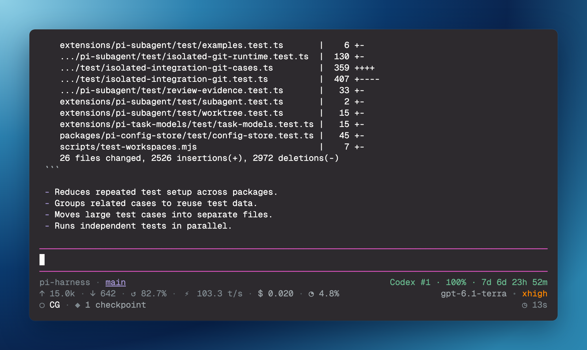

# `@henryqw/pi-footer`

Keep footer identity, model usage, agent-work time, and extension status visible in Pi. Fold long tool rows so agent replies stay on screen. Enable the footer, tool rows, and open commands independently.



## Install

This package requires Pi 1.5.0 or later in the 1.x series.

```bash
pi install npm:@henryqw/pi-footer
```

All three entry points load by default. Use `pi config` or the package `extensions` filter in `settings.json` to select the entries you need.

| Entry point | Features |
| --- | --- |
| `extensions/footer.ts` | Footer. |
| `extensions/open.ts` | Open commands. |
| `extensions/tool-rows.ts` | Tool-row folding. |

## Works with

| Package | Relationship | Purpose |
| --- | --- | --- |
| [`@henryqw/pi-codegraph`](https://pi.henry.wang/extensions/pi-codegraph) | Improves | Shows CodeGraph index status, quiet setup progress, and direct tool activity when loaded. |
| [`@henryqw/pi-magpie`](https://pi.henry.wang/extensions/pi-magpie) | Improves | Adds Magpie route and quota status. |
| [`@henryqw/pi-multi-codex`](https://pi.henry.wang/extensions/pi-multi-codex) | Improves | Adds active Codex subscription quota and reset status. |
| [`@henryqw/pi-pr`](https://pi.henry.wang/extensions/pi-pr) | Improves | Adds current-branch pull-request status. |

## Use

Start a Pi TUI session to see the footer. Run `/open` to open the current directory in VS Code, even while the agent is busy.

| Surface | Type | Purpose |
| --- | --- | --- |
| Footer | ui | Shows footer identity, usage, model, agent-work time, and extension statuses to the user. |
| `/open` | command | Opens the current directory for the user: runs `<command> <current-working-directory>`. |
| `/set-open-in <command>` | command | Sets the user's open command, such as `cursor --reuse-window`. |
| `/tool-rows [group\|line\|off]` | command | Sets and saves the tool-row mode. Without an argument, shows the current mode. |

### Footer lines

| Line | Left | Right |
| --- | --- | --- |
| First | Repository, branch, Git state, and `pi-pr` pull-request status. Linked-worktree branches omit the generated `worktree/` prefix. | Non-empty `pi-multi-codex` and `pi-magpie` status. |
| Second: usage line | Input and output token totals, latest cache-hit rate, response throughput, estimated cost, and context use. | Active model and thinking level. For Magpie, the served model and account card number replace the selected model when available. |
| Third | CodeGraph first, then other extension statuses sorted by key, including Ponytail and `pi-rewind`. | Cumulative agent-work time. |

Token and cost totals include native usage entries, reported tool usage, and completed background workflow entries from a retired subagent install. Response throughput measures output tokens per second from first to last streamed content. Non-streamed or instantaneous responses show `—`. Other unavailable values show `—` without a percent sign.

The model label includes its provider to distinguish models that several providers serve. Direct Magpie models on `vps/` omit the relay prefix in the footer. For example, `magpie/vps/claude/opus-5.5` shows as `claude/opus-5.5`. A missing model shows `no-model`. When a Magpie route is unknown, the selected model shows with `route?`.

Virtual models show the latest successful physical model and thinking level after an arrow: `router/auto • high → openai-codex/gpt-5.6-luna • medium`.

Other dependency statuses, such as `⠋ deps · installing 12s`, disappear after completion. Middle dots separate statuses.

### Tool rows

The default mode is `group`. The terminal user interface (TUI) shows one summary line for each tool group.

Run `/tool-rows line` or `/tool-rows off` when Pi is idle. A mode change reloads Pi extensions and redraws the transcript.

| Mode | Collapsed tool rows |
| --- | --- |
| `group` | One summary line for all tool calls between a user message and the next agent text, such as `▸ 4 tools: bash ×3, read · skills: git-pr · ↑ 1.5k ↓ 340 · 1 failed`. The `Thinking...` line of a hidden thinking block also disappears. |
| `line` | The first line of each finished call. A running or failed call keeps its full row. |
| `off` | Pi's own rows. |

The summary line shows the skills whose `SKILL.md` file the agent read, and the input and output tokens of the messages that made the calls. The footer counts tokens the same way. A running call shows its elapsed time, such as `running bash 12s`. The summary updates each second while tools run.

Press the tool-expansion key (`app.tools.expand`, `Ctrl+O` by default) to show every row in full. Pi can still display inline images in folded rows.

To hide thinking blocks, set `hideThinkingBlock` in Pi settings or press `Ctrl+T`.

### Git state

Badges appear only when action is necessary:

| Badge | Meaning |
| --- | --- |
| `+2` | Two staged paths |
| `~3` | Three unstaged tracked paths |
| `?N` | `N` untracked porcelain status entries; Git can collapse an untracked directory into one entry. |
| `!1` | One unresolved path |
| `↑2` | Two commits ahead of upstream |
| `↓1` | One commit behind upstream |

Active operations appear first: `REBASE 3/7`, `MERGING`, or `CHERRY-PICKING`. Detached HEAD shows a short commit, such as `@a1b2c3d`.

Git state refreshes after agent runs and branch changes. No model call or remote fetch occurs. Ahead and behind counts use the last fetched upstream state.

## Config

Package-owned paths:

- `~/.pi/agent/config/pi-footer/config.json`: footer colors.
- `~/.pi/agent/config/pi-open-in/config.json`: open command.
- `~/.pi/agent/config/pi-tool-rows/config.json`: tool-row mode.

| Name | Description | Values | Default |
| --- | --- | --- | --- |
| `colors` | Footer-owned colors by role. | Object mapping roles to theme tokens, `#RGB`, `#RRGGBB`, `oklch(...)`, `okhsl(...)`, or ANSI indices `0` to `255`. | Built-in colors. |
| `command` | Command for `/open`. | Non-empty string. | `"code"` |
| `mode` | Tool-row mode. | `"group"`, `"line"`, or `"off"`. | `"off"` |

Colors load at session start; run `/reload` after edits. A role with a missing or invalid color keeps its built-in color; other roles are not affected. A file problem gives all built-in colors. The footer never writes the colors file. For the shared rules, see [Config files](https://pi.henry.wang/overview#config-files).

### Footer color roles

Every role is optional:

| Role | Surface |
| --- | --- |
| `repository` | Repository name. |
| `branch` | Branch name, with a hyperlink where supported. |
| `gitStatus` | Git badges. |
| `input`, `output`, `cache`, `throughput`, `cost`, `context` | The six usage metrics. |
| `model` | Active and physical models. |
| `runtime` | Agent-work time. |
| `codegraphActive` | Direct-call `● CG` badge. |
| `separator` | Middle dots, bullets, arrows, and truncation ellipsis. |

Theme tokens: `accent`, `dim`, `muted`, `text`, `success`, `warning`, `error`, and `thinkingText`. Colors do not change the thinking gradient or other extensions' status colors.

```json
{ "colors": { "branch": "accent", "cost": "#ce9178" } }
```

## API

Consumers must use the owner API, not read config directly.

| Surface | Type | Purpose |
| --- | --- | --- |
| `default` (`openInExtension(pi)`) | function | Registers open commands without the footer. |
| `OpenInConfig` | type | Describes the command. |
| `loadOpenInConfig(agentDir?)` | function | Reads and validates owner config; accepts an optional agent directory. |
| `configuredOpenUri(path)` | function | Returns a safe VS Code URI for `code`, or `undefined` for other commands. |

Neither function shows notifications. For `code -n` and `code --new-window`, `configuredOpenUri(path)` adds `windowId=_blank`.

## Limits and recovery

Open commands split on whitespace. Quoting and tokens with spaces are unsupported; use a wrapper script for executable paths with spaces.

The tool-row mode loads at session start. Only `/tool-rows` writes the file. An invalid `mode` or a file problem gives `off`, and `/tool-rows` refuses to write until you fix the file.

Tool rows replace Pi's row frame with an identical frame, so a folded row can take no lines. Another extension that also changes tool rows can conflict; set `off` to restore Pi's rows.

`/open` reads config on each run. Only `/set-open-in` writes the file. An invalid `command` or a file problem uses `code`, and `/open` reports the problem. Fix the file or run `/set-open-in <command>`.

With `code` and Pi hyperlink support, the accent-colored branch name links to the current path. `code -n` and `code --new-window` open a new window. Other executables or disabled hyperlinks give plain text.

Use primary click in Pi's default fullscreen TUI. Regular TUI (`"tuiMode": "regular"` or `--tui-mode regular`) needs terminal support for OSC 8 links and custom URI schemes. Ghostty uses `Cmd+click`, but might not open custom URI schemes.
