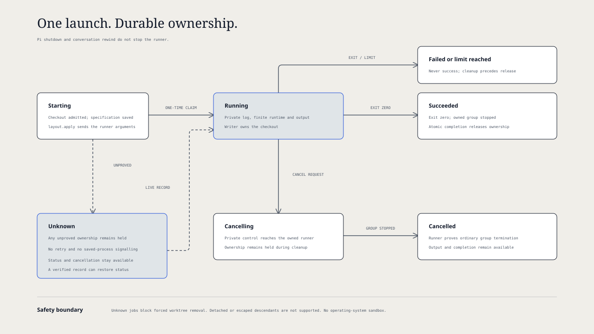

# `@henryqw/pi-herdr-tools`

Run bounded background commands, clone conversations, hand off tasks, and ask side questions in Herdr. Name conversations, see where idle conversations stopped, and finish worktrees with explicit safety checks.

## Install

```sh
pi install npm:@henryqw/pi-task-models
pi install npm:@henryqw/pi-herdr-tools
```

Use Herdr 0.9.3 or later in a Herdr-managed Pi pane. Outside Herdr, rename still sets the Pi session title.

Configure `fast` in `/task-models`.

## Works with

| Package | Relationship | Purpose |
| --- | --- | --- |
| [`@henryqw/pi-herdr`](https://pi.henry.wang/packages/pi-herdr) | Required | Herdr CLI access. |
| [`@henryqw/pi-memory`](https://pi.henry.wang/extensions/pi-memory) | Improves | Keeps Main-only memory and dream advice out of side threads. |
| [`@henryqw/pi-task-models`](https://pi.henry.wang/extensions/pi-task-models) | Required | Model profiles for titles, idle recaps, and side threads. |

## Use

Run `/clone-tab`; the original session stays active. Commands and prompts are for humans; tools are for agents.

| Surface | Type | Purpose |
| --- | --- | --- |
| `background_command` | tool | Launch, list, inspect, or cancel a managed command. |
| `/commands` | command | Inspect command status and output, or request cancellation. |
| `/clone-tab` | command | Clone into a new tab in the current workspace. |
| `/clone-worktree` | command | Clone into a new Git worktree workspace. |
| `/handoff-worktree <issue>` | prompt | Prepare a task for `herdr_handoff`. |
| `herdr_handoff` | tool | Start a separate task from local `main`, without changing focus. |
| `/done [-f]` | command | Remove the worktree and close its workspace tabs. `--force` aliases `-f`. |
| `/btw [<question...>]` | command | Open a side pane with an optional editable draft. |
| `/btw ask <question...>` | command | Ask a question starting with a subcommand name. |
| `/btw config [option value]` | command | Show values or `reset` defaults. Set `auto-submit` to `on`/`off`, `tools` to `inherit`/`all`/`read-only`/`none`, or `split` to `right`/`down`. |
| `/btw merge [<prompt...>]` | command | Queue a merge request. Without a prompt, open the editor. In Main, check pending deliveries. |
| `/btw help` | command | Show command grammar. |
| BTW capability widget | ui | Show `tool-free`, `read-only`, `tool-enabled`, or context-load errors with recovery steps. |
| `/rename` | command | Generate a title from up to five recent user messages. |
| Rename progress and result widgets | ui | Show `renaming...`, then `renamed to <title>` for two seconds on success. |
| First real user prompt | ui | Start titles in new, untitled conversations. |
| `pi-herdr-rename/rename` | model task | Title model profile. |
| Idle recap widget | ui | Show the goal, current state, and next action after four idle minutes. |
| `pi-herdr-tools/recap` | model task | Idle recap model profile. |
| `pi-herdr-btw/btw` | model task | Side-thread model profile. |
| Dialog blocked status | ui | Show `Input required` in Herdr during interactive TUI dialogs. |

### Background commands

Only Main, the parent Pi session, can launch managed commands. Delegated workers cannot launch commands in separate terminals outside their process lease. They can still list, inspect, and cancel commands.

Use `background_command` for an already authorized, noninteractive local command. No further approval is required. Declare `access: "write"` if it can change files, Git state, or external resources. `read` is a declaration, not an enforced restriction. There is no operating-system sandbox.

```json
{"action":"launch","command":"pnpm test","access":"write"}
```

Use `{"action":"list"}` to list jobs. Use `{"action":"status","id":"<job-id>"}` for status and the last 8192 output bytes. Use `{"action":"cancel","id":"<job-id>"}` to request cancellation. Lists show at most 20 jobs and the total count. Results include the full output path. Failed commands, limits, cancellation, and unknown ownership are error results.

Each command gets a dedicated, unfocused Herdr tab and pane. The extension sends a direct argument array through `layout.apply`; it does not type shell input. The packaged JavaScript runner uses Node to execute `/bin/sh -c` with closed standard input, in the current working directory. It inherits the Herdr terminal environment. Named Pi-agent launches do not change.

Launch needs a free checkout. A writer keeps checkout admission until its runner proves termination. Read jobs release admission after their specification is saved. Existing Main writes and direct subagent writers block launch. Main reads, command status, and cancellation remain available. This coordination covers the current Pi process and recovered command records, not arbitrary external writers or other Pi processes.

Do not use interactive commands, remote jobs, detached processes, or commands that escape their process group. The runner controls ordinary descendants in its own group. Cancellation first requests termination, then uses a forced kill if necessary. It never signals a process from a saved process number. A disappeared pane or screen text cannot prove completion.

### Clones

Both commands require `HERDR_ENV=1` and `HERDR_PANE_ID`. Pane, session-path, and leaf validation precedes target creation. Clones contain the root-to-current-leaf path, excluding sibling branches and still-streaming assistant output. Unsaved sessions use live state.


Clone tabs keep the current working directory. Worktree clones use the new checkout. Pi starts with `--session <absolute-clone-file>`; only successful launches change focus.

Worktree creation uses `herdr worktree create --workspace <current-workspace> --no-focus`, or the repository's parent workspace when already in a linked worktree. Herdr creates missing branches from `HEAD`, with checkouts under `worktrees.directory` in grouped workspaces. Clones and handoffs use an extra unfocused tab if a layout plugin such as `herdr-plus` occupies the root pane.

### Worktree handoff

Run `/handoff-worktree Fix the flaky login test`. The agent collects missing facts, asking one question only for an unclear repository, outcome, or critical constraint. It sends a self-contained prompt, not the conversation, and reports without waiting for completion.

The tool registers only with `HERDR_ENV=1`. It also requires `HERDR_PANE_ID`, local `main`, and matching Git repositories for the current directory and pane workspace.

All parameters must be non-empty strings:

| Parameter | Requirement |
| --- | --- |
| `branch` | New branch; must not exist. |
| `label` | Workspace label. |
| `agentName` | Unique agent name matching `^[a-z][a-z0-9_-]{0,31}$`. |
| `prompt` | Self-contained task prompt. |

After validation, the tool runs `herdr worktree create --workspace <parent> --branch <branch> --base main --label <label> --no-focus`. It starts Pi without session arguments. It submits `herdr agent prompt <agentName> <prompt> --wait --until working --timeout 30000`, with the prompt as one argument, not a shell command or file. The result includes workspace ID, tab, pane, branch, checkout path, and agent name.

### Side questions

With a conversation open, run `/btw Why is this test failing?`, then submit the draft. Exact first words `ask`, `config`, `merge`, and `help` select subcommands; other input is a question.

The side-thread model receives Main's fixed, compaction-aware context snapshot. Enabled tools can change shared files. Select `read-only` or `none` to prevent changes. Shorten Main's context if it exceeds the side-thread context limit.


Run `/btw merge Apply the smallest safe fix` after the answer. The merge request contains user and assistant text, without tool payloads. Pending delivery survives shutdown until consumption or 24-hour stale cleanup. Once idle and authenticated, Main appends the transcript without starting a turn, then submits the prompt.

### Titles

Automatic titles ignore extension-injected, empty, and image-only prompts. Expanded skill and prompt-template text starts background generation without delaying the reply. English, sentence-case display titles usually have two or three words; limits are four words and 20 characters.

Herdr updates the pane and sole-pane tab. Linked worktrees get semantic branches only for detached checkouts or generated `worktree/...` branches; other branches remain unchanged. For example, `Update task logic` gives `refactor/update-task-logic`. Generated worktree labels change automatically; manual `/rename` can replace custom workspace names.

### Idle recaps

When an agent run settles, a four-minute idle timer starts. Then the recap model reads the user and assistant text and the newest compaction or branch summary of the current branch, without tool payloads. The recap request has a limit of 48 KiB, so Pi keeps the start of the summary and the newest turns. It writes an idle recap of at most 40 words. The widget above the editor shows `↺ Recap: <text>`. The recap does not go into the model context.

Idle recaps require an interactive UI. Pi does not start the timer when the editor has text. In the TUI, a key press stops the timer and cancels a recap request. Submitted input, `!` shell commands, a new agent run, tree navigation, `/reload`, session switch, and exit also remove the widget. Without new entries on the branch since the last recap, Pi does not make a new recap.

### Dialog status

Status requires Herdr's installed Pi integration, `~/.pi/agent/extensions/herdr-agent-state.ts`. Select, confirm, input, editor, and custom dialogs from any package count; RPC, JSON, and print modes do not. No dialog title or content goes to Herdr.

Status clears on answer, cancellation, failure, `/reload`, session switch, or exit. Reload can hide dialogs; late events cannot restore status. Nested dialogs count as one block. Other status owners, including `@henryqw/pi-ask-question`, remain independent.

## Flow

### Managed command lifecycle



The specification is saved before dispatch. A one-time claim prevents duplicate execution. A lost response, runner crash, or stale heartbeat cannot cause another launch. Ownership stays held when termination is unknown. Only an exact runner record can restore status or prove completion.

The runner survives Pi shutdown, reload, and conversation rewind. Completion stays pending until the launching session is idle and its current branch contains the assistant tool-call entry that launched the command. On other branches, use `/commands` to inspect the result. Return to the launch branch to receive the pending notice. Delivery does not start a model turn. A saved delivery record and the session history prevent duplicate notices, including after rewind.

### Worktree completion


`/done` requires `HERDR_ENV=1`, `HERDR_WORKSPACE_ID`, and `HERDR_TAB_ID`. Commit or discard changes, then confirm removal; declining changes nothing. Normal and forced completion wait for idle Pi.

Active or unknown managed commands block both normal and forced removal, including read jobs. Cancel the job and wait for verified completion. Other admitted writers also block removal.

Normal removal rejects dirty worktrees and checkout use by other workspaces. Close listed tabs and retry; labels identify them, or IDs without labels. Primary-checkout tabs do not block removal or updates.

**`/done -f` skips confirmation and cross-workspace checks. It passes `--force` to Git, can permanently delete uncommitted work, and can leave other workspaces' tabs pointing at a removed checkout.**

Cleanup runs `git worktree remove <checkout>`, closes other tabs in the current workspace, then updates a non-bare primary checkout with `git pull --ff-only`. The current tab closes last, even if the update fails. Tabs in other workspaces do not close.

## Config

Package-owned: `~/.pi/agent/config/pi-herdr-btw/config.json`

| Name | Description | Values | Default |
| --- | --- | --- | --- |
| `autoSubmit` | Submit the draft automatically; otherwise, keep it editable. | Boolean. | `false` |
| `tools` | Tools available in the side pane. | `inherit` (Main's active tools), `all`, `read-only` (built-in read-only tools), or `none`. | `inherit` |
| `split` | Side-pane placement. | `right` or `down`. | `right` |

File and fields are optional. Launch reports unknown keys and invalid values, using field defaults; malformed files use all defaults. `/btw` continues without changing the file. `/btw config show` prints effective values. Updates fail until you correct issues or run `/btw config reset`. Reset reports issues, then replaces the file with defaults.

### Command policy

Package-owned: `~/.pi/agent/config/pi-herdr-tools/config.json`. The active Pi agent directory determines the config home.

| Name | Description | Values | Default |
| --- | --- | --- | --- |
| `runtimeMs` | Maximum command runtime in milliseconds. | Integer, 100 to 86400000. | `600000` |
| `outputBytes` | Maximum combined standard output and error bytes per job. | Integer, 1024 to 104857600. | `10485760` |
| `concurrency` | Maximum active or unknown jobs in the command store. | Integer, 1 to 16. | `4` |
| `retainedJobs` | Maximum saved job records before launch is refused. | Integer, 1 to 10000. | `1000` |

Missing fields use defaults. Invalid fields and malformed files produce config warnings and use finite defaults. The extension preserves the file. Edit the file to change policy; each launch loads it again. Existing jobs keep their saved limits. No automatic job queue or retry is provided.

### Model profiles

See [`@henryqw/pi-task-models`](https://pi.henry.wang/extensions/pi-task-models) for profile defaults, assignments, and config errors.

Side threads select the first authenticated viable route before launch. Titles use the primary route, then fallback, with configured thinking; they never substitute the current session model. An invalid title gets one repair request before fallback. Without a viable route, titles remain unchanged. Idle recaps use the same route order and never substitute the current session model.

## State and storage

Command records are private generated state under `~/.pi/agent/config/pi-herdr-tools/commands/`, outside transcripts. Each job keeps its immutable specification, runner claim, terminal identities, log, cancellation control, completion, and delivery record. The command text and output can contain secrets; do not share this directory. Logs stay readable after completion and stop at the output limit. Records and tabs are not removed automatically. Archive only verified terminal records when the record limit is reached; never delete active, unknown, or malformed state to permit another launch.

Malformed state is preserved and blocks writes. Repair requires inspection of the original files and actual owned processes. There is no force-release action for unknown ownership. The runner waits for output streams to close after group termination. If group termination is unproved, or output streams stay open for more than four seconds after the termination check, it records `unknown`, not success. The runner cannot track descendants that detach or escape; those commands are not supported.

On Linux, use an init process that reaps exited child processes. A zombie is an exited process whose parent has not collected its status. Without child reaping, zombie process groups can remain `unknown` and keep writer admission held. A process-table snapshot is not proof of termination and cannot release ownership.

Clones are separate session files in the Pi-selected session directory. Each contains only the active path. Pi names the clone file for a saved source session; otherwise, the extension creates and names it. Saved `pi-herdr-rename/title` entries restore display titles and semantic branches without another model request. Older titles get no migration.

## Limits and recovery

| Failure | Recovery |
| --- | --- |
| Unknown command ownership | Inspect `/commands` and the private state directory. Cancellation is a request, not proof of termination. Do not retry the command or delete its state. |
| Command runtime or output limit | Inspect the bounded log and error status. Any later launch is a new explicit decision. |
| Definite clone-tab creation failure | The clone file is removed. Cleanup errors name any remaining file. |
| Worktree creation or pre-launch extra-tab failure | No clone session exists yet. |
| Killed or incomplete worktree creation | Partial workspace state can remain. Inspect returned IDs with `herdr workspace list`. |
| Incomplete tab response | Inspect known IDs before cleanup. Clone tabs retain the session path; worktree clones retain the worktree without a clone session. |
| Agent start requested | An ambiguous launch retains targets and session files. Inspect reported IDs. |
| Clone focus failure | Pi already started. Focus its tab manually. |
| Handoff validation failure | No worktree exists. Correct the reported requirement. |
| Handoff cancellation | Before creation, nothing remains. After creation, reported resources remain; later launch or delivery steps stop. |
| Handoff start or prompt failure | Resources remain. Errors identify worktree, branch, workspace, tab, pane, and agent. No automatic cleanup occurs. |
| `agent_blocked` or `agent_prompt_stalled` | Prompt delivery failed. Inspect the agent before retrying. |

Timed-out prompts can still arrive. Check `herdr agent get` and `herdr agent read`; resend with `herdr agent prompt` only if absent. Alternatively, run `/done` in the new worktree. Remove personal `handoff-worktree.md` copies to resolve package-prompt name collisions.

After a failed primary update, the removed worktree stays removed. Correct primary-checkout changes or divergence, then run `git -C <primary-checkout> pull --ff-only`.

`/rename` warns without user text. For Herdr or Git synchronization warnings, correct the problem and retry `/rename`. Newer renames silently cancel older requests.

When an idle recap request fails, Pi shows a warning and does not retry. Pi shows each different warning only one time. The next settled run starts a new idle timer.
