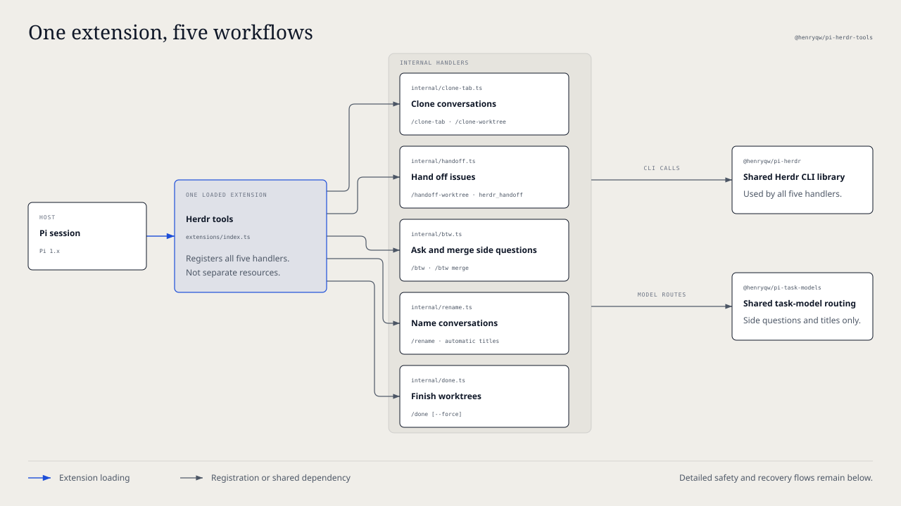
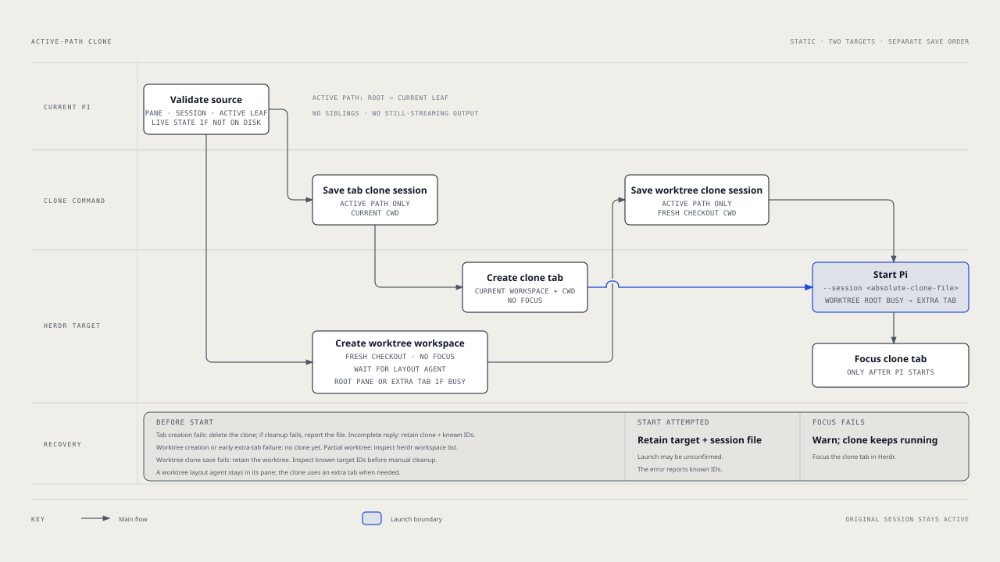
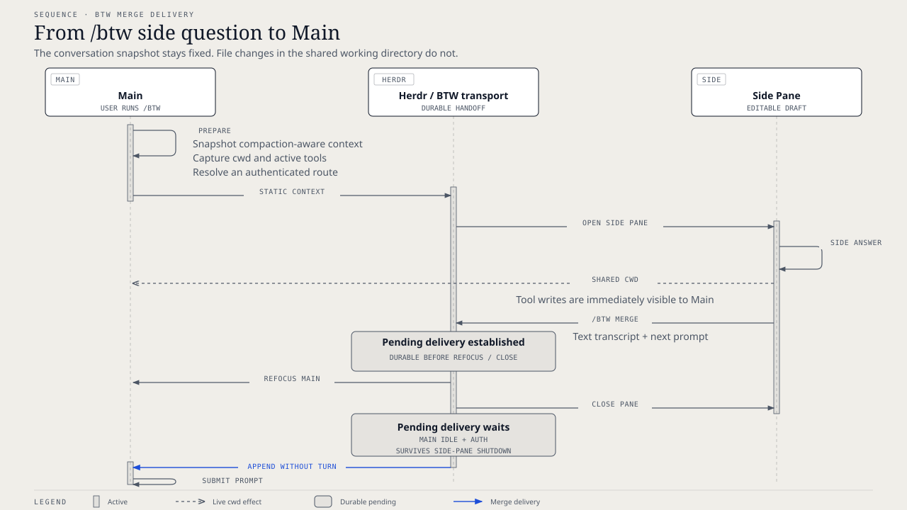

# `@henryqw/pi-herdr-tools`

Clone a conversation into a Herdr tab or worktree. Hand off a separate issue to a new agent in a new worktree. Ask a side question and merge its answer back into Main. Give the conversation a name, and finish the worktree safely. One package and one extension entry point supply `/clone-tab`, `/clone-worktree`, `/handoff-worktree`, `herdr_handoff`, `/btw`, `/rename`, and `/done`. Herdr also shows the pane as blocked while a Pi dialog waits for your answer.



## Install

```sh
pi install npm:@henryqw/pi-task-models
pi install npm:@henryqw/pi-herdr-tools
```

Requires Pi 1.1.0 or later in the 1.x series and Herdr 0.9.3 or later. Herdr operations require a Herdr-managed Pi pane. Outside Herdr, rename still sets the Pi session title. Before you use title generation or side threads, do these steps. Run `/task-models`. Configure `fast`. Make sure that it does not show `not configured`. Dialog status also requires the Herdr Pi integration (`~/.pi/agent/extensions/herdr-agent-state.ts`). Herdr installs this integration. This package only publishes the status event.

### Migrating from the merged packages

`@henryqw/pi-herdr-btw`, `@henryqw/pi-herdr-clone`, and `@henryqw/pi-herdr-rename` are retired. Before, `pi-herdr-clone` included `pi-herdr-done`. That package is also retired. Install the replacement first. Then remove all old installs before you restart Pi:

```sh
pi install npm:@henryqw/pi-herdr-tools
pi remove npm:@henryqw/pi-herdr-btw
pi remove npm:@henryqw/pi-herdr-clone
pi remove npm:@henryqw/pi-herdr-rename
# Only if the older standalone completion package is still installed:
pi remove npm:@henryqw/pi-herdr-done
```

Remove only the sources that you installed. For project-local installs, use `--local` on each command. Also remove old entry-point paths that you configured manually. If Pi loads an old package together with this package, Pi registers the commands two times. The harness installer removes retired personal npm sources only after the selected replacement installs successfully.

You do not need a data migration. Commands and safety behavior did not change. Existing `pi-herdr-btw/btw` and `pi-herdr-rename/rename` task-model assignments, `pi-herdr-rename/title` session entries, BTW payload flags, and pending deliveries keep their identifiers. BTW configuration stays at `~/.pi/agent/config/pi-herdr-btw/config.json`, although the package name is new. Each feature is an internal module, not a separately selectable extension resource.

## Works with

| Package | Relationship | Purpose |
| --- | --- | --- |
| [`@henryqw/pi-memory`](https://pi.henry.wang/extensions/pi-memory) | Improves | Recognizes side threads and does not inject Main-only memory or dream advice into them. |
| [`@henryqw/pi-task-models`](https://pi.henry.wang/extensions/pi-task-models) | Required | Shared profiles for title generation and side-thread routes. |

The shared [`@henryqw/pi-herdr`](https://pi.henry.wang/packages/pi-herdr) CLI library stays separate. Side questions are inspired by [Claude Code](https://github.com/anthropics/claude-code). This package also merges their side-thread transcripts back into Main.

## Use

Run `/clone-tab` to open a clone tab with an active-path clone. The original session stays open.

Commands and prompts are for humans. Tools are for agents.

| Surface | Type | Purpose |
| --- | --- | --- |
| `/clone-tab` | command | Clone the current conversation into a new tab of the current Herdr workspace. |
| `/clone-worktree` | command | Clone the current conversation into a new Herdr Git worktree workspace. |
| `/handoff-worktree <issue>` | prompt | For humans: tell the agent to write a self-contained task prompt for the issue and send it with `herdr_handoff`. |
| `herdr_handoff` | tool | For agents inside Herdr: create a worktree from local `main`, start Pi in it, and submit a task prompt. Focus does not change. |
| `/done [-f]` | command | Remove the current worktree and close its Herdr workspace tabs. `-f` (alias `--force`) skips confirmation. It permits forced removal and does not look for tabs in other workspaces. |
| `/btw [<question...>]` | command | For humans in Main: open an empty side pane, or start with an editable question draft. |
| `/btw ask <question...>` | command | For humans in Main: ask a question whose first word is `ask`, `config`, `merge`, or `help`. |
| `/btw config [option value]` | command | For humans: show values, set `auto-submit` to `on` or `off`, set `tools` to `inherit`, `all`, `read-only`, or `none`, set `split` to `right` or `down`, or reset the defaults. |
| `/btw merge [<prompt...>]` | command | For humans: in a side pane, put its side-thread transcript and next prompt in the queue for Main (`/btw merge` opens the prompt editor). In Main, look for pending side-thread deliveries. |
| `/btw help` | command | For humans: show the command grammar. |
| BTW capability widget | ui | For people in a side pane: shows `tool-free`, `read-only`, or `tool-enabled`. If the Main context cannot load, it shows the error and recovery steps. |
| `/rename` | command | For people: generate a new title from up to five recent user messages. |
| Rename progress and result widgets | ui | For people who run `/rename`: shows `renaming...`. On success, it then shows `renamed to <title>` for two seconds. |
| First real user prompt | ui | For people in a new, untitled conversation: starts title generation when the expanded prompt is ready. |
| `pi-herdr-rename/rename` | model task | Title-generation route. Users configure its profile with `/task-models`. |
| Dialog blocked status | ui | For people watching Herdr: while a TUI dialog is open, the pane shows blocked with the label `Input required`. |

### Clone conversations and finish worktrees

The active path goes from the session root to its current leaf at the time that you start the command. It does not include sibling branches or assistant output that Pi still streams. Both clone commands require a Pi session in a Herdr pane (`HERDR_ENV=1` and `HERDR_PANE_ID`). Before they create a target, they validate the pane, session path, and current leaf. If Pi has not written the session file yet, the commands clone the live session state. The commands have no configuration, and Pi stays in the original session.

Commit or discard changes in a Herdr-managed linked worktree. Then run `/done` and confirm. Normal removal does not remove dirty worktrees or worktrees that another Herdr workspace uses. **`/done -f` can irreversibly delete uncommitted work and leave other workspaces' tabs pointing at the removed checkout.**

### Hand off an issue

In a Herdr-managed Pi pane, run `/handoff-worktree Fix the flaky login test`. The agent collects the missing facts and writes one self-contained task prompt. It asks one question only when the repository, expected outcome, or a critical constraint is not clear. Then it calls `herdr_handoff` and reports the workspace, branch, checkout path, and agent name. It does not wait for the new agent to finish. A worktree handoff does not copy the current conversation.

`herdr_handoff` requires `HERDR_ENV=1`, `HERDR_PANE_ID`, and a local `main` branch. The current directory and the Herdr workspace of the pane must be in the same Git repository. Pi registers the tool only when `HERDR_ENV=1`. It takes these parameters, and each must be a non-empty string:

| Parameter | Purpose |
| --- | --- |
| `branch` | New Git branch. Herdr creates it from local `main`. The branch must not exist. |
| `label` | Herdr workspace label. |
| `agentName` | Unique Herdr agent name for the new Pi agent. It must match `^[a-z][a-z0-9_-]{0,31}$`. |
| `prompt` | Self-contained task prompt. |

### Ask and merge side questions

In a Herdr-managed Pi pane with a conversation, run `/btw Why is this test failing?`. A side pane opens with the question as an editable draft. Submit the question there. After the answer, run `/btw merge Apply the smallest safe fix`. Main receives the side-thread transcript, gets the focus again, and continues with the merge prompt.

### Name conversations

In a new, untitled conversation, send the first real prompt. Pi generates a display title in the background and does not delay the reply.

### Show open dialogs in Herdr

When an extension opens a select, confirm, input, editor, or custom dialog in the Pi interactive TUI, Herdr marks the pane as blocked. It uses the fixed label `Input required`. The status clears when you answer or cancel the dialog, or when the dialog fails. This also applies to dialogs from other packages, for example `pi-memory` review conflicts, `/task-models`, `/pr`, and `/cron`. This bridge never sends dialog titles or content to Herdr.

| Mode | Dialog status |
| --- | --- |
| Interactive TUI | Reported. |
| RPC, even when the client provides UI | Not reported. |
| JSON and print | Not reported. |

Nested dialogs count as one block. `ask_question` from `@henryqw/pi-ask-question` publishes its own status. The two statuses can overlap, and neither clears the other too early.

## Flow

### Clone conversations and finish worktrees



#### Clone a tab

1. Save the active path as a separate active-path clone with the current working directory.
2. Create an unfocused Herdr tab in the current workspace with that working directory.
3. Start Pi in the tab's root pane with `--session <absolute-clone-file>`.
4. Focus the new tab after Pi starts successfully.

#### Clone a worktree

1. Create a Git worktree-backed workspace with `herdr worktree create --workspace <current-workspace> --no-focus`. Herdr creates the branch from `HEAD` if the name does not exist. Herdr checks out the worktree under its configured `worktrees.directory` and opens it as a grouped workspace. If the current workspace is already a linked worktree, the command targets the parent workspace of its repository. Herdr creates worktrees from the parent.
2. Wait a short time for a worktree-layout plugin, such as `herdr-plus`, to start its agent in the root pane of the new workspace.
3. If the root pane is occupied, create an additional unfocused tab in the new workspace with the checkout as its working directory. The plugin agent and the worktree clone then coexist. If the root pane is not occupied, use the root pane.
4. Copy the active path into an active-path clone. Its working directory is the new checkout path.
5. Start Pi in the chosen pane with `--session <absolute-clone-file>`.
6. Focus the tab of the clone after Pi starts successfully.

#### Hand off to a worktree

1. Make sure that the current directory and the workspace of the pane are in the same Git repository, that the repository has a local `main` branch, and that `branch` does not exist. If not, stop before Herdr changes.
2. Find the parent workspace of the repository, as `/clone-worktree` does.
3. Run `herdr worktree create --workspace <parent> --branch <branch> --base main --label <label> --no-focus`.
4. Select the root pane, or an additional tab when a worktree-layout plugin uses the root pane, as `/clone-worktree` does. Start Pi with the agent name and no session arguments.
5. Submit the prompt with `herdr agent prompt <agentName> <prompt> --wait --until working --timeout 30000`. The prompt goes to Herdr as one argument, not through a shell or a file.
6. Return the workspace ID, tab, pane, branch, checkout path, and agent name. Focus does not change.

#### Finish a worktree



Normal `/done` asks for confirmation before it waits for Pi to become idle. If you decline, the checkout does not change. `/done -f` skips confirmation. Both wait for Pi to become idle before cleanup.

Normal cleanup does these steps. It checks whether a tab in another Herdr workspace uses the checkout. It removes the checkout with `git worktree remove <checkout>`. It closes all other tabs in the current Herdr workspace. If this was a linked worktree and the primary checkout is non-bare, it runs `git pull --ff-only` from the primary checkout. It closes the current tab last. Tabs that use the primary checkout do not block removal or the pull. Concurrent worktree completions run one at a time, with locks on the worktree and the primary checkout. Clone creation uses the same worktree lock.

### Side questions

#### Launch

- `ask`, `config`, `merge`, and `help` route only when they are the exact first word. All other input is a question.
- A provided question is an editable draft by default.
- `/btw` gives the side pane a static snapshot of the compaction-aware context of Main. The side pane uses the working directory of Main.
- The consumer-owned `pi-herdr-btw/btw` task defaults to `fast`.
- Before the pane starts, `/btw` selects the first authenticated viable effective profile route.

`~/.pi/agent/config/pi-task-models/config.json` is shared, and `@henryqw/pi-task-models` owns it. A task entry is an explicit user override. Routes resolve before the pane starts. If this file is missing, BTW shows a warning one time per session.

#### Merge delivery



- In the side pane, a merge request stores the side-thread transcript and next prompt as a pending delivery.
- Herdr then refocuses Main and closes the side pane.
- A pending delivery stays after side-pane shutdown. It waits for Main to settle and for current model authentication.
- Main appends the side-thread transcript and does not start a turn. Then Main submits the prompt.
- A pending delivery stays available until Main consumes it or the 24-hour stale cleanup removes it.

### Conversation titles

#### Trigger

In a new, untitled session, the first real user prompt generates a display title in the background. This occurs after Pi expands skill and prompt-template shorthand. It does not delay the main reply. The extension ignores extension-injected prompts, empty prompts, and image-only input.

#### Title and branch rules

A semantic branch is a Git-safe branch name from a task kind and the display-title words. The model replies with one JSON object that has `kind` and `subject`. That classification stays internal. For example, `{"kind":"refactor","subject":"update task logic"}` shows as `Update task logic` and becomes `refactor/update-task-logic`. If a reply does not have the correct shape, the extension sends it back one time with the rejection before it stops the route. Thus, a valid display title can still come from the first route.

- In a linked worktree, the extension renames a detached checkout or a Herdr `worktree/...` branch. An existing non-generated branch does not change.
- The generated worktree label of a linked worktree, such as `worktree-brave-meadow-4aa8`, changes to the display title automatically. A manual `/rename` can also replace a custom workspace name.
- The extension renames the pane in Herdr. The tab label changes only when the tab is a sole-pane tab.
- Outside Herdr, only the Pi session name changes. Herdr is required for pane, tab, workspace, and linked-worktree branch updates.

#### Model route

The task `pi-herdr-rename/rename` uses `fast` only when it has no explicit assignment. To use another configured profile, assign the task to that profile in `/task-models`. The shared [`pi-task-models` config](https://pi.henry.wang/extensions/pi-task-models#config) stores the assignment under `tasks` at `~/.pi/agent/config/pi-task-models/config.json`.

The extension tries the primary route of the assigned profile, then its fallback. It uses the configured thinking level. In one route, if a reply does not have the title shape, the extension tries again one time with the rejected text. Only a second failure goes to the fallback. The extension never uses the current session model as a replacement.

## Config

Package-owned: `~/.pi/agent/config/pi-herdr-btw/config.json`

| Name | Description | Values | Default |
| --- | --- | --- | --- |
| `autoSubmit` | Submits the draft question. When `false`, the question stays editable in the side pane. | Boolean. | `false` |
| `tools` | Selects the tools available in the side pane. | `inherit` (active tools of Main), `all`, `read-only` (built-in read-only tools), or `none`. | `inherit` |
| `split` | Sets the side-pane placement. | `right` or `down`. | `right` |

- All fields are optional.
- The extension rejects unknown keys and non-object files.
- `/btw config show` prints effective values.
- `/btw config reset` saves the defaults.
- The config file is optional. If it is missing, the extension uses the defaults.
- A malformed config file causes a visible failure, and the file does not change.

## State and storage

### Clones

Each active-path clone is a separate Pi session file in the Pi session directory. It contains only the active path. A clone tab uses the current working directory. A worktree clone uses the new checkout. The Pi session manager selects the session directory. For a persisted source session, Pi names the clone file. If Pi has not written the source session to disk, the extension creates and names the clone file in that directory.

### Conversation titles

The Pi session stores each generated display title and semantic branch in a `pi-herdr-rename/title` session entry. When you resume a session that this version created, the extension applies the saved display title and semantic branch again. It does not send another model request.

## Limits and recovery

### Cloning

| Outcome | What remains and how to recover |
| --- | --- |
| Definitive target creation failure | When `/clone-tab` tab creation fails, the extension removes its clone session if cleanup succeeds. If cleanup also fails, the error names the remaining file. A `/clone-worktree` failure in worktree creation or pre-launch extra-tab creation occurs before the extension creates a clone session. |
| Killed or incomplete worktree creation | Herdr can keep partial workspace state. The error reports all returned IDs and tells you to examine `herdr workspace list`. The extension has not created a clone session yet. |
| Incomplete tab-creation response | The error reports known IDs. For `/clone-tab`, the extension keeps the clone session and reports its path. For `/clone-worktree`, the extension keeps the worktree, and no clone session exists yet. Examine the target before manual cleanup. |
| Agent start attempted | The launch outcome can be unknown. Keep the target tab, panes, and session file. The error reports known IDs for recovery. |
| Focus failed after Pi started | Show a warning, but do not report the clone that already started as failed. If necessary, focus the clone tab in Herdr. |

### Worktree handoff

| Outcome | What remains and how to recover |
| --- | --- |
| No local `main`, an existing branch, a different repository, missing Herdr environment, or failed worktree creation | Nothing. The tool stops before it creates a worktree. |
| Tool call cancelled | Before worktree creation, nothing remains. After it, the tool does not start the agent or submit the prompt, and the error names the resources that remain. |
| Killed or incomplete worktree creation | Herdr can keep partial workspace state. The error reports all returned IDs and tells you to examine `herdr workspace list`. |
| Agent start or prompt delivery failed | The worktree, branch, workspace, tab, and pane remain. The error names each of them and the agent. The tool does no cleanup. A stalled or timed-out prompt can still be delivered. Before you send it again, examine the agent with `herdr agent get` and `herdr agent read`. Send the prompt again with `herdr agent prompt` only when the agent did not get it. Or run `/done` in the new worktree. |
| Agent was already blocked, or did not start to work | Herdr reports `agent_blocked` or `agent_prompt_stalled`. The tool reports this as a prompt delivery failure. |

If you also keep a personal prompt template with the name `handoff-worktree.md`, Pi loads only one of the two and reports a name collision. Remove the personal copy to use the package prompt.

### Worktree completion

- `/done` does not remove a dirty worktree. Commit or discard changes first. `/done -f` passes `--force` to Git and can irreversibly delete uncommitted work.
- A tab in another Herdr workspace that uses this checkout blocks normal removal. `/done` lists the tab label, or its ID when the tab has no label. Close the tab and try again. Use `/done -f` only if you accept that the checkout is removed while that tab still refers to it. `/done` does not close tabs in other workspaces.
- The command requires Pi inside Herdr with `HERDR_ENV=1`, `HERDR_WORKSPACE_ID`, and `HERDR_TAB_ID` set.
- The primary checkout update runs only after worktree removal. `git pull --ff-only` can fail, for example because the primary checkout has diverged or has local changes. In that case, the worktree is already removed, and the current tab still closes. Correct the primary checkout problem. Then try again with `git -C <primary-checkout> pull --ff-only`.

### Side questions

The side pane uses the working directory of Main. Thus, enabled tools can change files that Main can see. Select `read-only` or `none` when the side question must not make changes.

A large Main context can be more than the context limit of the side thread. Make the Main context shorter and try again.

### Conversation titles

Display titles are natural task phrases. They usually have two or three words, and they always have a maximum of four words and 20 characters. Models that answer in another language still make English display titles.

If the shared task-model config is missing, the extension shows a warning one time at session start. Run `/task-models` to configure rename routing. If no route is viable, display titles do not change. `/rename` shows a warning if the session has no user text to rename.

Herdr and Git synchronization failures show as warnings. Correct the reported problem. Then run `/rename` to try again. When a newer rename cancels an older rename, the extension shows no message. Older titles get no migration.

### Dialog status

- Without Herdr's Pi integration, the status event has no listener and Herdr shows no blocked state.
- On `/reload`, session switch, or exit, this package clears all blocks that it still holds, one time. Pi can hide a dialog that was open during reload. That old dialog does not affect Herdr status after that, and the package ignores late events from it.
- Another listener of the same event can still show blocked status for its own reasons. This package clears only its own contribution.
