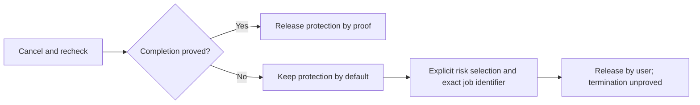
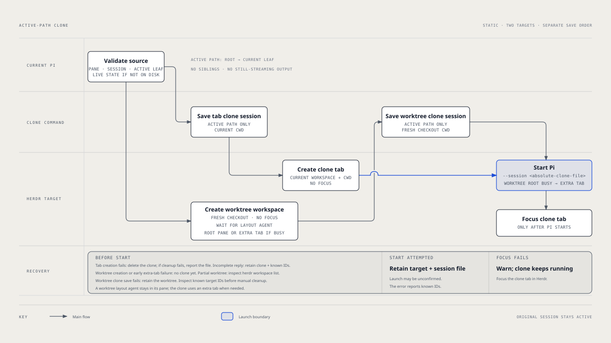
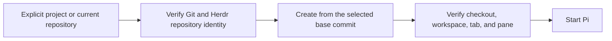
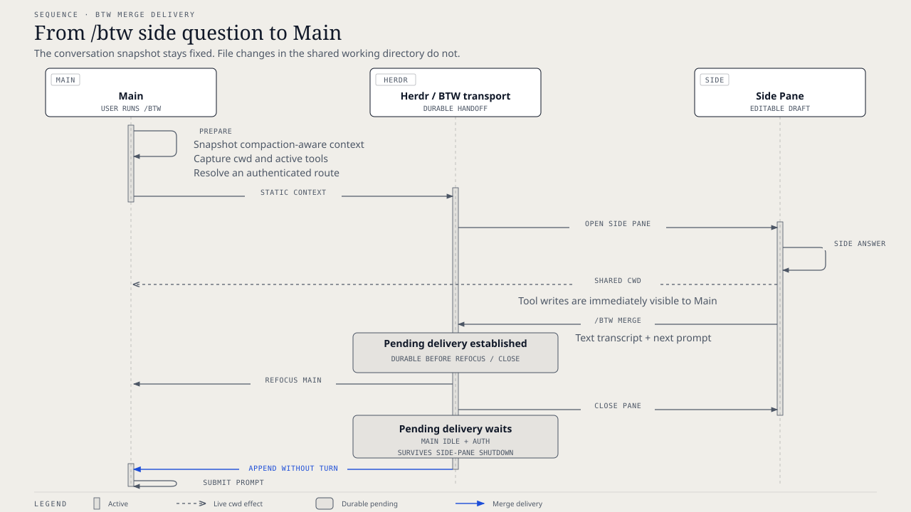
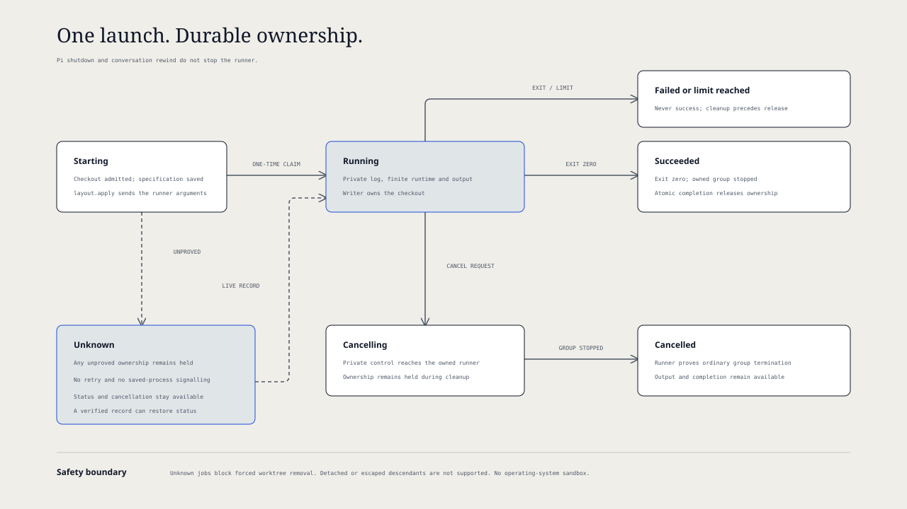
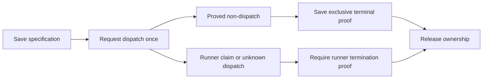
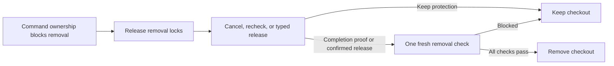

# `@henryqw/pi-herdr-tools`

Run bounded background commands, clone conversations, hand off tasks, and ask side questions in Herdr. Name conversations, see where idle conversations stopped, and finish worktrees with explicit safety checks.

## Install

```sh
pi install npm:@henryqw/pi-task-models
pi install npm:@henryqw/pi-herdr-tools
```

This package requires Pi 1.5.0 or later in the 1.x series. In a Herdr-managed Pi pane, use Herdr 0.9.3 or later. Outside Herdr, rename still sets the Pi session title.

Configure `fast` in `/task-models`.

## Works with

| Package | Relationship | Purpose |
| --- | --- | --- |
| [`@henryqw/pi-herdr`](https://pi.henry.wang/packages/pi-herdr) | Required | Herdr CLI access. |
| [`@henryqw/pi-memory`](https://pi.henry.wang/extensions/pi-memory) | Improves | Keeps Main-only memory and dream advice out of side threads. |
| [`@henryqw/pi-task-models`](https://pi.henry.wang/extensions/pi-task-models) | Required | Model profiles for titles, idle recaps, and side threads. |

## Use

Run `/clone-tab`; the original session stays active. Commands and prompts are for humans; tools are for agents.

| Surface | Type | Purpose |
| --- | --- | --- |
| `background_command` | tool | Launch, list, inspect, or cancel a managed command. |
| `/commands` | command | Inspect command status and output, or request cancellation. |
| `/clone-tab` | command | Clone into a new tab in the current workspace. |
| `/clone-worktree [project path]` | command | Clone into a new Git worktree workspace for the selected project. |
| `/handoff-worktree <issue>` | prompt | Prepare a task for `herdr_handoff`. |
| `herdr_handoff` | tool | Start a separate task from local `main`, without changing focus. |
| `/done [-f]` | command | Remove the worktree and close its workspace tabs. `--force` aliases `-f`. |
| `/btw [<question...>]` | command | Open a side pane with an optional editable draft. |
| `/btw ask <question...>` | command | Ask a question starting with a subcommand name. |
| `/btw config [option value]` | command | Show values or `reset` defaults. Set `auto-submit` to `on`/`off`, `tools` to `inherit`/`all`/`read-only`/`none`, or `split` to `right`/`down`. |
| `/btw merge [<prompt...>]` | command | Queue a merge request. Without a prompt, open the editor. In Main, check pending deliveries. |
| `/btw help` | command | Show command grammar. |
| BTW capability widget | ui | Show `tool-free`, `read-only`, `tool-enabled`, or context-load errors with recovery steps. |
| `/rename` | command | Generate a title from up to five recent user messages. |
| `/main-tab` | command | Select this tab as main and copy its existing meaningful label to the workspace. |
| Rename progress and result widgets | ui | Show `renaming...`, then `renamed to <title>` for two seconds on success. |
| First real user prompt | ui | Start titles in new, untitled conversations. |
| `pi-herdr-tools/rename` | model task | Title model profile. |
| Idle recap widget | ui | Show the goal, current state, and next action after four idle minutes. |
| `pi-herdr-tools/recap` | model task | Idle recap model profile. |
| `pi-herdr-tools/btw` | model task | Side-thread model profile. |
| Dialog blocked status | ui | Show `Input required` in Herdr during interactive TUI dialogs. |

### Background commands

Only Main, the parent Pi session, can launch managed commands. Delegated workers cannot launch commands in separate terminals outside their process lease. They can still list, inspect, and cancel commands.

Use `background_command` for an already authorized, noninteractive local command. No further approval is required. Declare `access: "write"` if it can change files, Git state, or external resources. `read` is a declaration, not an enforced restriction. There is no operating-system sandbox.

```json
{"action":"launch","command":"pnpm test","access":"write"}
```

Use `{"action":"list"}` to list jobs. Use `{"action":"status","id":"<job-id>"}` for status and the last 8192 output bytes. Use `{"action":"cancel","id":"<job-id>"}` to request cancellation. Lists show at most 20 jobs and the total count. Results include the full output path. Failed commands, limits, cancellation, and unknown ownership are error results.

In the interactive terminal, run `/commands`, select a command, then select `Show output`. A scrollable view shows its saved status and a snapshot of the last 8192 output bytes. Use the arrow keys to scroll and the Page Up and Page Down keys to move one page. Use Escape, Enter, or Control+C to close the view without cancelling the command. The view uses your configured selection keys. Reopen it for a new snapshot.

RPC, the remote procedure call mode, uses native selection and input dialogs when `ctx.hasUI` is true. Output uses a notification, not the custom terminal view. Without a user interface, `/commands` only reports the inventory and makes no changes. The `background_command` cancellation tool remains available.

The view shows output as literal text, not Markdown. It keeps spaces and line breaks and wraps long lines to fit the terminal. Terminal and directional control characters, including tabs and carriage returns, appear as Unicode escapes. In a one-column terminal, wide characters also appear as escapes. These display changes do not change the log file. Empty output shows `(No output.)`.

Each command gets a dedicated, unfocused Herdr tab and pane. The extension sends a direct argument array through `layout.apply`; it does not type shell input. The packaged JavaScript runner uses Node to execute `/bin/sh -c` with closed standard input, in the current working directory. It inherits the Herdr terminal environment.

The complete serialized specification must fit within 65,536 bytes. This limit includes command text, escaped characters, paths, and session data. An invalid or oversized specification is rejected before reservation or publication.

Launch needs a free checkout. A writer keeps checkout admission until termination or non-dispatch is proved, or the user explicitly releases protection through `/commands`. Read jobs release admission after their specification is saved. Existing Main writes and direct subagent writers block launch. Main reads, command status, and cancellation remain available. This coordination covers the current Pi process and recovered command records, not arbitrary external writers or other Pi processes.

An incomplete command specification makes write admission and full-store lists wait for publication, with a bounded lock wait. A valid specification for another checkout needs no publication lock. If the specification stays missing, invalid, or unsafe, writes stay blocked. The extension preserves the record for inspection.

Do not use interactive commands, remote jobs, detached processes, or commands that escape their process group. The runner controls ordinary descendants in its own group. Cancellation first requests termination, then uses a forced kill if necessary. It never signals a process from a saved process number. A disappeared pane or screen text cannot prove completion.

### Stuck command recovery

In `/commands`, first select `Cancel and recheck` or `Recheck proof`. Cancellation asks the live runner to stop its own child group. A recheck releases protection only when saved records prove completion. Neither action starts another command or signals a saved process number.

If termination remains unproved, the next selection defaults to `Keep protection`. You can cancel again or recheck again. To override protection, select `Release protection despite this risk`, then type the exact command ID, which is its saved job identifier. Spaces, partial identifiers, and Escape do not confirm release.

**A live command could still write after release. Both Pi writes and checkout removal can become possible.** Release is a user decision, not proof of termination. Without verified completion, status shows `unknown` and `released by user, termination unproved`. The extension preserves the active record, evidence, and output.

The release also asks the live runner to stop, but does not wait for proof. It survives reload and prevents older recovery scans from restoring this owner. A later valid terminal result updates status and permits normal completion delivery. The release audit stays saved and reports `released by user; completion later verified`.

Release needs a verified private specification with the same identity and checkout scope. A malformed specification cannot be released. A held mutable-record lock does not prevent release. A held start lock can prevent it; retry after that holder stops. The extension never steals or removes kernel lock files.

Release and shell start use the same start lock. A released command cannot acquire a new runner or start a shell, including after delayed dispatch.



### Prune finished output

Select a verified finished command in `/commands`, then select `Prune finished output`. The confirmation defaults to `Keep output`. Select `Delete output despite this risk` only if you accept permanent loss of the saved log. Escape and the default selection keep the output.

**Another Pi session may still need this output. Pi cannot prove that all readers have finished. Deletion cannot be undone.** This confirmation accepts possible output loss; it is not proof of exclusive consumption. A delivery receipt or user release does not provide that proof either.

Pruning requires the idle launching session, a branch that contains the launch, and a matching delivery receipt. Local pending delivery, queued messages, or an active follow-up block pruning. Unknown commands and released commands without verified completion cannot be pruned. The extension checks identity, state, delivery, output safety, and the local lifecycle again under the record locks before deletion. No dialog holds a command lock. Autonomous tools cannot prune output, and mode without a user interface only reports status.

Pruning deletes only `output.log`. It does not erase the saved command text. The specification, claim, terminal result, delivery record, and any dispatch, cancellation, release, or other audit evidence remain. A small pruning receipt records permission for deletion. Lock files remain unchanged. These retained records prevent another launch after reload.

Pruned commands disappear from the default `/commands` list. Run `/commands pruned` for a read-only receipt view; status reports that output has been pruned. Only records with a pruning receipt and absent output are excluded from the `retainedJobs` limit. If deletion fails or is interrupted, output that still exists stays visible. Before another deletion, Pi requires new human confirmation.

Every dialog checks the session, branch, and lifecycle again before it permits a change. Escape makes no change. A changed session or branch requires you to reopen `/commands`. No dialog holds a command lock.

### Clones

Both commands require `HERDR_ENV=1` and `HERDR_PANE_ID`. Pane, session-path, and leaf validation precedes target creation. Clones contain the root-to-current-leaf path, excluding sibling branches and still-streaming assistant output. Unsaved sessions use live state.



Clone tabs keep the current working directory. Worktree clones use the new checkout. Pi starts with `--session <absolute-clone-file>`; only successful launches change focus.

From a non-Git folder with sibling repositories, use `/clone-worktree project-a`. The complete argument is one project path, relative to the current Pi working directory or absolute. Paths can contain spaces; do not add shell quotes. No command scans or selects sibling repositories for you. Without a path, the current directory must be in the pane workspace's Git repository. `/clone-tab` still works in non-Git folders and keeps the current directory.

Worktree creation uses `herdr worktree create --cwd <primary-repository> --base <commit> --no-focus`. Here, `--cwd` selects the verified primary repository, `--base` selects an exact commit, and `--no-focus` keeps focus unchanged during creation. A clone starts from the selected checkout's `HEAD`, including a linked or detached checkout, not the primary checkout's tip. Uncommitted changes are not copied. Herdr puts checkouts under `worktrees.directory`.



The extension checks the common Git directory, primary repository, base commit, checkout registration, and Herdr workspace, tab, and pane relationships before launch. A failed check retains the allocation for inspection. It does not repeat creation or delete uncertain resources. Clones and handoffs use an extra unfocused tab if a layout plugin such as `herdr-plus` occupies the root pane. The extra tab must pass the same relationship checks.

### Worktree handoff

Run `/handoff-worktree Fix the flaky login test`. The agent collects missing facts, asking one question only for an unclear repository, outcome, or critical constraint. It sends a self-contained prompt, not the conversation, and reports without waiting for completion.

The tool registers only with `HERDR_ENV=1`. It also requires `HERDR_PANE_ID` and local `main` in the selected project. Set `project` to an explicit path when the current folder is not a Git repository or the pane workspace belongs to another repository. Without `project`, the current directory and pane workspace must use the same Git repository.

All parameters must be non-empty strings:

| Parameter | Requirement |
| --- | --- |
| `project` | Optional project path, relative to the current Pi working directory or absolute. No sibling search occurs. |
| `branch` | New literal branch name; must not exist. |
| `label` | Workspace label. |
| `agentName` | Unique agent name matching `^[a-z][a-z0-9_-]{0,31}$`. |
| `prompt` | Self-contained task prompt. |

After validation, the tool runs `herdr worktree create --cwd <primary-repository> --branch <branch> --base <local-main-commit> --label <label> --no-focus`. The `--branch` option sets the new branch name; `--label` sets the workspace label. The base is the verified local `main` commit, not the selected checkout's `HEAD`. It starts Pi without session arguments. It submits `herdr agent prompt <agentName> <prompt> --wait --until working --timeout 30000`, with the prompt as one argument, not a shell command or file. The result includes workspace ID, tab, pane, branch, checkout path, and agent name.

### Side questions

With a conversation open, run `/btw Why is this test failing?`, then submit the draft. Exact first words `ask`, `config`, `merge`, and `help` select subcommands; other input is a question.

The side-thread model receives Main's fixed, compaction-aware context snapshot. Enabled tools can change shared files. Select `read-only` or `none` to prevent changes. Shorten Main's context if it exceeds the side-thread context limit.



Run `/btw merge Apply the smallest safe fix` after the answer. The merge request contains user and assistant text, without tool payloads. Pending delivery survives shutdown until consumption or 24-hour stale cleanup. Once idle and authenticated, Main appends the transcript without starting a turn, then submits the prompt.

### Titles

Automatic titles ignore extension-injected, empty, and image-only prompts. Expanded skill and prompt-template text starts background generation without delaying the reply. English, sentence-case display titles usually have two or three words; limits are four words and 20 characters.

Titles update the Pi session, Herdr pane, and sole-pane tab. A main tab is the selected tab that can change the workspace title and Git branch. The first-created tab is the default main tab. Other tabs keep these effects local, including with `/rename`. Closing a selected main tab does not promote another tab. Run `/main-tab` in the intended replacement.

Only a sole-pane main tab can copy a generated title to the workspace. Automatic titles replace generated linked-worktree labels or the previous saved display title. Custom workspace names stay unchanged unless you run `/rename` in that main tab. Multi-pane tabs keep their tab label, workspace title, and branch unchanged when one pane generates a title.

Linked worktrees get semantic branches only from the sole-pane main tab, and only for detached checkouts or generated `worktree/...` branches. Other branches remain unchanged. For example, `Update task logic` gives `refactor/update-task-logic`.

Run `/main-tab` to select the current tab and explicitly copy its existing meaningful label to the workspace, including for a multi-pane tab. This command makes no model request, changes no Pi session title, and derives no Git branch. Numeric labels and generic labels such as `Tab 1`, `Tab`, `Shell`, `Terminal`, or `Untitled` are not copied. Selection still succeeds; name the tab, then run `/main-tab` again.

Automatic and resumed titles preserve assigned subagent pane and tab names when `PI_SUBAGENT_PROCESS_LEASE` is set. The Pi session can still get an automatic title. Explicit `/rename` overrides these assigned names but does not bypass main-tab selection.

### Idle recaps

When an agent run settles, a four-minute idle timer starts. Then the recap model reads the user and assistant text and the newest compaction or branch summary of the current branch, without tool payloads. The recap request has a limit of 48 KiB, so Pi keeps the start of the summary and the newest turns. It writes an idle recap of at most 40 words. The widget above the editor shows `↺ Recap: <text>`. The recap does not go into the model context.

Idle recaps require an interactive UI. Pi does not start the timer when the editor has text. In the TUI, a key press stops the timer and cancels a recap request. Submitted input, `!` shell commands, a new agent run, tree navigation, `/reload`, session switch, and exit also remove the widget. Without new entries on the branch since the last recap, Pi does not make a new recap.

### Dialog status

Status requires Herdr's installed Pi integration, `~/.pi/agent/extensions/herdr-agent-state.ts`. Select, confirm, input, editor, and custom dialogs from any package count; RPC, JSON, and print modes do not. No dialog title or content goes to Herdr.

Status clears on answer, cancellation, failure, `/reload`, session switch, or exit. Reload can hide dialogs; late events cannot restore status. Nested dialogs count as one block. Other status owners, including `@henryqw/pi-ask-question`, remain independent.

## Flow

### Managed command lifecycle



The specification is saved before dispatch. A one-time claim prevents duplicate execution. A lost response, runner crash, or stale heartbeat cannot cause another launch. Ownership stays held when termination is unknown.

A typed transport error can prove that dispatch did not occur. The extension saves and validates a terminal proof before it releases ownership. The proof and runner claim use the same write-once file, `claim.json`. Only one can create that file. The proof does not create a runner or terminal identity.

A cancelled request before dispatch records `cancelled`; another proved non-dispatch records `failed`. A duplicate call returns the saved job, not a new launch. An error after dispatch, an untyped error, or conflicting records cannot supply this proof.



An older shared checkout coordinator without the required command-protection methods stops command registration before any controls are written. Reload with the current Pi Herdr package; the extension does not create a separate coordinator.

Verified terminal owners and owners released by the user cannot be restored by an older recovery scan. A missing record does not prove completion; unknown owners without an explicit release stay held.

The runner survives Pi shutdown, reload, and conversation rewind. Completion stays pending until the launching session is idle and its current branch contains the assistant tool-call entry that launched the command. On other branches, use `/commands` to inspect the result. Return to the launch branch to receive the pending notice.

After a success or failure, delivery requests one model turn. The agent can inspect the result and continue the request if needed. If Pi cannot start the turn, Pi reports an error. Reload the session to retry a notice that is not in the session history. The delivery record and session history prevent duplicate notices and turn requests after a rewind.

A corrupt delivery record blocks only that job's notice. Other verified terminal jobs can still deliver. The corrupt file stays unchanged.

A delivery receipt from another process does not clear a local pending notice. Matching local session history can clear it after local work is idle. This also works when the shared receipt already exists.

Pi sends the notice asynchronously. The delivery record is saved only after the notice appears in session history. If dispatch fails before that point, inspect `/commands` and the session history. Reload to retry only after the earlier dispatch cannot still complete; otherwise, a duplicate notice is possible. The extension cannot detect an asynchronous dispatch failure or retry it during the same load.

### Worktree completion



`/done` requires `HERDR_ENV=1`, `HERDR_WORKSPACE_ID`, `HERDR_TAB_ID`, and `HERDR_PANE_ID`. Commit or discard changes, then confirm removal; declining changes nothing. Normal and forced completion wait for idle Pi.

Both normal and forced completion require the exact current pane, tab, and workspace to own the target linked checkout. A primary checkout, folder workspace, different checkout, stale pane, or unverified repository identity blocks removal and tab closure. A subdirectory of the owned checkout is allowed. These identity checks run before command recovery and again on the fresh removal check.

Active or unknown managed commands block both normal and forced removal, including read jobs. `/done` offers the same recovery dialog as `/commands`, only for commands in its target checkout. `Keep protection` is the default. You can cancel, recheck termination proof, or type the exact command ID to confirm release without termination proof. A released live command can still write. Other admitted writers still block removal.

Recovery dialogs run after all removal locks are released. Native dialogs also work in remote mode. Without a user interface, blocked removal fails without release. Session, branch, pane, or lifecycle changes stop recovery. Locks held by other processes cannot be stolen.

After verified completion or confirmed release, `/done` makes one fresh removal check. It checks worktree registration, repository identity, panes, tabs, checkout ownership, and command ownership again. A new blocker stops removal; it does not start another recovery cycle. Removal is never retried after it may have started.



`/done` holds the checkout lock, then the command-store lock, through actual checkout removal. The Git child inherits both lock descriptors. A parent crash cannot release them while that child continues. The primary update child inherits its primary-checkout lock.

These two mutations use native child processes. Git has no runtime timeout. After Git exits, Pi reads error output for at most 100 milliseconds. Later output from descendants is not saved. The error output buffer holds at most 8192 bytes. Other commands use Pi's executor.

Normal removal rejects dirty worktrees and checkout use by other workspaces. Close listed tabs and retry; labels identify them, or IDs without labels. Primary-checkout tabs do not block removal or updates.

**`/done -f` skips the initial removal confirmation and cross-workspace checks, but not separate command-release consent. It passes `--force` to Git, can permanently delete uncommitted work, and can leave other workspaces' tabs pointing at a removed checkout.**

Cleanup runs `git worktree remove <checkout>`, closes other tabs in the current workspace, then updates a non-bare primary checkout with `git pull --ff-only`. The current tab closes last, even if the update fails. Tabs in other workspaces do not close.

## Config

Package-owned: `~/.pi/agent/config/pi-herdr-tools/config.json`. For the shared rules, see [Config files](https://pi.henry.wang/overview#config-files). Side-thread settings are under `btw`; command limits are at the root.

```json
{
  "runtimeMs": 600000,
  "outputBytes": 10485760,
  "concurrency": 4,
  "retainedJobs": 1000,
  "btw": {
    "autoSubmit": false,
    "tools": "inherit",
    "split": "right"
  }
}
```

### Side-thread settings

| Name | Description | Values | Default |
| --- | --- | --- | --- |
| `btw.autoSubmit` | Submit the draft automatically; otherwise, keep it editable. | Boolean. | `false` |
| `btw.tools` | Tools available in the side pane. | `inherit` (Main's active tools), `all`, `read-only` (built-in read-only tools), or `none`. | `inherit` |
| `btw.split` | Side-pane placement. | `right` or `down`. | `right` |

`/btw` continues with defaults when the file has problems. `/btw config show` prints effective side-thread values. Updates preserve command limits but fail while any config issue remains.

`/btw config reset` replaces only `btw` with defaults and preserves command limits. It can correct invalid settings under `btw`. Reset refuses malformed files and issues outside `btw`; correct those manually first. If the file changes during a repair, reset refuses the write. Read the file and retry.

### Command policy

| Name | Description | Values | Default |
| --- | --- | --- | --- |
| `runtimeMs` | Maximum command runtime in milliseconds. | Integer, 100 to 86400000. | `600000` |
| `outputBytes` | Maximum combined standard output and error bytes per job. | Integer, 1024 to 104857600. | `10485760` |
| `concurrency` | Maximum active or unknown jobs that the user has not released. | Integer, 1 to 16. | `4` |
| `retainedJobs` | Maximum job records whose output has not been pruned before launch is refused. | Integer, 1 to 10000. | `1000` |

Edit the file to change policy; each launch loads it again. Existing jobs keep their saved limits. No automatic job queue or retry is provided.

### Model profiles

All three model tasks default to `fast`. Use `/task-models` to change their profiles.

Side threads select the first authenticated viable route before launch. Titles use the primary route, then fallback, with configured thinking; they never substitute the current session model. An invalid title gets one repair request before fallback. Without a viable route, titles remain unchanged. Idle recaps use the same route order and never substitute the current session model.

## State and storage

Command records are private generated state under `~/.pi/agent/config/pi-herdr-tools/commands/`, outside transcripts. Each job keeps its immutable specification, runner claim, terminal identities, log, cancellation control, completion, and delivery record. The command text and output can contain secrets; do not share this directory. Logs stay readable after completion and stop at the output limit. Records and tabs are not removed automatically.

The record limit does not authorize output deletion. Use `/commands` to inspect verified finished commands and explicitly accept the warned output loss before pruning. Never delete active, unknown, or malformed state to permit another launch.

Write admission checks only jobs in the exact target checkout set. Startup and periodic recovery check the current checkout. Removal checks its target checkout, including read jobs.

A valid immutable specification can exclude a foreign job without its mutable-state lock. A busy foreign job does not block these checks. Completion still requires a locked, validated read. Full-store lists and launch-limit checks still inspect all jobs. While the global store lock is held, a busy job lock makes launch or removal fail without a long retry. No record is skipped, and global capacity limits still apply.

Malformed state is preserved and blocks writes in the matching checkout. An unreadable or invalid specification blocks all checkout checks because its scope is unknown. A named pipe in command state or output is refused without waiting for a writer. The file is preserved. Repair requires inspection of the original files and actual owned processes.

The `/commands` inventory reports each record independently of strict write admission. A locked or malformed record does not hide other records. Diagnostics use fixed categories and do not include command text or tokens.

Runtime limits, cancellation, and output limits stop the child group without waiting for its record lock. Cancellation uses an atomic private control file. The cancel tool validates the immutable specification and writes the request before it reads locked status. Its status response can still wait for that lock. A late cancellation request does not change a verified terminal result.

A pending heartbeat must finish before the final state is saved, but not before the child is stopped. A state-write failure cannot release ownership.

The runner waits for output streams to close after group termination. If group termination is unproved, or output streams stay open for more than four seconds after the termination check, it records `unknown`, not success. The runner cannot track descendants that detach or escape; those commands are not supported.

On Linux, use an init process that reaps exited child processes. A zombie is an exited process whose parent has not collected its status. Without child reaping, zombie process groups can remain `unknown` and keep writer admission held. A process-table snapshot is not proof of termination and cannot release ownership.

Main-tab selection is shared generated state at `<checkout>/.context/pi-harness/pi-herdr-tools/state.json`, not package configuration. Herdr supplies the checkout path. Outside Git, the extension uses a directory only when every pane in the workspace reports the same working directory. This check does not require Git to be installed. Missing Herdr checkout data for a Git directory disables shared workspace effects.

The versioned file separates socket paths and workspace identifiers. `HERDR_SOCKET_PATH` must identify the active Herdr socket. A private directory lock covers selection and workspace effects. Git branch changes also take the separate checkout lock.

Symlinks in any checkout-relative state-directory component are refused. Directories are created one component at a time. Every component is checked before state reads and writes. Each component must be owned by the current user. Parent components must not allow group or other writes; the extension directory must be private. Correct the permissions if the extension reports an unsafe directory.

Files are limited to 65,536 bytes, read strictly, and replaced atomically with private permissions. Malformed files remain unchanged. The state is not added to Git or automatically ignored; it can appear as untracked work. If `.context/` is not ignored, pi-subagent and `/pr` clean-worktree checks can fail. Configure a Git exclusion if you use those workflows.

A workspace lifetime token is a random, non-secret metadata value that connects the saved selection to the live workspace. Herdr clears this metadata on server restart. A missing or changed token on an existing record disables automatic workspace effects until `/main-tab` confirms selection.

Herdr assigns number 1 to the first-created tab. The extension uses that number for the default selection and stores the tab identifier. If that tab is absent, select a main tab with `/main-tab`. An existing live token without a local selection does not authorize automatic selection.

The extension checks the lifetime token immediately before each workspace rename and Git branch mutation. An independent client can still clear metadata or change Herdr state after that check. Herdr cannot make the token check and mutation one atomic operation.

Clones are separate session files in the Pi-selected session directory. Each contains only the active path. Pi names the clone file for a saved source session; otherwise, the extension creates and names it. Saved titles restore display titles and semantic branches without another model request.

## Limits and recovery

| Failure | Recovery |
| --- | --- |
| Unknown command ownership | Inspect `/commands` and the private state directory. Cancellation is a request, not proof of termination. Do not retry the command or delete its state. |
| Recovery or delivery warning | The first three distinct warnings can identify a job, a state-file stage, and a fixed error category. One generic warning covers further failures or missing safe context. Warnings do not include commands, tokens, or exception text. Inspect the named job; do not delete unknown state. |
| Proved non-dispatch | Inspect the saved failed or cancelled result. The command did not start. Any later launch requires a new explicit decision. |
| Command runtime or output limit | Inspect the bounded log and error status. Any later launch is a new explicit decision. |
| Definite clone-tab creation failure | The clone file is removed. Cleanup errors name any remaining file. |
| Worktree creation or pre-launch extra-tab failure | No clone session exists yet. |
| Uncertain creation or target verification | Partial workspace state can remain. Inspect returned identifiers with `herdr workspace list`. Do not repeat creation or delete resources until ownership is clear. |
| Incomplete tab response | Inspect known IDs before cleanup. Clone tabs retain the session path; worktree clones retain the worktree without a clone session. |
| Agent start requested | An ambiguous launch retains targets and session files. Inspect reported IDs. |
| Clone focus failure | Pi already started. Focus its tab manually. |
| Handoff validation failure | No worktree exists. Correct the reported requirement. |
| Handoff cancellation | Before creation, nothing remains. After creation, reported resources remain; later launch or delivery steps stop. |
| Handoff start or prompt failure | Resources remain. Errors identify worktree, branch, workspace, tab, pane, and agent. No automatic cleanup occurs. |
| `agent_blocked` or `agent_prompt_stalled` | Prompt delivery failed. Inspect the agent before retrying. |

Timed-out prompts can still arrive. Check `herdr agent get` and `herdr agent read`; resend with `herdr agent prompt` only if absent. Alternatively, run `/done` in the new worktree.

After a failed primary update, the removed worktree stays removed. Correct primary-checkout changes or divergence, then run `git -C <primary-checkout> pull --ff-only`.

`/rename` warns without user text. Unavailable shared directories, malformed state, or failed token checks do not prevent Pi session, pane, and sole-pane-tab naming. They produce a warning and prevent shared workspace effects. Inspect and repair malformed state without deleting it to force automatic selection. Use `/main-tab` for a stale token or a closed main tab.

For other Herdr or Git synchronization warnings, correct the reported problem and retry the command. A later failure does not undo an earlier name change. Newer renames and `/main-tab` cancel older title requests in the same Pi process.

When an idle recap request fails, Pi shows a warning and does not retry. Pi shows each different warning only one time. The next settled run starts a new idle timer.
