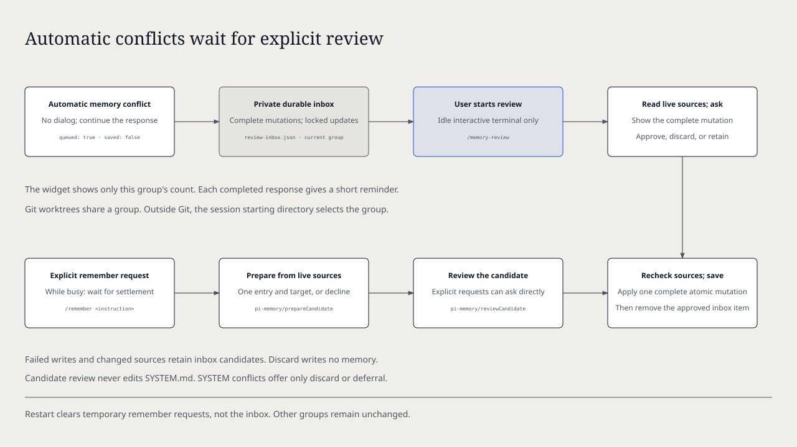

# `@henryqw/pi-memory`

Keep durable preferences and cross-project facts across Pi sessions in size-limited Markdown stores.

Inspired by [Hermes Agent](https://github.com/NousResearch/hermes-agent) and its bounded `MEMORY.md`/`USER.md` cross-session memory pattern.

## Install

```bash
pi install npm:@henryqw/pi-ask-question
pi install npm:@henryqw/pi-task-models
pi install npm:@henryqw/pi-memory
```

Configure `balanced` in `/task-models`.

## Works with

| Package | Relationship | Purpose |
| --- | --- | --- |
| [`@henryqw/pi-ask-question`](https://pi.henry.wang/extensions/pi-ask-question) | Required | Provides validated conflict prompts. |
| [`@henryqw/pi-herdr-tools`](https://pi.henry.wang/extensions/pi-herdr-tools) | Improves | Marks side-thread children to exclude parent-only memory injection and dream advice. |
| [`@henryqw/pi-task-models`](https://pi.henry.wang/extensions/pi-task-models) | Required | Provides routes for candidate review, `/remember` preparation, and `/dream` promotion. |

## Use

Run `/remember I prefer concise release notes.` Pi proposes and reviews an entry, then saves it to `USER.md` or asks about conflicts. Confirm the entry in `~/.pi/agent/config/pi-memory/memory/USER.md`, or your configured `directory`.

| Surface | Type | Purpose |
| --- | --- | --- |
| `/remember <instruction>` | command | For humans: request compact durable memory. |
| `/dream` | command | For humans: promote invariant memory instructions into agent-global `~/.pi/agent/SYSTEM.md`. |
| `memory` | tool | For agents: add, replace, remove, or batch-edit entries. |
| `pi-memory/reviewCandidate` | model task | For humans: assign a profile in `/task-models`. The task reviews additions. |
| `pi-memory/prepareCandidate` | model task | For humans: assign a profile in `/task-models`. The task proposes a `/remember` entry and target, or declines. |
| `pi-memory/promoteEntries` | model task | For humans: assign a profile in `/task-models`. The task proposes one guarded `/dream` promotion. |

## Flow

### Candidate review

`pi-memory/reviewCandidate` independently reviews single adds and batches containing adds. It defaults to `balanced`, tries configured Pi registry primary then fallback routes, and never substitutes the session model. Only verified bounded JSON evidence is accepted.


Review sends live agent-global `SYSTEM.md`, `MEMORY.md`, and `USER.md` snapshots to the configured model. Initially missing `SYSTEM.md` counts as empty. Unreadable, oversized, or over-cap sources block review. Restore a SYSTEM file that disappears after review proved it present.

Conflict-free additions save immediately. Exact duplicate single adds and duplicate-only add batches are idempotent and skip review.

Conflict prompts offer **Merge with existing entries**, **Discard the new entry, keep current**, **Replace current entry**, and **Something else.** The recommended choice comes first: merge for overlap, replace for contradiction, discard for SYSTEM conflicts. Candidate review never edits SYSTEM.md.

An approved merge or replacement requires a single add conflicting with exactly one same-store entry. Review checks it against other sources again; saving requires unchanged sources. Discard writes nothing. Custom answers, cross-target or ambiguous conflicts, conflicting batches, cancellation, and non-interactive UI leave candidates unwritten. SYSTEM.md conflicts cannot be resolved here.

### `/remember` and queued work



`/remember` uses bounded `pi-memory/prepareCandidate` proposals: one exact entry and target, or a decline for unsuitable, project-specific, temporary, or trivial content. It requires the configured `balanced` route, unchanged sources, and candidate review. It never sends open-ended instructions to the session agent.

Active responses queue trimmed `/remember` requests and interactive conflict questions separately. Queued conflicts return `queued: true`, `saved: false`; nothing is saved. The agent must finish replying without retrying or asking the user itself.

After settlement, conflicts run first, then remember requests: FIFO within each queue, only while idle. Each item re-reads live sources; remaining conflicts use `ask_question`. Idle requests can ask immediately. Deferred results and failures use UI notifications, not new agent turns.

Cancellation drops both queues before further preparation, dialogs, or writes, even without a context cancellation signal. Shutdown, reload, or session replacement also clears queues. Dropped requests never return; completed writes remain saved. Issue a new `/remember` if needed.

`/remember` rejects writes if another response starts, the session shuts down or changes, or the model changes during review. This applies without an idle cancellation signal; retry in the current session.

### `/dream`

Pi recommends `/dream` for non-empty memory with no recorded dream, or one at least 30 days old. It also recommends it when either store reaches 70% and the last dream was at least 7 days ago.

`/dream` requires an interactive UI, a configured `balanced` route, and existing, readable, non-symlink `~/.pi/agent/SYSTEM.md`. Create that file deliberately and completely: a partial SYSTEM replaces Pi's default prompt. SYSTEM edits take effect in a new session.

`pi-memory/promoteEntries` proposes one exact SYSTEM edit and the whole memory entries it represents. The UI shows the reason, a colored SYSTEM diff with line numbers, and entries to remove from each store. Select `Approve` to proceed; `Reject` or Esc changes nothing.

After approval, pi-memory checks that SYSTEM and both stores remain unchanged. It writes SYSTEM first, then removes entries. A failed SYSTEM write removes nothing. If removal fails, run `/dream` again to reconcile; the timestamp does not advance. Successful runs record time in `~/.pi/agent/config/pi-memory/dream.json`.

Commands stop before writes when Pi supplies a cancellation signal that aborts. Idle Pi can supply no signal. After a SYSTEM edit saves, entry removal continues even on cancellation, so a retry can reconcile it.

### Per-turn memory check

The current agent decides what qualifies for memory. Each turn's check asks it to save durable user identity, preferences, and corrections to `target=user`. Stable cross-project environment and workflow facts use `target=memory`.

Use the tool immediately for qualifying facts. Inferred habits need two independent signals from the conversation or existing profile. Skip repository facts, task-local behavior, progress, and temporary preferences.

## Config

Package-owned: `~/.pi/agent/config/pi-memory/config.json`. You write this optional file; pi-memory never creates or rewrites it. It reads config at session start. Missing fields or files use defaults; restart the session after changes.

| Name | Description | Values | Default |
| --- | --- | --- | --- |
| `directory` | Folder for both stores. | Non-empty absolute path without control characters. | `~/.pi/agent/config/pi-memory/memory` |
| `memoryCharLimit` | Character cap for `MEMORY.md`. | Safe integer from 1 to 100000. | `8800` |
| `userCharLimit` | Character cap for `USER.md`. | Safe integer from 1 to 100000. | `5500` |

Warnings and errors give the path and each problem:

| Problem | Result |
| --- | --- |
| Unknown key or invalid limit | Warn; ignore unknown keys and use defaults for invalid limits. |
| Misspelled key near a missing key | Treat that field as invalid; `memoryCharLimt` uses the default `memoryCharLimit`. |
| Invalid `directory`, including `directroy` without `directory` | Disable persistent memory; never substitute the default directory. |
| Malformed JSON, invalid UTF-8, over 64 KiB, unreadable file, non-object root | Disable persistent memory. |

Fix invalid config, then start a new session.

## State and storage

| Store | Scope |
| --- | --- |
| `MEMORY.md` | Cross-project agent notes. Put repository facts in repository docs. |
| `USER.md` | User profile. |

Files hold entries separated by `§`. Each session captures both stores once; later edits change live memory, not the injected session snapshot.

pi-memory tracks stores proven present during the session, including invalid UTF-8, oversized, and symlinked files. If one disappears, writes stop until restoration. Unconfirmed paths can be repaired and created normally; new sessions reset presence tracking. Inspect live state at `<directory>/MEMORY.md` and `<directory>/USER.md`.

Backups and the lock file stay outside `directory`, under `~/.pi/agent/config/pi-memory/backups/`. Before rewriting an existing store, pi-memory overwrites its matching `MEMORY.md.bak` or `USER.md.bak` with the previous contents. Failed writes can also update backups; first writes to missing stores create none. Backups are not versioned history.

You can use iCloud Drive or an Obsidian-synced folder as `directory`. Sync only carries files; pi-memory owns their format and does not merge remote changes.

## Limits and recovery

Cloud-synced files can be read outside Pi. Before using shared or synced storage, read [ADR 006: pi-memory global store threat model](https://github.com/HenryQW/pi-harness/blob/main/docs/adr/006-pi-memory-global-store-threat-model.md).

Writes over a store cap fail with current usage. Consolidate with one batch that removes or shortens stale entries and adds new content; only final size counts. Batches allow at most 100 operations; complete serialized mutations allow at most 1,000,000 UTF-8 bytes. Both limits apply before source reads or review; violations write nothing.

External edits or sync can exceed caps; snapshots omit overflow and warn. Startup lists at most three unexpected regular filenames, stopping on the fourth with `at least four unexpected files`. Only `MEMORY.md` and `USER.md` load. Reconcile or remove unexpected files.

### Restore a backup

Never copy backups over live or damaged stores:

1. Stop all Pi sessions and other writers using `directory`. Pause cloud sync. Keep them stopped during restoration.
2. Preserve the damaged file in a recovery folder outside `directory` and the backup folder. Verify that copy. Move the damaged file out of `directory`; do not delete it or overwrite the backup.
3. Inspect the matching `MEMORY.md.bak` or `USER.md.bak` for wanted entries, valid UTF-8, `§` delimiters, and the configured character cap. Stop if it is missing or damaged; backups provide no older versions.
4. Copy the checked backup to the vacant `<directory>/MEMORY.md` or `<directory>/USER.md` as a regular file, not a symlink. Preserve restrictive permissions, especially for `USER.md`.
5. Start one new Pi session. Confirm initialization without store warnings. Inspect the restored file and new snapshot before writing; old sessions cannot validate restored state.
6. Check for remote changes that could replace the restored file. Only then resume other writers and sync.
