# `@henryqw/pi-memory`

Keep durable preferences and cross-project facts across Pi sessions. Each session gets a frozen snapshot. Bounded Markdown controls prompt size, and you do not need a hand-maintained knowledge tree.

Inspired by [Hermes Agent](https://github.com/NousResearch/hermes-agent) and its bounded `MEMORY.md`/`USER.md` cross-session memory pattern.

## Install

This package requires Pi 1.1.0 or later in the 1.x series.

```bash
pi install npm:@henryqw/pi-ask-question
pi install npm:@henryqw/pi-task-models
pi install npm:@henryqw/pi-memory
```

Run `/task-models`. Configure the `balanced` profile before you add memory. Open `/task-models` again and verify that `balanced` no longer says `not configured`.

## Works with

| Package | Relationship | Purpose |
| --- | --- | --- |
| [`@henryqw/pi-ask-question`](https://pi.henry.wang/extensions/pi-ask-question) | Required | Provides the validated conflict prompt. |
| [`@henryqw/pi-herdr-tools`](https://pi.henry.wang/extensions/pi-herdr-tools) | Improves | Marks side-thread children, so they do not get parent-only memory injection and dream advice. |
| [`@henryqw/pi-task-models`](https://pi.henry.wang/extensions/pi-task-models) | Required | Provides candidate-review routes. |

## Use

Run `/remember I prefer concise release notes.` Pi proposes a suitable entry through a configured Model Task. Then it reviews the add. Pi saves a preference without conflicts in `USER.md`. If a conflict occurs, Pi asks you how to resolve it.

Read `~/.pi/agent/config/pi-memory/memory/USER.md` (the default path; `directory` is configurable) to confirm the saved entry. Start a new session to use its frozen snapshot.

| Surface | Type | Purpose |
| --- | --- | --- |
| `/remember <instruction>` | command | For humans: process an instruction into compact durable memory. Semantic conflicts require user resolution. Busy requests queue in FIFO order. |
| `/dream` | command | For humans: promote invariant memory instructions into the agent-global `~/.pi/agent/SYSTEM.md`. |
| `memory` | tool | For agents: add, replace, remove, or batch-edit entries across sessions. |
| `pi-memory/reviewCandidate` | model task | Reviews memory additions. |
| `pi-memory/prepareCandidate` | model task | Proposes a target and entry for `/remember`, or skips it. |
| `pi-memory/promoteEntries` | model task | Proposes one guarded `/dream` promotion. |

## Flow

### Candidate review

The local `pi-memory/reviewCandidate` Model Task independently reviews new single adds and batches that contain an `add`. It defaults to the shared `balanced` profile.



Candidate review gives the configured model live snapshots of agent-global `SYSTEM.md`, `MEMORY.md`, and `USER.md`. An initially missing `SYSTEM.md` is empty. Unreadable, oversized, or over-cap sources fail closed.

A SYSTEM file proven present during review cannot disappear later in that session. Restore it before the next add.

It resolves the configured Pi registry primary route, then fallback, through `/task-models`. It never substitutes the current session model. It accepts only verified bounded JSON evidence.

If the shared task-model config is missing, pi-memory shows a warning one time at session start. Configure `pi-memory/reviewCandidate` with `/task-models` before you add memory. pi-memory also shows each problem in the shared task-model config one time in each session, at session start or before a review.

An overlap or contradiction found during an active response queues the question instead of blocking the agent. The tool reports `queued: true` and `saved: false`. Nothing is written yet. The agent must finish its reply. It must not retry or ask you itself. After the response fully settles (`agent_settled`), pi-memory drains conflicts in FIFO order. It reviews live sources again. If a conflict remains, it uses the shared `ask_question` UI. An idle `/remember` request can ask immediately. Choose **Merge with existing entries**, **Discard the new entry, keep current**, or **Replace current entry**. The UI also offers **Something else.** for a custom answer. The recommended choice comes first: merge for overlap, replace for contradiction, and discard for SYSTEM conflicts. pi-memory never edits SYSTEM.md.

pi-memory still saves additions without conflicts immediately. Queued conflicts exist only in the current session. Cancellation drops them. Shutdown, reload, or session replacement clears them. Deferred results and failures appear as UI notifications. They do not start another agent turn.

Exact duplicate single adds and duplicate-only add batches are idempotent and skip model review. A single add can conflict with exactly one entry in the same store. In that case, pi-memory reviews an approved merge or replacement again against the other sources. It writes the result under the store lock only if those sources stay unchanged. Discard writes nothing. Custom answers, cross-target or ambiguous conflicts, batches, cancellation, and non-interactive UI leave the candidate unwritten. pi-memory cannot resolve a SYSTEM.md conflict.

### `/remember`

`/remember <instruction>` uses the bounded `pi-memory/prepareCandidate` Model Task to propose a target and exact entry, or to decline the request. It checks for source changes. Then it saves through the same reviewed memory tool. It does not dispatch an open-ended instruction to the session agent. The configured `balanced` task-model profile must be available.

If Pi is busy, it queues the trimmed instruction. If that response is cancelled, pi-memory drops queued `/remember` requests and conflicts before preparation, dialogs, or writes start. This occurs even without a context cancellation signal. They do not return on the next run. Completed writes stay saved. You can issue a new `/remember` command later. Otherwise, after the response settles, it drains queued requests in FIFO order while the session stays idle. It reads live entries for each request. `/remember` rejects the write in these cases, even when Pi provides no idle cancellation signal: another response starts, the session shuts down or is replaced, or the model changes during review. Retry in the current session. `/remember` refuses project-specific, temporary, trivial, or otherwise unsuitable content.

### `/dream`

Pi recommends `/dream` when memory is non-empty and no previous dream is recorded. It also recommends it when memory is non-empty and the last dream was over 30 days ago.

It recommends `/dream` when either store is at least 70% full and the last dream was at least 7 days ago.

`/dream` uses `pi-memory/promoteEntries` to propose one exact edit to the agent-global `~/.pi/agent/SYSTEM.md` and the whole entries represented by the result. It previews the proposal for approval in the interactive UI. After approval, it checks that SYSTEM and both memory stores are unchanged. Then it writes SYSTEM first and removes the selected entries. A failed SYSTEM write removes nothing. If removal fails after the SYSTEM update, run `/dream` again to reconcile. The timestamp does not advance. Successful runs record their time in `~/.pi/agent/config/pi-memory/dream.json`.

SYSTEM.md must already exist, be readable, and not be a symlink. Create it deliberately and completely. A partial SYSTEM replaces Pi's default prompt. A SYSTEM edit takes effect in a new session, not the current frozen snapshot. `/dream` cannot run without an interactive UI or a configured `balanced` task-model route. If Pi supplies a cancellation signal and the signal aborts, commands stop before they write. Pi can provide no signal while idle. After pi-memory saves a SYSTEM edit, entry removal continues. Thus, a retry can reconcile the promotion.

### Per-turn memory check

Final memory qualification remains a current-session-agent workflow. `/remember` and `/dream` use Model Tasks for semantic proposals and extension code for writes.

Each turn's shorter memory check asks the current agent to save two types of facts. It saves newly learned durable user identity, preferences, or corrections to `target=user`. It saves stable cross-project environment or workflow facts to `target=memory`.

Use the memory tool immediately only when something qualifies. If a conflict is queued, continue the response. The conflict is not saved yet. It needs no retry and no agent-issued question. Save inferred habits only after two independent signals from the conversation, the existing profile, or both. Skip project- or repository-specific facts, task-local behavior, progress, and temporary preferences.

## Config

Package-owned: `~/.pi/agent/config/pi-memory/config.json`. You write this optional file. pi-memory reads it at session start and never creates or rewrites it. All fields are optional. A missing file uses defaults. Start a new session for config changes to take effect.

| Name | Description | Values | Default |
| --- | --- | --- | --- |
| `directory` | Sets the folder for both memory stores. | Non-empty absolute path without control characters. | `~/.pi/agent/config/pi-memory/memory` |
| `memoryCharLimit` | Caps `MEMORY.md` by character count. | Safe integer from 1 to 100000. | `8800` |
| `userCharLimit` | Caps `USER.md` by character count. | Safe integer from 1 to 100000. | `5500` |

At session start, Pi shows a warning with the file path and each problem for an unknown key or an invalid `memoryCharLimit` or `userCharLimit`. pi-memory ignores the unknown key and uses the default for the invalid limit. A misspelled key near a missing key counts as an invalid value of that key. Thus, `memoryCharLimt` gives the default `memoryCharLimit`.

An invalid or misspelled `directory` (for example, `directroy` when `directory` is not in the file), malformed JSON, invalid UTF-8, a file over 64 KiB, an unreadable file, or a non-object root disables persistent memory for that session. pi-memory never uses the default directory in place of an invalid `directory`. Pi shows an error with the file path and each problem. Fix the file and start a new session. pi-memory never rewrites the file.

## State and storage

| Store | Scope | Default cap |
| --- | --- | --- |
| `MEMORY.md` | Global agent notes shared across all projects. Do not store project-specific facts here. Put them in the repository. | 8800 characters |
| `USER.md` | User profile. | 5500 characters |

Each file holds entries delimited by `§` and is size-capped. pi-memory captures both stores at session start. Later edits do not alter injected memory.

During a session, pi-memory remembers each store file proven to exist. This includes valid, invalid UTF-8, oversized, and symlinked files.

If a proven store disappears, writes stay blocked until you restore it. A path never confirmed present can be repaired and created normally. A new session starts new presence tracking.

Read `<directory>/MEMORY.md` and `<directory>/USER.md` to inspect live state.

Backups and the lock file are outside `directory`, under `~/.pi/agent/config/pi-memory/backups/`. The backup files are `MEMORY.md.bak` and `USER.md.bak`.

Before pi-memory rewrites an existing store, it copies the previous contents to the matching backup. This overwrites that backup. After a successful rewrite, the backup holds the previous store. A failed write can also leave an updated backup. The first write to a missing store creates no backup. These files are not versioned history.

Point `directory` at an iCloud Drive or Obsidian-vault-synced folder. The synced vault only carries files. pi-memory owns the file format and treats the remote as opaque storage, so no merge logic runs on the Pi side.

## Limits and recovery

A configured cloud-synced directory can be read outside Pi. Review [`ADR 006 — pi-memory global store threat model`](https://github.com/HenryQW/pi-harness/blob/main/docs/adr/006-pi-memory-global-store-threat-model.md) before you point it at a shared or cloud-synced path.

When a write would exceed a store's cap, the tool rejects it and reports current usage.

Consolidate with one batch that removes or shortens stale entries and adds the new entry together. A batch checks only the final size. A batch accepts at most 100 operations. A complete serialized mutation cannot exceed 1,000,000 UTF-8 bytes.

Both limits are checked before source loading or review. Calls over either limit do not write.

An external edit or sync can push an on-disk file over its cap. The session snapshot then omits the overflow and warns instead of injecting it.

Startup lists at most three unexpected regular filenames in `directory`. It stops on the fourth and reports `at least four unexpected files`. Only `MEMORY.md` and `USER.md` are loaded. Reconcile or remove the unexpected files.

### Restore a backup

Do not copy a backup over a live or damaged store. Use these steps for the affected store:

1. Stop all Pi sessions and other writers that use `directory`. Pause sync if the directory is cloud-synced. Keep them stopped during restoration.
2. Preserve the damaged current file in a separate recovery folder outside `directory` and the backup folder. Verify the saved copy, then move the damaged file out of `directory`. Do not delete it or overwrite the backup.
3. Inspect the matching `MEMORY.md.bak` or `USER.md.bak`. Confirm that it contains the entries you want, uses valid UTF-8 with `§` entry delimiters, and is within the configured character cap. If the backup is missing or damaged, stop. These backups provide no older versions.
4. Copy the checked backup to the now-vacant `<directory>/MEMORY.md` or `<directory>/USER.md` path as a regular file, not a symlink. Preserve restrictive file permissions, especially for `USER.md`.
5. Start one new Pi session. Confirm that initialization succeeds without store warnings. Inspect the restored live file. Check the new frozen snapshot before any write. Old sessions cannot validate the restored state because their snapshots do not change. Check for remote changes that can replace the restored file. Only then, resume other writers and sync.
