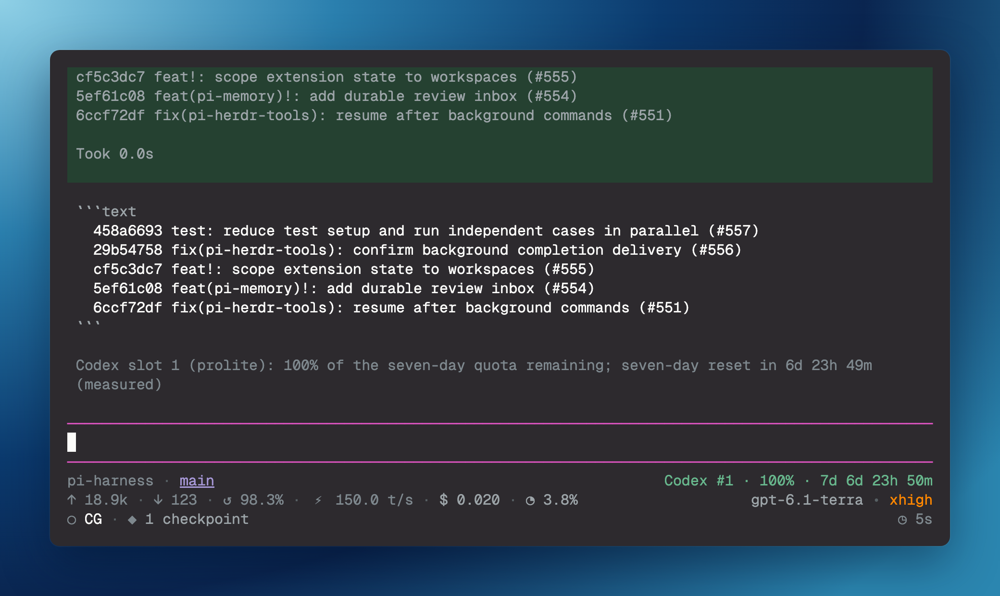
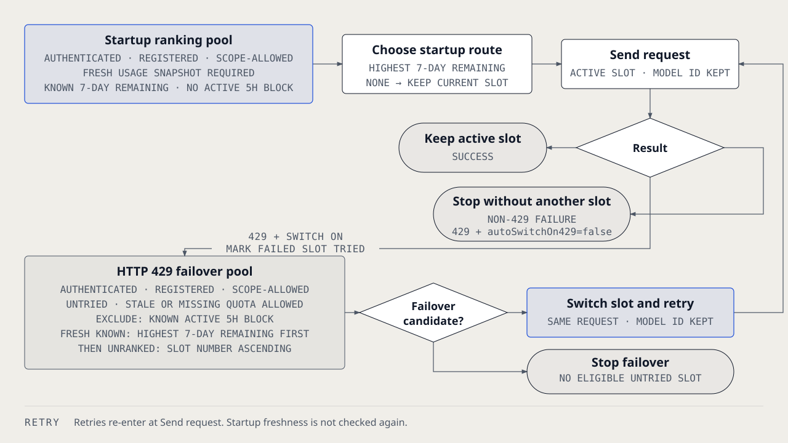

# `@henryqw/pi-multi-codex`

Add multiple ChatGPT Codex OAuth accounts and start Pi work on the eligible slot with the most remaining quota. The extension switches away from active five-hour quota blocks and can retry an HTTP 429 on another eligible slot.




## Install

```bash
pi install npm:@henryqw/pi-multi-codex
```

This package requires Pi 1.1.0 or later in the 1.x series.

## Works with

| Package | Relationship | Purpose |
| --- | --- | --- |
| [`@henryqw/pi-footer`](https://pi.henry.wang/extensions/pi-footer) | Improves | Shows the remaining quota or five-hour quota block of the active slot in the footer. |
| [`@henryqw/pi-subagent`](https://pi.henry.wang/extensions/pi-subagent) | Improves | Isolated children keep Main's active Codex slot. |
| [`@henryqw/pi-task-models`](https://pi.henry.wang/extensions/pi-task-models) | Improves | Numbered slots share one profile route. |

## Use

First, run `/login` and authenticate `OpenAI Codex (legacy)` for slot 1. Run `/codex-add`. Then run `/login` and select the new `OpenAI Codex #<n>` provider. Restart Pi or update model scope. Then run `/codex-status`. The status lists the new slot with cached quota when available, or `unavailable` until the first successful usage snapshot.

| Surface | Type | Purpose |
| --- | --- | --- |
| `/codex-add` | command | For people: create the next numbered slot, then authenticate that slot. |
| `/codex-status` | command | For people: show shared usage snapshots and five-hour quota blocks. It never waits on the network. |
| `/codex-switch` | command | For people: select an authenticated, scope-allowed slot for the current Codex model. |
| Pi model selector (`OpenAI Codex (legacy)`, `OpenAI Codex #<n>`) | ui | Choose an authenticated account slot. |
| Pi status `pi-multi-codex` | ui | Report the active slot's fresh quota, five-hour limit countdown, or stale/unavailable state. `@henryqw/pi-footer` displays it in the footer. |

The footer and `/codex-status` show the five-hour reset countdown for Free, Go, and Plus tiers. They show the seven-day reset countdown for Pro Lite and other tiers. A numbered slot is one Codex account position in Pi.

## Flow

- Before the first agent start, only fresh usage snapshots enter startup ranking. The slot with the most remaining quota wins.
- An explicit model selection always wins for the next agent start.
- Before later agent starts, a known active five-hour quota block switches to the eligible fresh slot with the most remaining quota.
- After HTTP 429, failover can use authenticated, registered, scope-allowed, untried slots with stale or missing quota.
- Failover skips known active five-hour quota blocks. It ranks fresh known quota first, then unranked slots by slot number.
- Routing preserves the model ID.
- Only physical Codex models are slots. A virtual model listed under `openai-codex`, such as `openai-codex/auto`, is never routed to a slot and shows no quota status.
- During one agent run, each eligible slot is tried at most one time after HTTP 429 responses.
- Automatic retry stops when no untried eligible slot remains.
- The footer shows the fresh quota or five-hour quota block of the active slot.

## Config

Package-owned: `~/.pi/agent/config/pi-multi-codex/config.json`

| Name | Description | Values | Default |
| --- | --- | --- | --- |
| `autoSwitchOn429` | Switches to another eligible slot after an HTTP 429. | Boolean. | `true` when the config file is missing |

Edit this file yourself. The extension does not create or write it. A missing file uses the default `true`, and config changes take effect at the next session start. Set `autoSwitchOn429` to `false` to disable automatic switching. A present config must contain only this field as a boolean. If the config is invalid, the extension keeps the file, shows a warning, and disables automatic switching for the session. Fix the file and start a new session to recover.

## State and storage

The extension keeps a generated, credential-free quota cache at `~/.pi/agent/config/pi-multi-codex/usage.json`.

## Limits and recovery

The extension reads `auth.json` to identify account slots but does not directly edit credentials. When it asks Pi's auth resolver for a token to check quota, Pi can refresh expired OAuth credentials and update its auth store.

Scoped sessions can switch only to exact scoped aliases.
