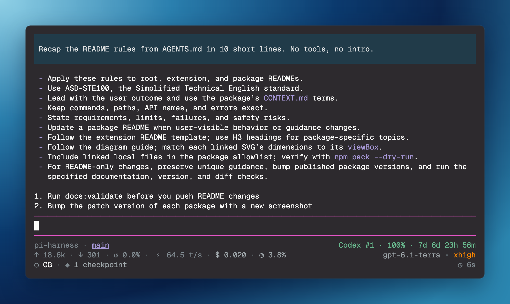

# `@henryqw/pi-notes`

Show up to four persistent reminders for each worktree above the Pi editor. The small number of fixed slots keeps notes useful and prevents an unbounded history store.



## Install

```bash
pi install npm:@henryqw/pi-notes
```

Requires Pi 1.1.0 or later in the 1.x series and Node.js 22.19.0 or newer.

## Use

Run `/note Verify the migration rollback.` in a Git worktree. The reminder shows above the editor immediately. It shows again in later sessions for that worktree.

| Surface | Type | Purpose |
| --- | --- | --- |
| `/note <text>` | command | Add a note to the current Git worktree (max 4). |
| `/note-rm` | command | Select a note from the current worktree and remove it. |
| `/note-clear` | command | Clear all notes for the current worktree. |
| Notes widget | ui | Show the notes of the current worktree. |

Each Git worktree has separate notes. In the TUI, the widget numbers the notes above the editor and shows at most two lines for each note. In non-TUI modes, notes are plain text without the two-line limit. When there are no notes, Pi does not show the widget.

## State and storage

The extension generates `~/.pi/agent/config/pi-notes/<worktree-sha256>.json` for command-managed notes in one Git worktree.

The extension silently deletes stale files for removed repositories and worktrees. It does this when a session starts or when notes change.

## Limits and recovery

Each worktree can hold at most four notes. The `/note` command changes each whitespace sequence to one space and trims the ends. It rejects any remaining terminal control characters with `Notes cannot contain terminal control characters.` The extension validates each worktree file as untrusted data. It preserves malformed files. A malformed file blocks note changes for its worktree until you fix the file or reset it with `/note-clear`.
