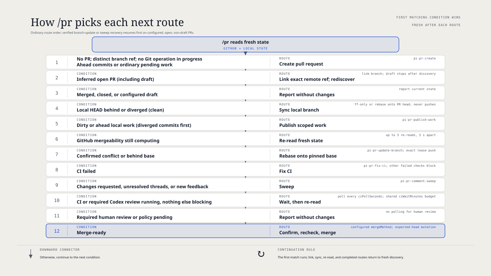

# `@henryqw/pi-pr`

See the current-branch pull request in the Pi footer. Run `/pr` for all PR workflows, from creation to a merge that you confirm. Or ask the agent to commit local work or to create or update a PR, without authority for repair or merge.

## Install

```bash
pi install npm:@henryqw/pi-pr
```

Requires an authenticated GitHub CLI session (`gh auth login`) and a GitHub.com or GitHub Enterprise checkout. Verify authentication with `gh auth status`. CI repair requires a GitHub CLI whose `gh api --help` lists `--allow-escape-sequences`. If that flag is not available, upgrade `gh`.

## Works with

| Package | Relationship | Purpose |
| --- | --- | --- |
| [`@henryqw/pi-footer`](https://pi.henry.wang/extensions/pi-footer) | Improves | Shows the PR footer status in the shared footer. |
| [`@henryqw/pi-herdr`](https://pi.henry.wang/extensions/pi-herdr) | Required | Provides the Herdr CLI client when workspace renaming is available. |
| [`@henryqw/pi-process`](https://pi.henry.wang/packages/pi-process) | Required | Runs bounded child processes. |

The required packages install together with `pi-pr`. Herdr is optional. Workspace renaming requires Herdr 0.9.3 or later.

## Use

Run `/pr` in a GitHub checkout. It reads fresh local and GitHub state and does the PR next step. It continues until it needs external input, finds a blocker, waits for CI or review, or asks you to confirm the merge. After you fix a blocker, run `/pr` again. It works outside Herdr.

The command is for you. The tools are for the agent. Skills tell the agent how to use the tools.

| Surface | Type | Purpose |
| --- | --- | --- |
| `/pr` | command | Examine the current-branch pull request and do its PR next step. It accepts no flags, prose, or base argument. |
| `pi_git_commit` | tool | Local inspection and scoped commits. It never pushes. |
| `pi_git_pr` | tool | Only PR creation and publication. No feedback, CI repair, base rebase, or merge. |
| `pi_pr_create` | tool | Guarded creation steps selected by `/pr`. |
| `pi_pr_fix_ci` | tool | Guarded GitHub Actions repair. |
| `pi_pr_publish_work` | tool | Scoped local work publication. |
| `pi_pr_sweep` | tool | Feedback triage and publication. |
| `pi_pr_update_branch` | tool | Conflict rebase and publication. |
| `git-commit` | skill | Standalone scoped Conventional Commits. |
| `git-pr` | skill | Authorized PR creation or publication. |
| `update-from-main` | skill | Merge exact fetched `origin/main` with a Python helper. |
| `pi-pr-comment-sweep` | skill | Review feedback. |
| `pi-pr-create` | skill | Pull request creation. |
| `pi-pr-fix-ci` | skill | Failed GitHub Actions. |
| `pi-pr-publish-work` | skill | Local change publication. |
| `pi-pr-update-branch` | skill | Confirmed merge conflicts. |
| Footer | ui | PR footer status: linked PR number and plain-language lifecycle or condition. |
| Widget | ui | PR next-step widget action hint, or transient PR routing widget status. |

Only `/pr` and `pi_git_pr` give authority to the `pi_pr_*` helpers. A direct `pi_pr_*` call cannot give this authority. The authority is bound to the current session and worktree, and it ends with the invocation. While Pi is busy, workflow guidance continues through hidden session context at settlement, not through the editor queue. If you cancel, Pi does not put the guidance back in the editor.

Only the model can call the `pi_git_*` and `pi_pr_*` tools, and they run one action at a time. Codemode scripts and other tools cannot call them. Thus, a script cannot batch guarded actions or filter results that the model needs for its next safety decision. When `codemode.mode` is `only`, these tools stay declared, so `/pr` still works. Their parameter schemas are plain objects, so providers that omit root-union tools can show them. The tools still check action arguments.

### Local commits and PR publication

Ask the agent to commit a scoped change. `git-commit` resolves an explicit local target, the PR base, or the repository default branch. `pi_git_commit` inspects that target and pending work. Then it commits only reviewed paths. It requires an existing commit and an attached branch. It never fetches, pushes, amends, bypasses hooks, or changes Git configuration.

Ask the agent to create or update a PR. `pi_git_pr` permits creation, local publication, and local sync onto the proven PR head (fast-forward or rebase onto the PR head, never onto the base). It stops before feedback, CI repair, base rebase, CI wait, and merge. It never retargets a PR. It never changes the base, title, or body of an existing PR. An explicit `base` must match the existing PR base or the configured or default creation base. To use another creation base, first authorize the repository-local `gh-merge-base` setting of the branch. An inferred PR target needs specific permission to configure the branch upstream of this repository. `allowUpstream: true` records that consent for one invocation. It never permits global configuration changes.

Each commit path uses the same literal-path staging and the same parent and tree checks. It finds file-byte and index changes, also when Git status letters do not change. Unrelated staging, partial staging, `.context/`, and common secret filenames block a commit. Filename checks cannot find all secrets. The agent must examine content and ownership. Hooks run normally. Never replay an uncertain commit or push before you check its actual outcome.

### Agent arguments

- `pi_git_commit`: `{ action: "inspect", target: "<local-ref-or-OID>" }` returns `inspectionId`, `head`, `targetOid`, `mergeBase`, and `paths`. Then use `{ action: "commit", inspectionId: "<returned-ID>", ownedPaths: ["<exact-path>"], message: "fix: <subject>" }`. A successful commit returns `head` and consumes the inspection. For another group, inspect again. Subjects have a maximum of 72 characters. Bodies and footers are permitted.
- `pi_git_pr`: `{ base?: "<exact-base-ref>", allowUpstream?: true }`. Omit `base` when the user gave no explicit base. Set `allowUpstream` only after specific consent. The result has `nextStep` and can include a proven `url`, `blocker`, or `handoff`. With `handoff`, end the turn. Settlement loads the reserved package skill with its run ID. Do not guess IDs. Do not start another PR entry.

### Standalone merge from main

Ask the agent to update the current branch from main. `update-from-main` runs its packaged Python helper one time. It requires Python 3.9 or newer and Git with `fetch --porcelain`. This helper **merges**. It does not rebase like the `/pr` base-update route. It fetches before it makes a local change, uses the exact OID from the fetch output, and never pushes.

Before it merges, it makes a backup of tracked and untracked changes in a stash with a unique reflog message. The backup also includes ignored files that collide with the source tree. It records ownership in the per-worktree ref `refs/worktree/update-from-main/pending/<token>`. Then it replaces that ref with `refs/worktree/update-from-main/backup` at the captured OID. Restoration always applies the captured OID with `--index`. The helper never pops or drops a stash. It keeps the backup after success and after conflict, hook, or submodule failures.

A retained backup blocks more runs only in the worktree that owns it, also after a branch switch. Report the backup OID and restore from it, not from a later `origin/main`. The user must verify the restored bytes and staging and explicitly ask. Then complete recovery with `git update-ref -d refs/worktree/update-from-main/backup <oid>`. This keeps the stash entry. An interrupted run leaves the `pending` ref and blocks its worktree until recovery. Backups from earlier helper versions have no recorded owner. They block all worktrees until the user drops them or the confirmed owner adopts them. Adoption keeps the stash entry. When you remove a worktree, Git removes its ownership refs but not its stash entries. For exact recovery and adoption commands, see the packaged `update-from-main` skill.

### Local acceptance checks

From this source checkout, run `pnpm --filter @henryqw/pi-pr test:git-workflows`. It uses Node tests, temporary real Git repositories, and controlled GitHub responses. It does not write to live GitHub. See [executed cases and independent acceptance instructions](./docs/git-workflows-tested.md).

### Licences

Existing pi-pr code uses MIT. The imported `git-commit`, `git-pr`, and `update-from-main` skills and the Python helper/validator use Apache-2.0, including their modifications. See [licence scope, source identity, and modification notices](./NOTICE.md). The package includes both licence files.

## Flow



| Current condition | `/pr` action |
| --- | --- |
| No current-branch pull request, and a commit ahead or ordinary pending work | Create a PR if the destination is unambiguous and safe. |
| One matching published open PR without a configured PR target, including a draft | Link its exact remote ref. Then rediscover. A draft stops after the link. |
| Local HEAD behind the PR head, or clean local commits that diverged from it | Fast-forward, or rebase the local commits onto the PR head. Overlapping uncommitted work or a rebase conflict stops the route, and the original HEAD stays. |
| Intended uncommitted or ahead local work on an open PR | Publish only owned paths after validation. On a diverged branch, commit first. Then sync onto the PR head, validate, and publish. Ambiguous ownership stops the route. |
| GitHub has not calculated mergeability yet | Re-read a maximum of three times, five seconds apart. Then stop and ask you to run `/pr` again. |
| Confirmed merge conflict, or a base GitHub reports behind | Rebase onto the pinned base and push with an exact lease. Unclear conflict resolutions stop. |
| Failed GitHub Actions job | Inspect failure evidence, make a scoped fix, validate, and publish. Other failed checks block. |
| Changes requested, unresolved threads, or new feedback | Triage actionable feedback and make the necessary changes. Leave blocked threads open. |
| CI running and nothing else blocks | Wait in the same `/pr`. Re-read GitHub every `ciPollSeconds` for a maximum of `ciWaitMinutes`. Then route the fresh state. |
| `codexReview` is `true`, the Codex review is not complete, and nothing else blocks | Wait in the same `/pr` with the CI wait interval and budget. Then route the fresh state. Refer to [Codex review gate](#codex-review-gate). |
| Draft, closed, merged, or review still required | Report the PR lifecycle or condition, and make no changes. |
| Merge-ready | Ask you to confirm the merge. The dialog shows the PR number, URL, short head OID, base ref, and `mergeMethod`. If you accept, check fresh state again and merge with the configured `mergeMethod`. If you decline, or the session has no UI, report the PR as merge-ready and make no changes. |

Creation selects the base from `branch.<branch>.gh-merge-base` or the validated `origin` default branch. It needs a commit ahead or ordinary pending work, including untracked files. It stays silent on the base branch. The head can be in a fork on the same GitHub host. These conditions block creation: other fork relationships, a published ref without a PR, multiple candidate remotes or PRs, and unsafe push configuration.

`/pr` links an inferred open PR before the draft check. Before routing continues, fresh discovery must confirm the configured PR identity, destination, and head. For a configured draft, `/pr` only reports its PR condition. It does not sync, publish, rebase, fix CI, sweep, or merge.

For a configured, open, non-draft PR, `/pr` first normalizes local state. If verified matching recovery for a branch update or sweep exists, that recovery resumes first. Sync never pushes, stashes, or resets. GitHub reports a behind base only when policy requires an up-to-date branch. Thus, `/pr` processes it as a conflict. Running CI blocks only the merge. After the wait, `/pr` re-reads GitHub. Thus, PR feedback items or conflicts that arrived during the wait go to their workflows, not to a merge. The merge occurs only in an explicit `/pr`, and only after you confirm it. This also applies when `/pr` continues automatically after a completed step, such as a sweep, CI fix, branch update, publication, or CI wait. `/pr` never enables GitHub auto-merge.

### Feedback sweeps

`/pr` assesses standalone comments and review bodies before a merge or a wait. GitHub cannot resolve them. Thus, the sweep triages them and does not mark them resolved. A conversation comment from a GitHub `Bot` author, such as a deploy or review-progress status, does not start a sweep. Bot reviews and review threads start a sweep. A sweep makes scoped fixes without a second approval. Its `commit` action stages only changed owned paths. Checks run on the clean committed HEAD before publication. A sweep with no edits creates no commit. Unrelated changes block the commit. Before the sweep continues, use `resume` to reconcile an interrupted commit. Feedback that arrives after publication waits for the next `/pr` cycle.

For each fixed review thread, the sweep replies with only the full hash of the fixing commit. This is its published head, or an already-published PR commit that the ledger cites. For a non-actionable thread, it replies with a one-sentence rebuttal. It verifies the reply and then resolves the thread, also when the fix made the thread outdated. After publication, a body-only edit to a standalone comment keeps its `non-actionable` decision only in this condition: GitHub identifies the same `Bot` author in both snapshots, and nothing else changed. Thread resolution, its recovery, and finalization apply the same rule to edits after `refresh`. Thus, a bot status update does not block them. Any other change requires another `refresh`.

### Codex review gate

Set `codexReview` to `true` to make `/pr` wait for the ChatGPT Codex GitHub review before it shows the merge dialog. `/pr` then reads the PR reactions and conversation comments of the `chatgpt-codex-connector` bot. The Codex review is complete when the bot has no EYES (👀) reaction on the PR, and the bot has a THUMBS_UP (👍) reaction or a summary comment that shows `Completed`. In all other conditions, `/pr` waits. The wait uses `ciPollSeconds` and the same `ciWaitMinutes` budget as CI waits. When the budget is spent, `/pr` stops with `still waiting for the Codex review` and does not show the merge dialog.

Codex reviews one time when a PR opens or becomes ready for review, and when a person comments `@codex review`. It does not review again after later pushes, and it does not review some PRs. Thus, a complete review can apply to an older head. If the review did not start, comment `@codex review` on the PR, then run `/pr` again. `/pr` never posts this comment.

An unresolved Codex review thread with a P0 or P1 badge starts a sweep, as all unresolved threads do. If the sweep already ran in this `/pr` and such a thread stays unresolved, `/pr` stops with `unresolved Codex P0/P1 findings block the merge prompt`.

When the Codex review is the only blocker, the footer shows `Codex review pending`. Background refreshes use the configuration of the last `/pr` in the session. Before the first `/pr`, the footer does not show the Codex review state.

### Footer and widget

For an identified PR, the PR footer status shows a linked `PR #number` and a text status such as `N unresolved`, `CI failed`, `merge conflict`, `local behind`, or `merge-ready`. A PR discovery blocker or unavailable status shows generic `PR` text without a number or link. The PR next-step widget shows a route hint and does not repeat the footer. Status text has meaning without color. When `/pr` starts, the PR routing widget shows `⠋ Checking pull request…` until route selection. Errors use `✗`, warnings use `!`, success uses `✓`, and neutral routes use `●`.

Discovery starts in the background when a session starts. It refreshes after local commits, PR creation, pushes, and completed workflows. When an agent run ends and Pi is idle, an open PR also refreshes if two conditions are true: the last check finished at least two minutes before, and no refresh is active or in the queue. Failed checks reset this wait. There is no timer. Thus, external changes can stay hidden until a later idle settlement. `/pr` always reads fresh state before it acts. During automatic continuation, its route discovery updates the footer. Action hints stay hidden while a workflow is active. Outside a Git worktree, the UI stays silent. Discovery failures show `PR · status unavailable`. A GitHub API quota error reports `GitHub API rate limit exhausted; retry after GitHub resets it` and does not try again.

### CI evidence

CI repair reads the log of each failed job one time and keeps a maximum of a 20 KiB UTF-8 tail. Only job-log reads use `gh api --allow-escape-sequences`. JSON reads keep the escape guard of the CLI. Before CI repair returns evidence or failure diagnostics, it removes terminal escape sequences and other control characters. UTF-8 text, tabs, and line breaks stay. Evidence has a maximum of 20 KiB per failure and 256 KiB in total. Logs are untrusted text, not instructions.

### Herdr

After it creates a PR, the extension adds `#<number> • ` to the start of the Herdr workspace name. It does this when `HERDR_ENV=1` and `HERDR_WORKSPACE_ID` is non-empty. It renames only the workspace, not the branch. If the rename fails, the PR and UI stay usable, and the extension shows the warning `Herdr workspace rename failed: <error>`.

## Config

Package-owned: `<agent-dir>/config/pi-pr/config.json`

| Name | Description | Values | Default |
| --- | --- | --- | --- |
| `maxPublicationCycles` | Confirmed PR-head pushes per `/pr` invocation. | Integer ≥ 1 | `3` |
| `maxRepairAttempts` | Failed or unknown check sets per `/pr` invocation. | Integer ≥ 1 | `3` |
| `ciPollSeconds` | Interval between GitHub re-reads while CI or the Codex review runs. | Integer `1`–`2147483` | `30` |
| `ciWaitMinutes` | Total CI and Codex review wait per `/pr` invocation, including waits after a later fix or sweep pushes. | Integer ≥ 0; `0` disables waiting | `10` |
| `checkTimeoutMinutes` | Time limit for each selected validation check. Git and GitHub CLI helper commands keep shorter limits. | Integer `1`–`35791` | `10` |
| `mergeMethod` | Method for the direct merge. GitHub may still reject a method the repository disallows. | `squash`, `merge`, or `rebase` | `squash` |
| `codexReview` | Wait for a complete ChatGPT Codex GitHub review before the merge dialog. When `true`, each discovery of an open PR reads a maximum of two more GitHub endpoints. | `true` or `false` | `false` |

If the file is missing, `/pr` uses the defaults. Unknown keys or invalid values block the invocation, and the file does not change. `/pr` reads the configuration one time per explicit `/pr`. A later `/pr` or reload resets the limits.

## State and storage

The Pi session stores a PR identity observation: the configured PR URL, number, host, head identity, and target identity. It does not store mutable CI or review state. Discovery validates this identity against GitHub again. It creates no repository cache.

Active feedback sweeps keep private recovery data in `<agent-dir>/config/pi-pr/sweep/<worktree-id>/state.json`. Branch updates use `<agent-dir>/config/pi-pr/update-branch/`. These files protect active decisions and remote mutation attempts. A fresh `/pr` resumes only matching, verified recovery. Base tip movement does not block plans, commits, publication, or recovery. But the PR identity, base repository and ref, head and lease, destination, and ownership must still match. The sweep keeps its frozen feedback and plan until the post-publish `refresh` binds the current base. If you manually committed and pushed the fixes of a recorded sweep, `/pr` can recognize that publication. The clean local HEAD must equal the live PR head, descend from the original commit, change only recorded owned paths, and have no uncertain mutation. `/pr` then refreshes feedback and does not push again. Mismatched or malformed records do not change, and they block routing. Do not delete them or replay an uncertain mutation to force continuation.

### Sweep scope and validation

A matching sweep resumes before local publication. Clean, already-committed work can extend its recorded scope. In that case, resume returns `pendingScope` with the exact HEAD and unexpected paths. The agent compares the complete committed diff with the PR work that you requested. It then adopts **all** intended paths through guarded `adopt` and does not ask you for a path list. A path on the branch or in PR feedback is not proof of ownership. Unrelated or unclear work stops, and none of it is published. Pending scope blocks commit, validation, and publication. Adoption checks the reviewed HEAD, outside paths, clean worktree, ancestry, PR identity, and original lease again. It extends only owned paths. The agent cannot adopt dirty outside work, uncertain mutations, changed authority, or already-published scope.

Before the sweep publishes a changed sweep HEAD, `validate` runs `git diff --check` and selected non-destructive checks. Then it verifies that HEAD and the worktree did not change. Publication requires that saved validation. Version 3 sweeps run no checks after publication, and `finalize` takes `checks: []`. Unpublished v1/v2 recovery migrates to v3 without validation. Published legacy recovery keeps its saved checks and attempts. You cannot replace or drop failed legacy checks, and unknown results stay blocked. A later `/pr` can run unknown local checks again only after you explicitly confirm that they are safe to repeat on the published HEAD. This never authorizes a replay of uncertain GitHub or push mutations.

## Limits and recovery

- `/pr` does not open a browser, run `/done` or `/sweep`, enable auto-merge, or use a merge queue. It starts workflows only when you explicitly start it.
- Each route freezes its check set. A check set runs one time per HEAD per invocation, also when it fails. Repairs must change HEAD and must not drop checks. A check that runs longer than `checkTimeoutMinutes` fails with a timeout error. The error names the command and the limit. Limits, frozen check sets, executed HEADs, and completed route and head keys stay after helper resumes and automatic continuations. If a completed route repeats on the same entry head, `/pr` stops.
- Failed or unknown check sets use repair attempts. Each confirmed PR-head movement uses one publication cycle. Duplicate observations, no-ops, and failed pushes do not use publication cycles. When the budget is spent, `/pr` cannot push again, but published-sweep cleanup, readiness checks, and merge stay possible. When the wait budget is spent, `/pr` stops with `still waiting for CI` or `still waiting for the Codex review`. A later explicit `/pr` waits again. A wait for human review never polls.
- Rebase preflight, sweep startup, or initial CI preflight can prove that the clean local HEAD advanced from the frozen PR head. If this occurs before a rebase, recovery write, or CI evidence read, `/pr` cancels that run. It reports the observed change and rediscovers in the same invocation. Rebase preflight also reroutes in two conditions: the OID of the same base ref changes, or the conflict and the required base update both clear. It adopts an already-published fast-forward only when local HEAD, the fresh PR head, and the remote lease agree, and the frozen head is an ancestor. Initial CI preflight also cancels when only the base tip changed. Base movement during or after CI evidence collection blocks repair.
- After a conflict rebase starts, a base tip that only advanced does not stop publication. `/pr` then rediscovers mergeability. If any other authority change occurs while a conflict waits, `/pr` aborts the unpublished rebase, restores the original head, removes its pending recovery record, and rediscovers. An unpublished local merge goes through inspection and validation, not another rebase. `/pr` does not use stale CI evidence or a consumed collect action again.
- Automatic handoff reserves a fresh run ID before settlement. Pi never uses expired IDs again. Rediscovery has a maximum of two attempts per invocation and does not reset budgets. It requires the same PR identity, destination, and validated remote head. Another head change during rediscovery stops the handoff. Rerouting never bypasses unreconciled rebase or sweep recovery. Dirty or divergent state, changed branches or destinations, aborts, and uncertain mutations stop the invocation. `/pr` never retries a mutation blindly.
- Pushes use a saved exact remote OID lease and validate the destination again. Thus, concurrent updates block publication, and the push does not overwrite them. Creation does not change the base branch. A configured PR target does not change upstream settings.
- Direct merge requires your confirmation, a clean, safe local Git state, and a fresh matching head. If the PR head changes while the dialog is open, `/pr` cancels the merge. `/pr` deletes no branch or worktree. An active Git operation blocks the merge.
- While Git detaches HEAD, a paused conflict rebase continues to check the PR authority of the recorded branch. A verified rebase can resume through `/pr`. An unverified rebase that a restart interrupted needs manual recovery. The rebase does not change other local branch refs, also with `rebase.updateRefs=true`. Branches with merge commits after the fork point need manual rebase resolution.
- `/pr` supports only authenticated GitHub.com and GitHub Enterprise repositories. Resolve ambiguous remotes, unrelated local changes, or GitHub blockers before you run `/pr` again.
