# `@henryqw/pi-prompt-creator`

Turn repeated requests or corrections in the Current Conversation into a global Pi prompt. Review the Prompt Candidate with Main and approve it before saving.

## Install

```bash
pi install npm:@henryqw/pi-task-models
pi install npm:@henryqw/pi-prompt-creator
```

Configure `fast` in `/task-models`, or override `pi-prompt-creator/draft`.

## Works with

| Package | Relationship | Purpose |
| --- | --- | --- |
| [`@henryqw/pi-task-models`](https://pi.henry.wang/extensions/pi-task-models) | Required | Provides the isolated draft model route. |

## Use

After a repeated request or correction appears in the interactive TUI:

1. Run `/promptor`. The completed Prompt Candidate appears automatically.
2. Review it with Main. After approval, ask Main to return only the complete Final Prompt Draft.
3. Run `/promptor save` for the suggested name, or `/promptor save <name>` for another name.

The extension creates `~/.pi/agent/prompts/<name>.md` and reloads Pi resources, without a selection menu or name prompt.

| Surface | Type | Purpose |
| --- | --- | --- |
| `/promptor [analyze\|dismiss\|save [name]\|automatic <on\|off>]` | command | For TUI users: start or show analysis, dismiss a pending candidate, save a reviewed prompt, or control automatic analysis. |
| `pi-prompt-creator/draft` | task | For `/task-models` users: select the draft model and thinking level. Default profile: `fast`. |
| Analysis status widget and candidate message | ui | Show users progress, readiness, or failure. Displayed candidates are untrusted review material. |

## Flow



### Analysis

Automatic analysis starts after `inputThreshold` non-empty user inputs, at the next idle completion that was not aborted. It runs at most once per extension runtime. An aborted run keeps the count and permits analysis after a later completion. A completion without cancellation does not guarantee provider success.

Manual analysis prevents later automatic analysis in that runtime. `/promptor analyze` remains available after cancellation. Branch changes reset the count. Only one analysis can run; a pending candidate blocks another. Automatic analysis and candidate widgets require the interactive TUI.

Manual and automatic analysis send Pi's current model-visible session context to the child model configured through `/task-models`. Session context edits apply: removed or replaced original text does not reach the child. Request-local `context` and `context_with_system` transformations do not apply.

The payload includes the active compaction or branch summary, user text, completed assistant text, and effective prompt names and descriptions. It excludes tool traffic, thinking, images, custom messages, and inactive branches. The child has no tools, user extensions, Skills, saved session, project context files, or prompt templates. It returns one JSON response.

New input does not stop analysis. Branch navigation discards the old result without stopping the child. Background work does not interrupt the conversation. Manual candidates appear immediately. Automatic candidates stay behind `Prompt ready — /promptor` until you show them with `/promptor` or discard them with `/promptor dismiss`.

### Review safeguards

Displayed Prompt Candidates are untrusted messages, not instructions to execute. Automatic analysis never saves a candidate without approval.

Saving requires a displayed candidate followed by Main's valid Markdown review reply. The latest retained Main reply becomes the entire file. Replies before the active compaction or branch summary cannot qualify. Interrupted, failed, empty, or tool-use replies cannot qualify; the extension never substitutes an older reply.

A successful save ends the Prompt Review. Another save requires another displayed candidate and completed Main review. Names must use lowercase kebab-case, start with a letter, and contain at most 64 ASCII characters. Existing command names and prompt files are rejected. If resource reload fails after saving, the file remains saved; run `/reload`.

## Config

Package-owned: `~/.pi/agent/config/pi-prompt-creator/config.json`

| Name | Description | Values | Default |
| --- | --- | --- | --- |
| `automatic` | Starts automatic analysis after enough user inputs. | Boolean. | `true` |
| `inputThreshold` | Required number of non-empty user inputs. | Safe integer from `1` to `9007199254740991`. | `3` |

Edit the file, then run `/reload`. For the shared rules, see [Config files](https://pi.henry.wang/overview#config-files).

An invalid or misspelled `automatic`, or a file problem, disables automatic analysis for the session.

Only `/promptor automatic on` and `/promptor automatic off` write config. Each toggle rereads the file and preserves its current `inputThreshold`, including changes from another session. For a file with problems, it reports them, keeps usable values, and removes unknown keys. If another session changes that file before replacement, the toggle writes nothing.

The extension owns no model config.

## State and storage

Pending candidates and input counters stay in memory only. Only automatic mode and approved prompt files persist. A save never replaces an existing file.

## Limits and recovery

| Limit | Behavior |
| --- | --- |
| Child payload | At most 30,000 characters, including JSON and prompt metadata. Active summary has priority, then newest complete messages. Excess prompt metadata goes first. |
| Conversation | Older messages can be omitted. Individual messages are never cut. Past sessions are not searched. |
| Markdown | Prompt Candidate and Final Prompt Draft must be non-empty and at most 16 KiB. NUL and other terminal controls are rejected, except tabs and line feeds. |
| Child runtime | Two-minute idle timeout and five-minute hard timeout. |

No candidate clears the running widget without a notice. Invalid output or child failure shows `Prompt analysis failed — /promptor`. Analysis never retries automatically; run `/promptor` or `/promptor analyze` to try again. The next non-empty user input clears the failure widget.
