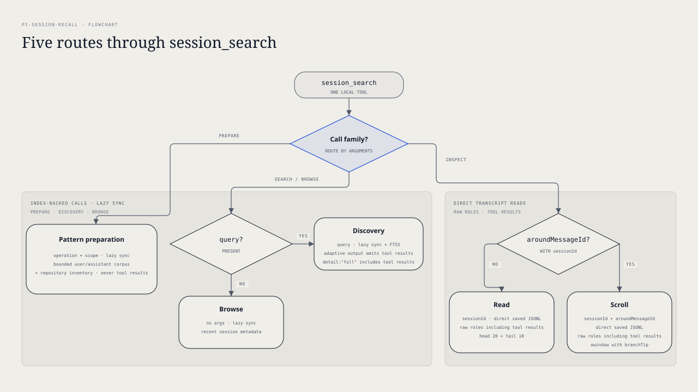

# `@henryqw/pi-session-recall`

Search past Pi sessions locally to find earlier decisions and context. The extension does not inject saved transcripts on every turn.

Its schema, descriptions, and guideline still add prompt cost while the tool is active. Returned content enters active model context.

## Install

```bash
pi install npm:@henryqw/pi-session-recall
```

This package requires Pi 1.3.0 or later in the 1.x series and Node.js 22.19.0 or later.

## Use

Ask the agent to search with distinctive keywords, for example:

```json
{ "query": "database migration rollback" }
```

Discovery returns ranked metadata and snippets. Use a result's `path` and `matchMessageId` to scroll to the relevant messages.

| Surface | Type | Purpose |
| --- | --- | --- |
| `session_search` | tool | Agent tool to browse, search, read, scroll, or prepare a bounded pattern-mining corpus. |
| `/skill:pi-session-pattern-miner` | skill | Agent workflow, invoked by a user, to find repeated work and choose the smallest useful automation. |

The tool supports these modes. Agents use `session_search`; users can invoke the skill with `/skill:pi-session-pattern-miner`.

| Mode | Call | Result |
| --- | --- | --- |
| Pattern preparation | `operation:"prepare-pattern-miner"` + `scope:"repository"` or `scope:"all"` | Up to ten recent lineage-unique sessions plus repository inventory. `limit` defaults to 10 and is clamped to [1,10]. Repository scope includes exact and descendant `cwd` values, filters before the limit, and excludes the current session file. |
| Discovery | `query` | BM25-ranked metadata and snippets. Each result includes `path` and `matchMessageId` for a follow-up scroll. Start with keywords. Then narrow the query before you scroll. `limit` defaults to 3 and is clamped to [1,10]. |
| Scroll | `sessionId` + `aroundMessageId` | Raw message roles, including tool results, within ±`window` ([1,20], default 5) of the anchor on the selected branch. To scroll, anchor again on the last or first message ID. Across forks, pass the `branchTip` of the previous response. `aroundMessageId` must be on that branch. |
| Read | `sessionId` | Raw message roles, including tool results, from the session. Large sessions return head 20 + tail 10. Oversized content is bounded to 50k characters and marked with `contentTruncated`. |
| Browse | no args | Recent sessions with path, name, cwd, started date, and preview. `limit` defaults to 3 and is clamped to [1,10]. |

BM25 is a text-ranking method. Discovery returns index metadata. READ and SCROLL retrieve messages from saved session files.

To scroll directly to a discovery hit, pass its `path` and `matchMessageId`:

```json
{
  "sessionId": "<result path>",
  "aroundMessageId": "<result matchMessageId>",
  "window": 10
}
```

This returns up to ten messages before and after the anchor on the selected branch.

Start pattern mining with one preparation call:

```json
{
  "operation": "prepare-pattern-miner",
  "scope": "repository",
  "limit": 10
}
```

Use `scope:"all"` for cross-repository work. It still returns the corpus when repository inventory is unavailable.

In the interactive TUI, the collapsed tool block shows the last five visual lines and the earlier-line count. Press `Ctrl+O` to expand the full bounded response. The model always receives the complete tool result.

### Programmatic output

`session_search` declares an output schema. Programmatic callers, such as Pi `codemode` scripts, receive the result as a structured value instead of text. The model receives the same JSON, including `mode`, `contentTruncated`, `syncWarning`, and the 50,000-character limit. The `mode` field selects one schema variant.

Failures produce tool errors, not JSON that indicates success. The model sees an error result. Codemode scripts reject with the error message. Rejected session paths and scroll identifiers cannot increase an error message beyond the same 50,000-character limit.

These failures include invalid or conflicting arguments. A `sessionId` that names a missing file or a file outside the Pi sessions directory also causes failure. Other failures include an unknown scroll anchor, session files over 32 MiB, failed required repository inventory, and cancelled preparation. Results whose metadata alone exceeds the output limit also cause failure.

The tool keeps Pi's default `direct` exposure. While the tool is active, Pi declares it to the model, and scripts can call it. The tool has a read-only annotation. It writes only its own derived index. This package does not enable codemode.

### Pattern-miner skill

Invoke `/skill:pi-session-pattern-miner` to find repeated workflows in past sessions. The skill makes exactly one preparation call before interpretation.

It treats one lineage as one source and requires two independent examples before it recommends automation. A requested topic gets a focused confirmation search even when the prepared sample does not contain it.

The skill groups related examples. It then checks the current package manifests, scripts, skills, and instructions for each candidate. It makes no recommendation if it cannot check them safely.

### Repository inventory

Repository inventory contains discovery hints. It never proves that a file owns a workflow. It does not verify the current worktree.

Package scripts, executable paths, and instruction paths come from stage-0 entries in the Git index. Package content comes from indexed blobs. Git reads the objects locally in one check batch and one content batch. Inventory disables lazy object fetching and replacement refs. Inventory never opens working-tree package paths.

Executables need index mode `100755`. Instructions need a recognized name and a regular-file index mode. Skills come from Pi's effective command registry. Their canonical source paths must stay inside the repository.

Available inventory includes this provenance:

```json
{
  "packageScripts": "git-index",
  "executableScripts": "git-index",
  "agentInstructions": "git-index",
  "skills": "pi-effective-registry"
}
```

It also sets `worktreeVerified:false`. Staged additions, changes, and deletions affect the Git-index collections. Unstaged changes, deletions, mode changes, symlinks, and untracked files do not affect those collections. Skills come from Pi's effective registry and can include untracked files.

Inspect the current files for each candidate before you assign ownership. Make no recommendation if you cannot safely check those files.

## Flow



Search makes no model calls.

### Query and index

- Discovery trims the query. Then it truncates the query to 512 characters before it finds matches. Discovery ignores text after that limit.
- Prefer distinctive identifiers, package names, issue numbers, or uncommon terms. Use quoted phrases only when you know the exact wording.
- The FTS5 trigram index uses AND for multiple words by default. Use `OR` for breadth, quoted phrases for exact matches, and `NOT` to exclude. Wildcards help only with stems of three or more characters.
- The extension indexes only user and assistant text. You cannot search thinking blocks or tool output.
- For message text over the 20,000-character indexing limit, the extension indexes only the first and last regions. It omits the middle. Phrases and `NEAR` cannot cross those regions, but ordinary AND terms can.
- `sessionId` must be a `.jsonl` file under the Pi sessions directory.

### Context and sync

Discovery excludes the current session file when its path is available. Forked sessions collapse into their parent when both match.

Before browse, discovery, or pattern preparation, the extension lazily syncs the index from the session tree. Pattern preparation reports `sync.walkComplete`, `sync.backlogRemaining`, and `sync.complete`. `sync.complete` is true only after a complete walk with no backlog.

### Retrieval safety

Discovery returns short snippets from indexed user and assistant transcript text. Use a result's `path` and `matchMessageId` with SCROLL for targeted context. READ and SCROLL retrieve raw messages, including tool-result messages when present.

Pattern preparation returns only non-empty user and assistant text. It never returns thinking blocks or tool-result content. When it cannot read a source, it keeps the citation and lineage metadata.

Historical tool output may contain secrets or other sensitive data. Raw retrieval places that output in active model context.

## State and storage

The extension keeps its derived SQLite search index at `~/.pi/agent/config/pi-session-recall/index.db`. To build the index again from your session files, delete this derived state. You do not need migration or recovery tools.

The extension reads the index and transcripts locally. It reads transcripts in place. Returned content follows the data path of your configured model provider.

## Limits and recovery

Lazy index sync can fail during the walk of the session tree. Results still come from the current index and can be partly updated or stale. Files found before the failure can have new content. Rows for files that the walk did not reach stay stale.

- A partial walk returns top-level `syncWarning`: `{kind:"incomplete-walk"}`. In that case, the extension never purges indexed paths that the walk did not see.
- A total sync failure returns top-level `syncWarning`: `{kind:"sync-failed", error}` with the capped failure message.
- The extension omits the warning after a completed sync.

The extension never indexes session directories whose encoded path starts with `--tmp-` or `--private-tmp-`. These sessions run from `/tmp` or `/private/tmp`.

The extension does not index or retrieve content from session files over 32 MiB. Discovery cannot find new files of this size. READ and SCROLL return an explicit size error. Discovery returns indexed metadata even when a source file changes afterward.

Pattern preparation runs one sync pass. A positive backlog or incomplete walk limits the sample and sets `sync.complete:false`. A total sync or required repository-inventory failure returns an explicit tool error.

Repository scope fails outside Git or when repository inventory fails. All scope still returns its corpus when Git-root lookup exits nonzero (`inventory.available:false`, `reason:"not-a-git-repository"`). It also returns its corpus when inventory fails after root resolution (`reason:"inventory-failed"`).

Preparation fails, even with all scope, if working directory resolution fails or Git cannot start. It also fails if root lookup overflows or produces invalid output or unexpected stderr. Cancellation also causes preparation to fail. These failures do not return unavailable inventory.

Preparation rejects `query`, session cursors, or `window` in the same call. It also rejects `scope` without the operation.

Preparation output stays within 50,000 serialized characters. Inventory uses at most 10,000 characters. Its `omittedCounts` report only omitted collection entries, and `inventory.truncated` reports those omissions.

Inventory fails if the Git root output exceeds 4 KiB or the raw index listing exceeds 8 MiB. It also fails on malformed index data, invalid UTF-8, conflict entries, or unsupported package modes. Git errors, unexpected Git stderr, or stream overflow beyond the limit also cause failure.

Inventory accepts at most 512 package manifests. Each indexed manifest can be at most 1 MiB. Their declared sizes can total at most 16 MiB. One bounded batch checks all blob sizes before one bounded batch reads their content. Inventory checks blob order, type, size, UTF-8, and exact output framing before it parses manifest data.

Session and top-level `contentTruncated` report transcript budget trimming only. Session `truncated` reports omitted middle messages.

### Rollback

To return to the older 2.1.1 behavior, pin that release:

```bash
pi install npm:@henryqw/pi-session-recall@2.1.1
```

You do not need an index migration or cleanup.
