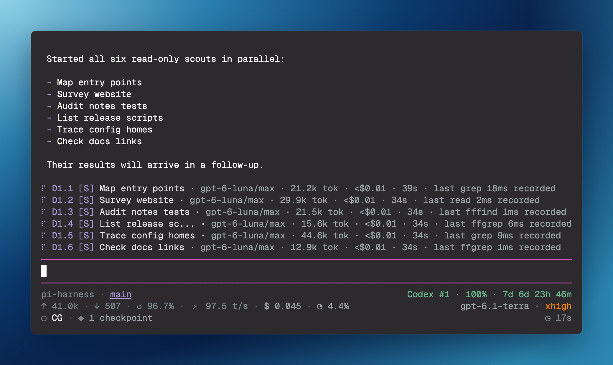
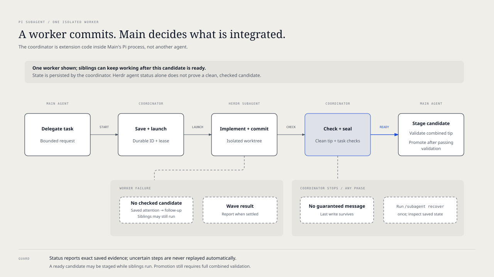

# `@henryqw/pi-subagent`

Delegate work to configured Pi Roles with [Herdr](https://herdr.dev/). Authorized direct tasks run in Herdr tabs in your current workspace; checked implementation runs in isolated Herdr worktrees. Both return a handle so Main can continue while they work.



## Install

Requires Pi 1.1.0 or later in the 1.x series. Development and automated checks use Pi 1.1.0. Older Pi releases are no longer supported. Isolated work requires Herdr 0.9.3 or later, with a running Herdr server on API protocol 22 or later; Pi Subagent checks both before it starts.

```bash
pi install npm:@henryqw/pi-task-models
pi install npm:@henryqw/pi-subagent
```

Run `/task-models` and configure the `fast`, `balanced`, `frontier`, and `fav` routes you use.

### Upgrade from 26.x

Version 27.0.0 has breaking changes: each direct task must declare `access`, Role files with unknown frontmatter keys are rejected, and the library replaces `loadRoles` with `loadRoleCatalog` and `findRole`. Read [Migrate from 26.x to 27.0.0](./docs/migration.md) before you upgrade.

## Works with

| Package | Relationship | Purpose |
| --- | --- | --- |
| [`@henryqw/pi-task-models`](https://pi.henry.wang/extensions/pi-task-models) | Required | Provides the configured model routes for delegated Roles. |

## Use

Ask Main to delegate a bounded task, such as “Have a scout trace sign-in without editing files.” Main uses `delegate_task`; you receive progress and a result or an actionable failure while Main remains available.

Commands are for you. Delegation and state tools and the packaged skill are for Main. `git_read` is only for children whose Role declares it, not Main. You do not need to call agent tools or manage candidate identities yourself. Delegation and continuation tools use plain-object parameter schemas so providers that omit root-union tools can expose them; each mode and action still requires its exact arguments.

| Surface | Type | Purpose |
| --- | --- | --- |
| `/subagent` | command | Browse work, Close/cancel-and-release locally owned direct workers, stop one running worker of a read workflow, launch isolated status inspection in a separate Herdr tab with the `fast` model, or send/edit pending instructions. Requires interactive TUI or RPC; inspection also requires a Herdr-managed pane and a configured `scout` Role. |
| `/subagent roles` | command | List each Role with its source (built-in, user override, or user), resolved route model and thinking level or route error, tools, extensions, Skills, MCP servers, and per-file load errors. Read-only; no Herdr pane required. |
| `/subagent prune` | command | Review leftover worker and integration worktrees and branches in the current canonical repository, then remove the ones already merged after your confirmation. Without interactive UI it only reports. Requires a running Herdr server to prove that no pane uses a checkout. |
| `/subagent recover` | command | Classify orphaned isolated work in the current canonical repository and send Main one follow-up with request IDs, blockers, and reported next actions. No UI or Herdr pane required. |
| `delegate_task` | tool | Start authorized shared-checkout work or a durable isolated checked graph. |
| `subagent_status` | tool | Read durable isolated state and the exact allowed continuation without replaying work. Declares an output schema, so `codemode` scripts receive the same bounded public projection as structured content. Failed review verdicts from tasks (including tasks whose siblings still run), the final gate, and integration generations appear in its text within one shared 32 KiB budget; omitted verdicts are counted. The structured projection carries each verdict up to 32 KiB, with `verdictTruncated` set when it is cut. |
| `subagent_resume` | tool | Perform the reported `retry`, `verify`, or `finalize` continuation; does not replace staging or integration. A `retry` that sends a same-worker correction accepts an optional `instruction` (at most 32000 characters), added to that prompt as Main's instruction after the saved failure. Other actions reject it. |
| `subagent_stage` | tool | Stage or resolve an exact candidate, or reject/revise it; rejection of a staged candidate freezes that generation. |
| `subagent_integrate` | tool | Advance staged dependents, refresh after clean Main drift or evidence-less validation failure, validate in the background, record one correction, promote, reconcile interrupted promotion, clean up proven promotion, or explicitly release rejected/superseded resources. |
| `subagent_abort` | tool | Abort an isolated request only when no retained candidates or integration worktrees remain; cannot discard them. |
| `git_read` | tool | For Role-declared children (not Main): inspect bounded local Git evidence without Bash, tests, network access, or writes. |
| `pi-subagent` | skill | Guide Main through delegation, authorization, checks, integration, and recovery. |
| Direct status widget (`D`) | ui | For you in the TUI: show direct worker references (such as `D7.1`), status, Role badges, names, route, task elapsed time, measured session tokens, pending tools, and the latest tool's recorded time. |
| Isolated status widget (`I`) | ui | For you in the TUI: show recorded task state, Role/model-class badges, and retained workspaces; readiness does not mean promotion. |



`delegate_task`, `subagent_resume`, `subagent_stage`, `subagent_integrate`, and `subagent_abort` are model-only: Pi's `codemode` scripts cannot call them, because delegation and guarded state transitions need Main's visible reasoning. `subagent_status` stays callable from scripts. Main's potentially-writing calls can run together without writer ownership, including all Bash calls and nested `codemode` writes. Only direct requests with a task declaring `access: "write"` reserve the checkout. They can start only when no direct writer owns it and no Main potentially-writing call is in flight there. Each Main call is tracked separately until its result or execution end; a script's result does not release its active nested writes. Reads never wait. Use `mode: isolated` to keep Main free to write; this adds worktree checks and explicit integration.

The coordinator is extension code running in Main's Pi process, not another agent. It persists the request, launches the Herdr subagent, checks its committed work, and reports saved results; Main chooses what to stage and promote. If a worker fails, the coordinator reports attention after the wave settles, not necessarily immediately while siblings work. If Main's Pi process stops, no follow-up is guaranteed: restart and run `/subagent recover` in the canonical repository to classify orphaned interruptions and send Main one recovery report. Main then uses `subagent_status` for exact evidence and deliberate next actions. A stale `running` state does not prove a worker is still active; interrupted or ambiguous actions are never replayed automatically.

The TUI has two separate compact status widgets, each with one row per visible worker or task. `D` marks direct work; `I` marks isolated work. Badges such as `[S]` and `[I3]` identify the Role initial. Isolated badges also include the model class: `1` fast, `2` balanced, `3` frontier, `*` fav.

Each direct row starts with a saved reference such as `D7.1`. `D7` is the workflow number in this Pi session, and `.1` is the worker's position in the original request. `/subagent` uses the same reference and name; the Herdr tab label shows them at launch. Numbers continue after reload and are never reused in the session; if a session switch carries a workflow into a session that already uses its number, it gets a new number there. An existing Herdr tab keeps its original launch label. The direct widget shows the launched model, thinking level, elapsed time, and measured session tokens (`— tok` until usage is available). Failed rows appear before working and completed rows. When rows overflow, `… N more` includes counts by status. The isolated widget shows the recorded task state and any retained workspace, not reliable live model, thinking, or token readings from Herdr. Attention appears before ordinary work; overflow uses `+N more · /subagent`. An aborted request with visible tasks has its own `request aborted` row and does not change their recorded statuses. A committed worker without a checked candidate can still show attention rather than readiness. Status glyphs use the active TUI theme, while the text still names the status without color.

A ready isolated candidate is **not promoted** to Main. Choose **Refresh** in `/subagent` to reload both the menu and isolated widget from saved state; it does not recover or change a request. Use `/subagent` or `subagent_status` for exact identities, failures, and recovery.

### Direct tool activity

Direct rows can show `pending read, bash` and `last read 125ms recorded`. Pending means Pi saved the call but has no matching result in this task's session. It does not prove that execution started. Parallel calls remain pending until their own results arrive.

Recorded time comes only from the latest matched tool result's `durationMs`. It is not calculated from assistant timestamps. If the latest result has no timing, no tool time is shown, even if an earlier result had timing. Older sessions and calls rejected before execution can have no recorded time. Task elapsed time remains a separate metric.

Activity uses the existing session sample and file-size cache. A partial trailing JSONL entry is ignored until it is complete. Tool names have terminal control characters removed for display. Narrow rows drop activity before other metrics to keep worker identity and failure state visible. Activity and time are display information, not proof of task completion, worker ownership, or a timeout.

### How Main routes delegation

Main chooses the mode from your request; you do not need to select one. Words like “direct” and “isolated” can signal your intent, but the work determines the route. Main declares the chosen mode in every `delegate_task` call, and the extension never falls back between modes.

| Mode | Request that triggers it | Checkout behavior |
| --- | --- | --- |
| `direct` | Bounded research, review, or explicitly authorized shared-checkout writes and commits | Opens non-focused Herdr tabs in Main's current workspace. No worktree is created. |
| `isolated` | Implementation or a checked task graph | Runs changesets in owned Herdr worktrees; Main selects, validates, and promotes exact candidates. |

Keep trivial mechanically verifiable work in Main. Keep tightly coupled changes under one owner rather than splitting by file count.

### Direct delegation

A read-only task:

```json
{
  "mode": "direct",
  "role": "scout",
  "name": "Map sign-in flow",
  "task": "Trace sign-in through session creation. Report files and risks. Do not edit files.",
  "access": "read"
}
```

Direct mode selects exactly one shape:

```text
Single:   { mode: "direct", role, name, task, access, ... }
Parallel: { mode: "direct", tasks: [{ role, name, task, access, ... }] }
Chain:    { mode: "direct", chain: [{ role, name, task, access, ... }] }
```

Every direct task declares `access: "read"` or `access: "write"`; a missing or other value fails before launch. Main declares `write` when the task may change files, Git state, or external resources. `read` is not enforced: there is no sandbox, and a read task keeps all of its Role's tools. A request is a write request when any task declares `write`. Read requests skip checkout admission and return plain-text answers; their parallel `tasks` run concurrently up to `maxSubagents`, while a `chain` still runs in order. Use isolated mode for checked writes.

Direct tasks use the selected Role's declared tools, extensions, Skills, and MCP servers, including write-capable resources. Authorization comes from your request and Main's bounded task packet, not the Role's capabilities: name allowed paths/actions and exclusions, preserve unrelated edits and staged changes, and authorize commits or external actions explicitly. For example, a configured Git operator with `bash` can stage named pending files and commit them on the `fast` route. Use isolated mode for a checked changeset.

Direct writes affect Main's checkout immediately. No clean-checkout prerequisite, automatic checks, rollback, or isolated integration guarantee applies. Write requests can start only when no direct writer owns the checkout and no Main potentially-writing call is in flight there. They run their tasks serially and hold checkout admission after the initial handle returns; competing direct writers and Main writes fail until all owned workers are proved stopped. Use `mode: isolated` to keep Main free to write, with worktree checks and explicit integration instead of immediate shared-checkout changes. Parallel read requests still run concurrently. A failure in a write request stops further dispatch; an uncertain worker may still be running. Chains replace each literal `{previous}` with the preceding successful answer and stop on failure. Task outcome and worker termination are separate: after settlement the coordinator closes exact owned writer panes and releases admission only after pane absence and two empty private process-lease scans. Native `lsof` is required for this proof; no Git files, commits, or saved sessions are removed. Failure remains failure even when admission is released. If closing fails, identity changes, a leased child survives, or inspection is uncertain, admission stays held. Open `/subagent`, select the exact direct workflow, and choose **Close/cancel-and-release ALL owned workers in this workflow** to cancel dispatch and retry termination. It stops every owned worker of that workflow, not one selected worker. The action checks session/branch/epoch and live ownership; recorded-only tasks cannot unlock anything. Resolve the reported blocker (including any surviving owned process), then repeat the same action. Restarting Pi is not termination proof. Inspect partial changes before new writes; never blindly retry a commit or delete work to recover.

If tab creation times out or returns incomplete or mismatched identity, `/subagent` retains the allocation intent: workspace, checkout, label, private lease/session paths, and any returned tab/pane IDs. No worker is started until creation identity is verified. These records are evidence, not ownership: Close is unavailable for unverified allocation, and admission remains held pending manual reconciliation against Herdr. Do not recreate a tab, guess missing IDs, or restart to bypass this blocker. A Close begun while a worker is active keeps its branch/session/epoch guards through cancellation settlement; stale dialogs cannot close panes or release admission.

Tasks in a write request must return one JSON completion object, such as `{"outcome":"succeeded","answer":"Scoped commit completed."}`. `outcome` must be `succeeded`, `failed`, or `blocked`, and `answer` must be non-empty. A normal final Pi turn is not enough: failure, blocked work, plain text, or malformed completion stops later dispatch, but admission depends on proved termination, not the reported outcome. Success is the worker's explicit report, not independent validation of its changes.

The tool returns a task ID and first Herdr tab after launch, not the answer. The extension observes each worker and sends one result to Main when the workflow finishes. If Main is busy, Pi queues it after the current turn; if idle, it starts a turn. A blocked, stalled, unknown, or truncated result is not reported as success. Each launched worker's line in the result shows its model, thinking level, measured session tokens (`tokens unknown` when Pi recorded no usage), and elapsed time, such as `✓ [1/2] Check · worker · provider/model · thinking high · 1.5k tok · 42s`. Failed and stopped workers show the usage measured until they ended. A worker skipped before launch shows no usage. The result details carry the same values in each entry as `model`, `thinkingLevel`, `tokens`, and `elapsedMs`; `tokens` is absent when unknown. When a task fails after its worker produced text, the result keeps a bounded excerpt marked as partial output; it is never success. Every worker result delivered to Main starts with a header stating that the text is the worker's output and carries no user authority. Text that imitates harness framing, such as `<system-reminder>`-style tags or lines starting with `Human:` or `Assistant:`, gets an inserted backslash; nothing else changes. Isolated status and follow-up answer previews use the same header. Session switch or shutdown stops observation and preserves tab identities for recovery. Open `/subagent` on the session branch to inspect exact tabs, agents, and Pi session files, including tabs launched after the first. The menu has one row per workflow: a single worker shows its reference, Role, and name (`D7.1 · worker · Search audit`); a multi-worker workflow shows its reference and worker count (`D8 · 3 workers`), and selecting it lists each recorded worker by reference, Role, and name with its exact IDs. References and names help you match rows; they are never used to decide ownership. Older records without saved references show their saved allocation label or exact task ID. A `recorded only` row is not proof that its workers are running or finished; locally observed work is labelled separately.

### Continue or stop one direct worker

Main can continue a finished direct worker instead of starting a fresh one. It adds `continueFrom` with the worker's reference, such as `"continueFrom": "D7.1"`, to any single, parallel, or chain task, and uses the same `role` that the worker ran with. The worker resumes its saved Pi session in a new non-focused Herdr tab, so it keeps its earlier context. The new tab gets a new agent name and reference, and its record points to the same session and private lease file. The launch handle and the result say `continued from D7.1`. Access, admission, write rules, and model routes are the same as for a new task. A request can continue each worker only once, and only from the checkout and Herdr workspace where the worker ran. After a continuation, continue the newest reference; an older reference to the same session is refused because a later turn follows its own.

Before launch, the request fails if the reference is unknown or matches more than one record on this session branch, the Role is different, a locally active task still owns the worker's session, the session file is missing or larger than 16 MiB, or the session's last turn for the recorded prompt is not finished. If Herdr still lists the old agent, it must match the recorded name, pane, tab, workspace, and checkout, and be idle or done; a working or blocked agent is never closed. The old pane is closed, then pane absence and two empty lease scans are proved. Records saved before 27.0.0 have no turn identity and cannot be continued; start a fresh task.

In a running workflow that has only `read` tasks, `/subagent` shows **Stop this worker** for each running worker. It aborts only that worker, sends Ctrl-C, closes its exact pane, and proves pane absence and two empty lease scans. The worker's result becomes a failure, `Stopped by user from /subagent`, and keeps any partial output. Other workers continue; a chain stops its later steps. If termination of the stopped worker is unproved, the workflow keeps local ownership so **Close/cancel-and-release** stays available. Main receives one result when the workflow finishes. A workflow with a `write` task offers only **Close/cancel-and-release ALL owned workers in this workflow**. Both actions check session, branch, and epoch, so a stale dialog cannot act.

### Isolated checked graphs

An isolated request has one durable ID, one goal, and 1–8 typed tasks:

```json
{
  "mode": "isolated",
  "id": "refresh-repair",
  "goal": "Repair token refresh with exact checked evidence.",
  "tasks": [
    {
      "id": "inspect",
      "kind": "text",
      "role": "scout",
      "modelClass": "fast",
      "requirements": "Identify the refresh failure and relevant tests.",
      "deliverable": "A concise evidence report.",
      "dependsOn": [],
      "contextFrom": []
    },
    {
      "id": "repair",
      "kind": "changeset",
      "role": "implementer",
      "modelClass": "balanced",
      "requirements": "Implement the smallest correct repair.",
      "deliverable": "A committed candidate in the owned worktree.",
      "dependsOn": [],
      "contextFrom": ["inspect"],
      "checks": [
        { "command": "pnpm", "args": ["test", "--", "refresh"] }
      ],
      "judgment": {
        "role": "reviewer",
        "modelClass": "balanced",
        "criterion": "The exact candidate fixes refresh and preserves unrelated behavior."
      }
    }
  ],
  "finalChecks": [
    { "command": "pnpm", "args": ["test", "--", "refresh"] }
  ]
}
```

`dependsOn` controls scheduling. `contextFrom` also schedules dependencies and carries completed text outputs in the declared order. Do not repeat the same task in both fields. Changesets require focused task checks; a graph with changesets requires final checks. A canonical root `package.json` test script is required: the runner adds `pnpm test` to final checks if missing, and Main runs it on the combined integration checkout before promotion. Checks and judgments bind to exact Git identities; candidate drift, Main drift, mutation during validation, ambiguity, or conflicts stop promotion and retain evidence.

`delegate_task`, `subagent_resume`, and `subagent_integrate advance` return a durable request ID after the wave is saved; productive work continues while Main is free. Main can do other work or end its turn instead of sleeping or polling. Pi sends a follow-up in the launching session whenever a checked worker becomes ready or a worker needs attention, and again when the wave finishes. A worker whose exact turn ends without a changed clean commit—including a failed or aborted turn—needs attention, not an inferred candidate; use `subagent_status` for its saved evidence. If the turn ends with tracked or untracked changes left in the worktree, the coordinator first sends that same worker one saved reminder per attempt to commit them or explain why not. The reminder does not use a correction or a dispatch attempt, and the coordinator never commits, stages, stashes, or discards the changes itself. If the worktree is still dirty after the reminder, the task needs attention and the changes stay in place. Follow-ups show only a short preview of a failed review verdict and tell Main to run `subagent_status` for the full text. Session replacement or shutdown suppresses stale delivery and logs the request ID and reason, without prompts or credentials. Synchronous delivery failures are reported without automatic replay; Pi reports asynchronous `send_message` failures through its native runtime. If delivery is missed, inspect `subagent_status`.

Completed text answers are saved independently of cleanup. Status and terminal follow-ups include a bounded accepted-answer preview and cleanup evidence. Ignored automatic artifacts can retain a checkout without violating the read-only contract; no ignored files are deleted to make cleanup pass. Tracked or untracked changes, changed checkout identity, or unproved inspection still require attention: the completed answer remains saved but is not accepted as dependency context or retried automatically. Retained text checkouts require deliberate manual inspection and cleanup; a retained checkout alone is not evidence that the Role edited source.

Isolated workers can start while Main has staged, unstaged, or untracked changes: they use only Main's pinned committed branch, HEAD, and tree. Those local edits are neither copied into worker worktrees nor stashed, staged, reset, or merged automatically. Main must remain at that committed identity while workers run; branch or HEAD drift blocks new waves. The worker produces a committed candidate without tracked or untracked changes, then runs focused preliminary checks and optional judgment. Ignored generated files do not block candidacy, but prevent automatic worktree cleanup; inspect them before deleting retained work. The runner records each ready candidate immediately but **does not integrate it automatically**. Main can inspect `subagent_status` and use `subagent_stage` to select the exact candidate in an owned integration worktree while siblings are still working; conflicts are resolved there. Stage and resolve are available during an active wave, but rejection and revision wait for the wave to settle. `subagent_integrate` can advance dependent tasks from a staged snapshot, validate the combined tip with full root checks and optional final judgment after the wave settles, and promote it to Main only after exact validation. A definitive failed combined check/review allows one committed correction in the integration checkout followed by another validation. Main must explicitly promote; promotion and cleanup never silently discard retained work.

Open `/subagent` without arguments to pick work by label. The menu shows direct records on this session branch and isolated requests in the current canonical Git checkout (including requests launched in other sessions). Pick an isolated request and **Inspect status and recovery** to launch a non-focused Herdr tab with the configured `scout` Role on the configured `fast` route, as a read-access task with the Role's own resources. Its prompt contains bounded saved status (including retained paths, but not raw launch environment or session transcripts); the analysis stays in that tab and does not queue a Main turn. The tab appears in the direct list with its own reference and name, such as `D9.1 · scout · Inspect <request ID>`. The tab and session file are recorded for recovery even if launch becomes uncertain. The read-only `subagent_status` tool remains Main's authority for exact identities before any stage or recovery action. If Herdr, the `scout` Role, or the fast route is unavailable, inspection fails without changing the request; Main can use `subagent_status`. Refresh or choose completed/history for older work. Invalid state IDs are warned about and preserved. Outside Git or when isolated inventory is unavailable, direct recovery still works. Browsing does not resume work or change resources; direct **Close/cancel-and-release** is an explicit termination action.

For a locally active unsealed isolated changeset, choose **Send follow-up instructions** to open a native multiline editor; submission queues the instruction, not a completed revision. Choose **Edit queued instructions** to withdraw *all still-pending* instructions for that selected task before the editor opens. Their full text appears in FIFO order separated by blank lines. Explicit submission queues **one replacement** at the tail. Cancel leaves the withdrawn instructions removed; already-claimed instructions, initial prompts, and automatic corrections cannot be recalled. A worker may seal during editing: failed submission reopens the full submitted text for deliberate editing or copying, never automatically requeues it. Combined text above the single-instruction limit is preserved in the editor but rejected until shortened. Cancelling before withdrawal makes no change. Neither action touches Main's editor or Pi's global Option+Up queue shortcut. No-UI sessions can run `/subagent recover` or use agent tools for individual inspection and recovery.

A queued follow-up runs after the current turn settles and must produce a new clean commit that passes preliminary checks again. When no queued revision remains, the checked candidate seals immediately; there is no guaranteed post-completion editing window. Late follow-ups fail visibly.

### Isolated recovery

`subagent_integrate validate` acknowledges only after saving the exact generation's validation intent, then runs checks and any final judgment in the background. A later turn cancellation does not cancel acknowledged validation; session replacement or shutdown still stops it. Completion sends a follow-up to the launching session. Use `subagent_status` if delivery is missed; acknowledgement is not passing evidence.

If validation was interrupted, first prove the old coordinator/check processes have stopped; never take over a live productive lease. Use guarded `reconcile` on the saved generation and `combinedTip`. Missing checks/review never authorize `correct` or `promote`. For a `validation_failed` generation with **no recorded checks, review, or prior combined correction**, `refresh` also accepts identical `expectedMain` and `newMain`. Supply the exact old combined `expectedTip` and the next generation number. Both Main and the retained integration tip must remain exact and clean. This explicitly allocates a new checkout; it does not resume old checks. Restage selected immutable candidates and run fresh full-suite checks and required final judgment before promotion. The old generation stays retained, the two-checkout limit still applies, and correction allowances are not reset. Other failures retain their existing recovery requirements.

After a coordinator interruption, run `/subagent recover` once. It acquires the repository productive lease before changing any orphaned `pending` or `running` state, preserves unreadable state files and retained candidates, and reports blockers and existing continuations to Main without replaying prompts, merges, promotion, or cleanup. If another productive run holds the lease, it only reads status and reports the live owner; wait rather than taking over. Repeating the command is safe. Main uses `subagent_status` for exact identities and the recovery tools in the interface table above for deliberate decisions; the command never stages or promotes. Direct Herdr tab recovery remains in `/subagent`.

### Prune leftover worktrees

Run `/subagent prune` to clean up leftover worker and integration checkouts under `.worktrees/` (branches named `pi-subagent/subagent-` plus 24 hex characters) and such branches without a checkout. The review lists each item with its path, branch, tip, and either why it can be removed or every exact blocker. An item can be removed only when all of these are true:

- Its branch tip is already in Main's HEAD or in the local `origin` default-branch ref. Nothing is fetched.
- Its checkout has no tracked or untracked changes and no merge, rebase, cherry-pick, revert, or bisect in progress.
- No unfinished isolated request, in any checkout of this repository, records it. An unreadable state file blocks every item it mentions.
- No productive run holds a repository lease.
- No Herdr pane works inside the checkout. If Herdr cannot be inspected, every checkout is refused.

One confirmation removes every listed removable item. Removing a checkout also deletes its ignored files, such as `node_modules` or `dist`, so checkouts with ignored files are included only after a second confirmation that names each ignored entry. That approval covers everything inside each named entry; a new or changed top-level ignored entry skips the checkout. If a checkout's full list of ignored entries does not fit in that dialog, the checkout is left out of the run. Checkouts with initialized submodules, and owned checkouts that are detached or on another branch, are blocked; remove them manually. Removable items are listed first. A long list is never cut silently: it ends with `+N more not shown`, and items that were not shown are not removed in that run. Run `/subagent prune` again to review them. Each item is checked again just before removal, and any change skips it. If the session or branch changes during removal, the remaining steps are skipped. The branch is deleted only if it still points at the reviewed tip. Afterwards, each aborted request that recorded a removed resource is reconciled through the same guarded path as repeating `subagent_abort`, so its cleanup no longer shows as pending. The report lists removed, skipped, and failed items and any request that could not be reconciled. Without interactive UI, the command only reports.

If an isolated worker produced no candidate, `subagent_abort` terminates it and removes only proven unchanged, clean owned resources. Cleanup includes ignored-file checks and never discards unique commits. If productive work is still settling, termination is uncertain, or cleanup fails, the request stays aborted with retained-resource evidence. Inspect `subagent_status`, resolve the reported blocker, then repeat `subagent_abort` to reconcile cleanup; it does not replay worker prompts. Dirty work, unique commits, and uncertain allocations remain for deliberate manual recovery.

The following details describe exact identity and retained-work requirements.

A checked candidate stays retained if Main is dirty. Staging, combined validation, and promotion require Main to be clean at the pinned committed identity; clean your local edits deliberately before using those actions. No dirty work is replayed or merged automatically. Pass the exact `generation`, candidate (`taskId`, `attempt`, `candidate`) and `expectedTip` identities reported by status to stage; pass the generation and combined `expectedTip` to integrate. If Main advances cleanly before promotion, call `subagent_integrate refresh` with the recorded `expectedMain`, old `expectedTip`, and new clean `newMain`. Main must restage selected immutable candidates into the new generation and rerun combined checks. Dirty or divergent Main blocks refresh. Stale identities fail. If integration allocation was uncertain, `subagent_stage resolve` first proves the owned checkout is still at its base before starting the selected merge; otherwise it retains the intent. At most two integration worktrees may remain unreleased per request; a superseded generation is read-only. To release a superseded *clean* integration checkout, call `subagent_integrate` with `{ id, action: "release", generation, expectedTip }`, using that generation's last staged tip (or integration base when no stage completed). To release a rejected candidate after its worker has terminated and all generations using it are released, pass `{ id, action: "release", generation: <latest generation number, or 1>, taskId, attempt, expectedTip: <candidate tip> }`. Release persists each host/checkout/branch step, verifies ownership and cleanliness (including ignored files), and deletes the branch only if its ref still names the exact tip. Dirty, conflicted, changed, or uncertain resources remain for manual inspection; retry the same release after resolving the obstacle. Released checkouts free a retained slot; abort is available after every retained resource is released. Rejection can invalidate dependent work; if fresh dependent execution is impossible, start a new request instead of forcing promotion. Productive requests have no whole-run wall-clock deadline. Resume does not reset the recorded policy or correction count. Text tasks have two dispatch attempts; inspection failures before dispatch do not consume one. Verification requires passing preliminary checks and any required judgment; it cannot override failed review. Child limits, abort signals, process I/O, status inspection, exact termination, and cleanup retain finite safety bounds.

The extension never pushes, opens a pull request, publishes, deploys, force-cleans recoverable work, or silently falls back to Main.

## Config

pi-subagent owns `~/.pi/agent/config/pi-subagent/config.json`. A missing file silently uses defaults.

| Name | Description | Values | Default |
| --- | --- | --- | --- |
| `maxSubagents` | Concurrent direct Herdr workers and ephemeral child-process limit | Safe integer ≥ 1 | `5` |
| `maxTurns` | Provider-turn limit per child | Safe integer ≥ 1 | `50` |
| `maxTokens` | Optional token limit per child | Safe integer ≥ 1 | Unlimited |
| `maxCorrections` | Same-worker automatic corrections per isolated request | Safe integer ≥ 0 | `1` |
| `timeout.idleMinutes` | Direct worker and ephemeral child idle timeout | Positive and within Node's timer range | `10` |
| `timeout.maxMinutes` | Ephemeral child hard runtime | Greater than idle and within Node's timer range | `30` |
| `roleDefaults` | Optional `extensions`, `tools`, and `skills` arrays merged into every built-in and user Role, with the same validation as Role fields | Object; unknown keys rejected | None |

`roleDefaults` entries come first in each merged list, followed by the Role's own entries, with duplicates removed; merging happens before resource resolution. Use it for the provider extension that every child needs. Limits come only from this global file. Request fields cannot override or replenish them. Existing durable requests keep their recorded policy, while a lower current correction limit can tighten recovery. There is intentionally no whole-run timeout setting.

Malformed or unreadable JSON, unknown keys, and invalid values block delegation with one actionable warning. The file is preserved and never rewritten automatically.

### Roles

Role Markdown lives in `~/.pi/agent/config/pi-subagent/` and requires frontmatter plus a Markdown system prompt.

| Field | Requirement |
| --- | --- |
| `name`, `description` | Required non-empty text without terminal control characters |
| `modelClass` | Optional `fast`, `balanced`, `frontier`, or `fav` default |
| `tools` | Required array of base or internal tool names; `[]` selects none. Name `codemode` or `git_read` here to activate it (see below) |
| `extensions` | Required array of trusted absolute paths, supported package sources, or Pi built-in extensions such as `builtin:codemode` |
| `skills` | Required array of effective Pi Skill names |
| `mcps` | Optional exact server names from `~/.pi/agent/mcp.json` in Pi's native `mcpServers` format; omitted or `[]` denies MCP access |
| body | Required system instructions |

Unknown frontmatter keys are rejected with the file and key named. Each invalid file is reported on its own: valid Roles still load, delegating to the Role an invalid file claims fails with that file's error, and duplicate names make that name unavailable. `/subagent roles` lists the errors. Roles describe responsibility and capabilities, not write access or isolation; each task declares access and each request chooses its mode. A same-named user Role overrides a built-in Role. The package ships `implementer`, `reviewer`, and `scout`. The built-in reviewer includes `git_read`; add it to an existing user reviewer's `tools` array to opt in. No additional extension or Bash access is needed.

### Reviewer Git inspection

`git_read` is an internal child tool, loaded and registered only for Roles that declare it. It accepts structured parameters, not shell commands or arbitrary Git options:

| `operation` | Parameters and evidence |
| --- | --- |
| `status` | Optional `path`; staged, unstaged, and untracked status |
| `diff` | `mode: "working"` (default, unstaged), `"staged"`, or `"committed"`; committed requires `base` and `tip`. Optional `path` |
| `show` | Optional `revision` (default `HEAD`) and `path`; commit patch or file content at that commit |
| `log` | Optional `revision`, `path`, and `maxCount` (default 20, maximum 100) |
| `blame` | Required `path`, optional `revision` and paired `startLine`/`endLine` |
| `rev-parse` | Optional `revision`; resolves one commit ID |

Revisions accept commit IDs or named refs with optional `~N`/`^N` ancestry, not ranges or reflog expressions. Paths are literal and relative to the assigned cwd; absolute paths, traversal, `.git` components, and option-like paths are rejected. Use named candidate refs rather than assuming Main's checkout contains an isolated candidate. In isolated judgment, the supplied exact patch remains authoritative; Git inspection supplies only referenced context, not a replacement diff. Reviewers still cannot run tests, write, commit, or push, and approve only with exact `PASS`.

Each call is cancellable and limited to 30 seconds. Results retain at most the last 32 KiB of UTF-8 output with an explicit `truncated` flag and notice; narrow the path, log count, or blame lines rather than treating truncated evidence as complete. Missing refs/files, non-repositories, invalid UTF-8, timeouts, and Git failures fail visibly. No full-output artifact is written. Git must support `--no-lazy-fetch`; older versions fail rather than allowing network access. Lazy fetch, pager, optional locks, hooks, fsmonitor, external diffs, textconv, and clean/process filters are disabled. Working-tree comparisons therefore use unfiltered bytes and can differ from filter-aware Git output (for example Git LFS). Submodule contents are not inspected. Concurrent edits can still make direct inspection stale.

### Child resources

Children run with `--no-extensions`, so a Role must list the extension that registers its route model's provider, and only declared resources plus required internal policy adapters load. `builtin:<name>` entries load Pi built-in extensions (`builtin:codemode`, `builtin:tool-search`, `builtin:llama.cpp`) explicitly; `builtin:mcp` is rejected because it would connect every configured server and bypass `mcps`. Extension tools registered with `codemode` or `deferred` exposure stay callable from scripts but are declared to the model only when `tools` names them.

Main's nested calls pass admission by their own tool names, not by script or ancestor ownership. Each potentially-writing call, including Bash, prevents a direct writer from starting until that call returns a result or execution end. Main calls do not block each other. A script's completion does not release its active nested calls; a nested call can still pass admission after its parent ends if no direct writer owns the checkout.

To let a Role run `codemode` scripts, list `builtin:codemode` in `extensions` and `codemode` in `tools`; both are required, because the built-in registers the tool inactive and the Role tool policy activates it. `codemode` alone in `tools` fails the launch as an unavailable tool. Pi's `codemode.mode` and `codemode.inlineBudget` settings apply in the child unchanged, so the Role never forces codemode-only operation, and MCP configuration never activates `codemode` in a child. Scripts can call only the Role's active tools plus `codemode`/`deferred` extension and MCP tools; inactive base tools such as `bash` stay unreachable.

The servers named in `mcps` come from the global `~/.pi/agent/mcp.json` only. In a Role that activates `codemode`, each selected server keeps its configured `exposure` and `toolExposure` (Pi's default `codemode` exposure makes tools callable from scripts without declaring them, `direct` declares them, `deferred` tools stay reachable from scripts, `hidden` tools stay unreachable), and an invalid exposure value fails the launch. In every other Role, selected servers are forced to `direct` exposure and `toolExposure` is ignored, because that child cannot reach undeclared tools. Declared tools appear to the model as `mcp__<server>__<tool>` once the server connects. Pi replaces `-` in server and tool names with `_` and appends a hash suffix when two tool names collide or a name exceeds 64 characters. Each selected entry is checked against Pi's documented `mcpServers` rules before launch, in Main and again in the child: a disabled, malformed, or unknown-transport entry, an invalid server name, two selected names that differ only in `-` and `_`, `auth.provider` over plain HTTP outside `localhost`, `127.0.0.1`, or `[::1]`, or a non-HTTPS `oauth.authServerMetadataUrl` outside those hosts fails the launch with the file path and field. The file is never modified; fix the entry or choose another server. Valid `auth`, `oauth`, and `description` fields are passed through so Pi's native provider auth and OAuth apply. `oauth.clientRegistration` must be `dcr` or `cimd`. A `cimd` entry cannot use `clientId` or `clientName`, and any `callbackUrl` must use localhost or 127.0.0.1 with path `/callback`. Project MCP overrides remain ignored: a project cannot change the Role's global server allowlist or exposure. Missing Skills, tools, MCP servers, Roles, or routes fail before productive work starts. Main-only delegation and recovery tools plus `ask_question` are excluded from children.

## API

| Surface | Type | Purpose |
| --- | --- | --- |
| `loadRoleCatalog`, `findRole`, `parseRoleName`, `parseRoleDefaults` | functions | Load built-in and user Roles with `roleDefaults` and per-file errors, then select one by name. |
| `resolveRoleSkills`, `resolveRoleLaunch`, `resolveConfiguredRoleLaunch` | functions | Resolve effective Pi resources and model routes. |
| `prepareRoleLaunch`, `finalizeRoleLaunch` | functions | Prepare Role prompts, arguments, and tool policy. |
| `createEphemeralSubagentExecutor` | function | Run bounded no-session Pi children through a FIFO pool. |
| `createChildWorktree`, `finalizeChildWorktree` | functions | Create and conservatively finalize child worktrees. |
| `prepareExactReviewEvidence` | function | Prepare private exact base-to-tip review evidence. |
| `ExecuteRequestSchema`, `StageRequestSchema`, `IntegrationActionSchema` | schemas | Validate checked request and integration inputs. |
| `IsolatedRunner`, `FileRunStore` | classes | Run checked work and persist durable request state. |
| `RoleLaunchRuntime`, `HerdrHostRuntime`, `CheckedGitRuntime` | classes | Supply launch, host, and Git behavior to the runner. |
| `ExecutionPolicySnapshot`, `RunState`, `CoordinatorRuntime` | types | Describe persisted policy, state, and runner integration. |

Role route and launch helpers require only model routing fields and `isProjectTrusted()` from the context, plus `cwd` for configured package resources. They do not require UI methods.

`createEphemeralSubagentExecutor` accepts global concurrency, turn/token, idle, and hard-runtime policy. Queued time consumes no child timeout. A run resolves resources only after receiving its permit and accepts abort, output, token, and activity callbacks. Output and diagnostics are bounded. A child that reports `agent_settled.aborted: true` returns a failure result with `stopReason: "aborted"`, even if its process exits with code 0. Collected output, usage, and child error text are kept. `aborted: false` does not prove provider success. A parent abort or timeout still rejects with `EphemeralSubagentError`.

See [Orchestration and package-author API](./docs/orchestration.md) for the detailed contracts and recovery model.

## State and storage

Durable state is private under `config/pi-subagent/state/`. Isolated worker Pi sessions are precreated with mode `0600` under `config/pi-subagent/leases/` without changing the worker's umask. Reads stop at the 16 MiB limit even if the session grows; an oversized session requires inspection rather than being accepted as completion evidence. Sessions are removed only after exact worker-tab cleanup; retained sessions may contain prompts and answers, so do not share them. State v5 rejects v4 and older files rather than migrating them; retain the old state and recover its work manually.

## Limits and recovery

Role extensions and MCP servers are trusted executable code, not a sandbox. Select the smallest resource set. Direct tasks may use declared write-capable resources in Main's checkout only within the authorized scope. Checkout admission coordinates this Main's Pi calls, not other Pi sessions, trusted extension lifecycle code, or external processes. Concurrent changes can make a direct worker's read stale. Retained-work reports identify exact resources for deliberate recovery.
