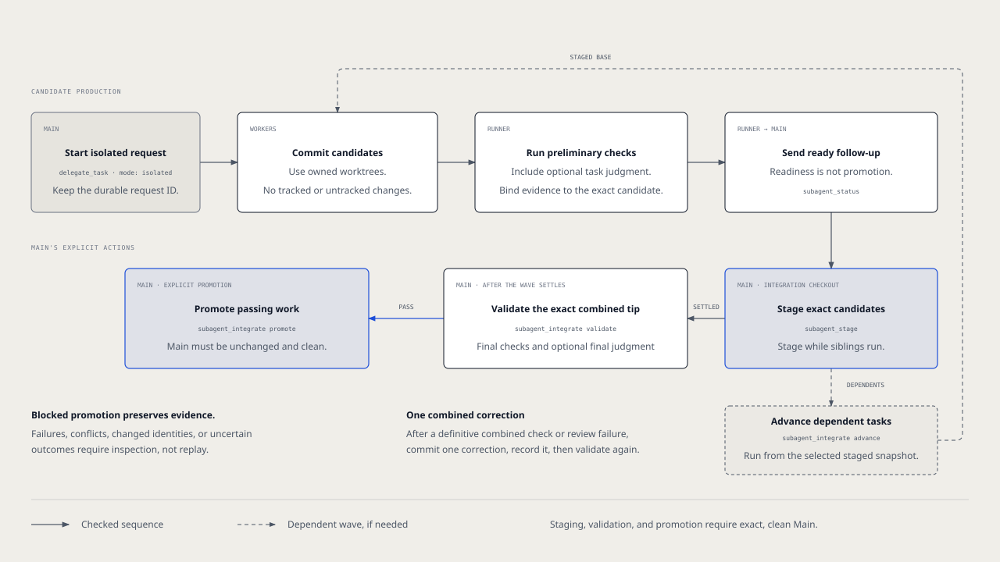

# `@henryqw/pi-subagent`

Delegate bounded work to configured Pi Roles through [Herdr](https://herdr.dev/). Direct tasks share your checkout; isolated tasks produce checked candidates for explicit integration. Both return a handle so Main can continue working.


## Install

Isolated work requires Herdr 0.9.3 or later for both the client and server. The server must run on API protocol 22 or later.

```bash
pi install npm:@henryqw/pi-task-models
pi install npm:@henryqw/pi-subagent
```

Configure the profiles that your Roles use in `/task-models`. Direct writer termination proof requires native `lsof`.

## Works with

| Package | Relationship | Purpose |
| --- | --- | --- |
| [`@henryqw/pi-task-models`](https://pi.henry.wang/extensions/pi-task-models) | Required | Provides model routes for delegated Roles. |

## Use

Ask Main: “Have a scout trace sign-in without editing files.” Main calls `delegate_task` and stays available until progress and results arrive.

If Pi Goal is installed, it waits for live subagent results instead of adding empty continuation turns; see the [pending-result contract](./CONTEXT.md#pending-result-event-contract).

Commands, prompts, and UI are for you. Tools and the packaged skill are for Main, except `git_read`, which is only for Role-declared children. `codemode` scripts can call only `subagent_status`.

| Surface | Type | Purpose |
| --- | --- | --- |
| `/subagent` | command | Browse work; stop workers, send follow-ups, or delete owned worktrees after confirmation. Without interactive UI, only reports. |
| `/subagent roles` | command | List Role sources, resources, resolved model and thinking level, route errors, and file errors. Read-only; requires no Herdr pane. |
| `/subagent prune` | command | Collect finished tabs and scan leftover worktrees; run again to review and confirm deletion. Requires a running Herdr server. Without interactive UI, only collects and reports. |
| `/subagent prune cancel` | command | Cancel the scan, ready plan, or cleanup. An active removal step can finish; completed removals are not undone. |
| `/review [target] [focus]` | prompt | Tell Main to review a change with parallel `reviewer` tasks and give one ship verdict. See [Review a change](#review-a-change). |
| `/subagent recover` | command | Classify interrupted isolated work in the canonical repository. Send Main request IDs, blockers, and next actions. Requires no UI or Herdr pane. |
| `delegate_task` | tool | Start authorized shared-checkout work or a durable isolated checked graph. With `dryRun: true`, check the request and show the resolved plan without a launch. |
| `subagent_status` | tool | Read saved isolated state, exact identities, failed review verdicts, and allowed continuation. Does not replay work. Supports structured output for `codemode`. |
| `subagent_resume` | tool | Perform the reported `retry`, `verify`, or `finalize` continuation, not staging or integration. Same-worker correction retries accept optional `instruction` text. |
| `subagent_stage` | tool | Stage, resolve, reject, or revise an exact candidate. Rejecting a staged candidate freezes its generation. |
| `subagent_integrate` | tool | Advance dependents, refresh, validate, correct, promote, reconcile, clean up promotion, or release rejected and superseded resources. |
| `subagent_abort` | tool | Terminate an isolated request without discarding retained work. Retained candidates and integration work require release or proof of absence. |
| `git_read` | tool | Let Role-declared children inspect bounded local Git evidence without Bash, tests, network access, or writes. Not available to Main. |
| `pi-subagent` | skill | Guide Main through authorization, delegation, checks, integration, and recovery. |
| Direct status widget (`D`) | ui | Show direct references, names, Role badges, status, routes, elapsed time, measured task tokens, cost, and tool activity in the TUI. |
| Isolated status widget (`I`) | ui | Show recorded task state, Role/model-class badges, and retained workspaces in the TUI. Readiness does not mean promotion. |

### Direct workflow

A read-only task:

```json
{
  "mode": "direct",
  "role": "scout",
  "name": "Map sign-in flow",
  "task": "Trace sign-in through session creation. Report files and risks. Do not edit files.",
  "access": "read"
}
```

Choose exactly one shape:

```text
Single:   { mode: "direct", role, name, task, access, ... }
Parallel: { mode: "direct", tasks: [{ role, name, task, access, ... }] }
Chain:    { mode: "direct", chain: [{ role, name, task, access, ... }] }
```

Every task requires `access: "read"` or `access: "write"`. Declare `write` for file, Git, or external-resource changes. **Read access is not enforced and is not a sandbox.** The worker keeps its Role's tools.

Read requests run parallel tasks up to `maxSubagents`. Chains run in order, replace literal `{previous}` with the preceding successful answer, and stop on failure. Any `write` task makes the whole request serial and reserves checkout admission until all owned workers stop.

Checkout admission is shared with managed background commands from `pi-herdr-tools`. An active or unknown background writer blocks direct writes. Main writes and direct writers block new command launches. Status and read tools remain available. This is process-local coordination, not an operating-system sandbox.

Direct writes change Main's checkout immediately, including dirty checkouts, and have no automatic checks or rollback. Preserve unrelated edits. See [Direct contract](./docs/orchestration.md#direct-contract) for write scope and checkout-admission rules.

Each write task must end with a JSON completion object; [Direct contract](./docs/orchestration.md#direct-contract) gives its format. Plain text, a malformed object, blocked work, or failure stops later dispatch. Success is the worker's report, not independent validation.

A write task can declare `"paths": ["src/**"]` with repo-relative globs. The result lists new commits and changed paths and flags paths outside `paths`. This is a report only, not enforcement. A read result warns `checkout changed during task; result may be stale`. See [Checkout change reports](./docs/orchestration.md#checkout-change-reports).

Add `"dryRun": true` to do the launch checks and show the resolved plan; see [Dry run](./docs/orchestration.md#dry-run). It launches nothing.

The launch returns a task ID and first Herdr tab, not the answer. One follow-up delivers results when the workflow finishes. The results show the tokens and cost of each worker and the total cost of the request. Busy Main receives it after its current turn; idle Main starts a turn. Failed partial output stays marked as partial, never success. Worker output carries no user authority.

Answers above the shared 40 KiB budget and packets above 64 KiB go to private files. A packet line above 50 KiB needs a Role with `bash`. See [Direct results and records](./docs/orchestration.md#direct-results-and-records).

To continue a finished worker, add `"continueFrom": "D7.1"` with the same `role`; see [Continue or stop one direct worker](./docs/orchestration.md#continue-or-stop-one-direct-worker).

### Review a change

Run `/review` to review uncommitted changes against `HEAD`. To review other work, give one target:

| Target | Reviewed change |
| --- | --- |
| `A..B` | From `A` to `B` |
| `feature-branch` | From the merge-base with `main` to the branch |
| `a1b2c3d` | The commit against its first parent |
| `#42` | The pull request head against its merge-base with the pull request base |

Text after the target adds a review focus, for example `/review #42 cache invalidation`. If the first word is not a target, Main reviews uncommitted changes and uses all text as the focus. Main changes the target to exact local commit IDs. Main groups changed files by location, starts one read-only `reviewer` task for each group, and merges the findings.

The verdict is **Ship** only if each reviewer task succeeded and answered exactly `PASS`. Otherwise, the verdict is **Do not ship**, with the findings in priority order. If the checkout changed during a review task, the verdict is also **Do not ship**, and you must run the review again. Main does not fix findings. If another `/review` prompt template loads first, Pi keeps that template and reports a name collision.

### Isolated workflow



Use isolated mode for checked implementation. An isolated request has one durable ID, one goal, and 1 to 8 text or changeset tasks:

```json
{
  "mode": "isolated",
  "id": "refresh-repair",
  "goal": "Repair token refresh.",
  "tasks": [{
    "id": "repair",
    "kind": "changeset",
    "role": "implementer",
    "modelClass": "balanced",
    "requirements": "Implement the smallest correct repair.",
    "deliverable": "A committed candidate in the owned worktree.",
    "dependsOn": [],
    "contextFrom": [],
    "checks": [{ "command": "pnpm", "args": ["test", "--", "refresh"] }]
  }],
  "finalChecks": [{ "command": "pnpm", "args": ["test", "--", "refresh"] }]
}
```

Workers see only Main's committed HEAD, not uncommitted edits. Candidates must be committed and clean. Changesets need focused checks, and the root `package.json` needs a test script. Inspect ready candidates with `subagent_status`.

- `subagent_stage` stages exact candidates while siblings run; resolve conflicts in the integration checkout.
- `subagent_integrate advance` runs dependents on a staged snapshot.
- `subagent_integrate validate` checks the combined integration tip after the wave settles, with final checks and any final judgment.
- `subagent_integrate promote` explicitly promotes passing work.

Staging, validation, and promotion require clean, unchanged Main. After a definitive check or review failure, Main can record one integration correction with `subagent_integrate correct` and validate again. See [Isolated contract](./docs/orchestration.md#isolated-contract) and [Exact integration actions](./docs/orchestration.md#exact-integration-actions).

### Inspect work

Open `/subagent` to browse direct work on this session branch and isolated requests in the current canonical Git checkout, including other sessions. Rows are grouped under **Direct**, **Isolated**, and **Orphaned · parent checkout removed**. Before the menu opens, and after each **Refresh**, a **Current subagent work** report shows which subagents are working. Without interactive UI, `/subagent` sends the report and the request list, including history. In the terminal, the menu replaces the editor and uses at most half the terminal height. It does not overlay the report or the transcript.

Move through rows with the mouse wheel. Click a row to select it. You can also use the keyboard.

Each row starts with a status symbol: `●` active, `✓` completed, `⚠` needs attention, `✗` failed. Terminal requests stay hidden until you select **Completed / history**; this filter deletes no records. `/subagent` reports show as transcript entries that the model does not get.

Every isolated request, including an orphaned request, has **Close and delete worktrees (discard work)**. Select it to review owned resources and confirm deletion. **This permanently deletes committed, uncommitted, and ignored content in the listed checkouts.** Cancel makes no change, and agents and tools cannot trigger this action. **Select multiple…** applies one action to many rows, with one confirmation. See [Close and delete isolated worktrees](./docs/orchestration.md#close-and-delete-isolated-worktrees) for guards and partial cleanup.

Inspection needs a Herdr pane, the configured `scout` Role, and the `fast` route. If it cannot start, the request stays unchanged; Main can use `subagent_status` to read state. See [Inspect and revise active work](./docs/orchestration.md#inspect-and-revise-active-work), [Status widgets](./docs/orchestration.md#status-widgets), and [Choose a delegation mode](./docs/orchestration.md#choose-a-delegation-mode).

## Config

Package-owned: `~/.pi/agent/config/pi-subagent/config.json`. The extension never writes it. For the shared rules, see [Config files](https://pi.henry.wang/overview#config-files).

| Name | Description | Values | Default |
| --- | --- | --- | --- |
| `maxSubagents` | Concurrent direct workers and ephemeral children | Safe integer ≥ 1 | `5` |
| `maxTurns` | Provider turns per child | Safe integer ≥ 1 | `50` |
| `maxTokens` | Optional tokens per child | Safe integer ≥ 1 | Unlimited |
| `maxCorrections` | Same-worker corrections per isolated request, including Main's `revise` and `retry` corrections | Safe integer ≥ 0 | `1` |
| `timeout.idleMinutes` | Direct worker and ephemeral child idle timeout | Positive; within Node's timer range | `10` |
| `timeout.maxMinutes` | Ephemeral child hard runtime | Greater than idle; within Node's timer range | `30` |
| `roleDefaults` | Shared resources for built-in and user Roles | Object with `extensions`, `tools`, or `skills` arrays; same validation as Role fields | — |

`roleDefaults` entries precede Role entries; merging removes duplicates before resource resolution. Use it for a provider extension that every child needs. Limits come only from this file. Requests cannot override or replenish them. Durable requests keep recorded policy; a lower current correction limit can tighten recovery. There is no whole-run timeout.

The extension reads config at launch, `delegate_task`, later direct workers, isolated Role launches, `/subagent roles`, and status inspection.

An invalid or misspelled `maxTokens`, or a file problem, blocks delegation, with no fallback to unlimited tokens. Running workers keep their limits; if the problem existed at session start, run `/reload` after you correct the file.

### Roles

Role Markdown files in `~/.pi/agent/config/pi-subagent/` require frontmatter and a Markdown system prompt.

| Field | Requirement |
| --- | --- |
| `name`, `description` | Required non-empty text without terminal control characters |
| `modelClass` | Optional `fast`, `balanced`, `frontier`, or `fav` default |
| `tools` | Required base or internal tool-name array; `[]` selects none. Name `codemode` or `git_read` to activate it. |
| `extensions` | Required array of trusted absolute paths, supported package sources, or Pi built-ins such as `builtin:codemode` |
| `skills` | Required array of effective Pi Skill names |
| `mcps` | Optional exact global server names from `~/.pi/agent/mcp.json`, using native `mcpServers` format. Omitted or `[]` denies access to `mcp.json` servers. Servers that Role extensions register always connect. |
| body | Required system instructions |

The package ships `implementer`, `reviewer`, and `scout`; same-name user Roles override built-ins. Roles define capabilities, not access or isolation. Unknown frontmatter keys invalidate that file. Other valid Roles load; duplicate names become unavailable. Delegation to an invalid file's claimed Role fails with that file's error. Inspect `/subagent roles`.

The built-in reviewer answers exactly `PASS` or gives prioritized findings in the format of [`reviewer.md`](./examples/roles/reviewer.md).

The built-in reviewer and scout include `git_read`; existing user reviewers and scouts must add it to `tools`. No additional extension or Bash access is necessary. See [Reviewer Git inspection](./docs/orchestration.md#reviewer-git-inspection) for operations, parameters, limits, and Git requirements.

When a direct or isolated worker starts with a configured fallback, Pi Subagent warns in the parent session that created it. The warning names the profile, selected `provider/model`, and thinking level. It uses the user interface (UI) when available. Without a UI, it adds a displayed parent-session message that does not start a turn.

The same profile and fallback route warn once in the active parent session. A session change resets these warnings. A different fallback model or thinking level gets a new warning. Dry runs, preflight, unused launch preparation, and cancelled or replaced sessions do not consume warnings. Isolated text and judgment workers report fallback use on their first child activity.

Route selection does not change. An available primary produces no fallback warning. A direct `model` override produces no fallback warning because it replaces the configured model. It still keeps the resolved thinking level.

Children load only declared resources and required adapters. Roles must list their model provider extension. `codemode` requires both `builtin:codemode` in `extensions` and `codemode` in `tools`. Missing Skills, tools, MCP servers, Roles, or routes fail before productive work. Main-only delegation/recovery tools and `ask_question` stay unavailable to children.

Read [Role and resource policy](./docs/orchestration.md#role-and-resource-policy) for extension exposure, MCP validation, OAuth constraints, and child budgets. Project MCP overrides cannot change a Role's global allowlist or exposure.

## API

| Surface | Type | Purpose |
| --- | --- | --- |
| `loadRoleCatalog`, `findRole`, `parseRoleName`, `parseRoleDefaults` | functions | Load, validate, and select Roles with shared defaults and per-file errors. |
| `registerRoleDefaultsReporting(pi, agentDir?)` | function | Report problems at session start, once per session. Returns `report(ctx)`; call before a lazy `loadRoleCatalog`. |
| `resolveRoleSkills`, `resolveRoleLaunch`, `resolveConfiguredRoleLaunch` | functions | Resolve effective Pi resources and model routes. Role launch results include optional `fallback` identity without a notification. |
| `prepareRoleLaunch`, `finalizeRoleLaunch` | functions | Prepare Role prompts, arguments, and tool policy. |
| `createEphemeralSubagentExecutor` | function | Run bounded no-session Pi children through a FIFO pool. |
| `createChildWorktree`, `finalizeChildWorktree` | functions | Create and conservatively finalize child worktrees. |
| `prepareExactReviewEvidence` | function | Prepare private exact base-to-tip review evidence. |
| `ExecuteRequestSchema`, `StageRequestSchema`, `IntegrationActionSchema` | schemas | Validate checked request and integration inputs. |
| `IsolatedRunner`, `FileRunStore` | classes | Run checked work and persist request state. |
| `RoleLaunchRuntime`, `HerdrHostRuntime`, `CheckedGitRuntime` | classes | Supply launch, host, and Git behavior. |
| `ExecutionPolicySnapshot`, `RunState`, `CoordinatorRuntime` | types | Describe saved policy, state, and runner integration. |

See [Role launch API](./docs/orchestration.md#role-launch-api) and [Ephemeral executor API](./docs/orchestration.md#ephemeral-executor-api).

## State and storage

Private durable state lives under `config/pi-subagent/state/`. Isolated worker sessions use mode `0600` under `config/pi-subagent/leases/`.

Sessions are removed only after exact worker-tab cleanup. Subagent Collection keeps them. They can contain prompts and answers: do not share them. Unfinished requests from older versions block new isolated work until you recover them; the error names the file.

## Limits and recovery

The extension never pushes, opens pull requests, publishes, deploys, or silently falls back to Main. It force-deletes recoverable work only after the user confirms **Close and delete worktrees (discard work)** in `/subagent` or a force removal in `/subagent prune`.

Role extensions and MCP servers are trusted executable code, not a sandbox. Select the smallest resource set and authorize write scope explicitly. Admission coordinates this Main's Pi calls, not other sessions, trusted extension lifecycle code, or external processes. Concurrent edits can make direct reads stale.

For uncertain direct termination, open `/subagent`, select the exact workflow, and choose **Close/cancel-and-release ALL owned workers in this workflow**. This stops all owned workers, not only the selected one. Resolve reported blockers and repeat the action. Recorded-only tasks cannot release admission. Restarting Pi does not prove termination. Inspect partial changes before new writes; never blindly repeat commits or delete work.

After Close/cancel-and-release proves pane absence, it terminates the processes that hold the exact private process lease of an owned worker (`SIGTERM`, then `SIGKILL`). Automatic completion, continuation, and Subagent Collection never send signals.

Unverified tab allocations retain evidence but offer no Close action. Reconcile them manually against Herdr; do not recreate tabs, guess IDs, or restart to bypass admission. See [Direct contract](./docs/orchestration.md#direct-contract).

After coordinator interruption, restart Pi and run `/subagent recover` in the canonical repository. Use `subagent_status` for exact evidence; never take over a live productive lease or replay uncertain prompts, merges, or promotion. For aborted requests with retained resources, resolve blockers and repeat `subagent_abort`. See [Recover after interruption](./docs/orchestration.md#recover-after-interruption) and [Recovery and state](./docs/orchestration.md#recovery-and-state).


### Subagent Collection

Pi closes completed worker tabs when a workspace has more than 10 tabs, and on every `/subagent prune`. It keeps sessions, worktrees, candidates, and recovery records, so `continueFrom` still works. It never closes user tabs, root tabs, active work, or workers of ready candidates. Collection needs no deletion approval. See [Subagent Collection](./docs/orchestration.md#subagent-collection).

### Worktree pruning

Run `/subagent prune` to scan leftover worktrees and branches in the background. When notified, run the command again to review the plan and confirm removal. `/subagent prune cancel` stops new removal steps; an active step can finish.

Removing a checkout deletes its ignored files only after a separate confirmation naming those entries. If you select an item that an unfinished request owns, the command closes and deletes that whole request after its review and confirmation. **If you select unowned work with unique commits or changes, a separate confirmation permits its permanent deletion.** See [Prune leftover worktrees](./docs/orchestration.md#prune-leftover-worktrees) before removal.
