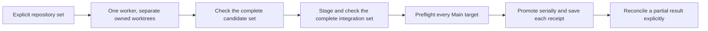

# Checked workspace tasks

Use one worker to change several explicitly selected Git repositories in a non-Git workspace. The worker receives an absolute worktree map. It does not need sibling-relative paths.



## Request

```json
{
  "mode": "isolated",
  "id": "change-contract",
  "goal": "Change the service and client together.",
  "repositories": { "service": "/work/app/service", "client": "/work/app/client" },
  "tasks": [{
    "id": "change", "kind": "changeset", "role": "implementer", "modelClass": "balanced",
    "requirements": "Change and test both sides of the contract.",
    "deliverable": "Clean committed candidates in both selected worktrees.",
    "dependsOn": [], "contextFrom": [],
    "inputs": { "contract": "/work/app/contract.txt" },
    "checks": [
      { "repository": "service", "command": "pnpm", "args": ["test"] },
      { "repository": "client", "command": "pnpm", "args": ["test"] }
    ]
  }],
  "finalChecks": [
    { "repository": "service", "command": "pnpm", "args": ["test"] },
    { "repository": "client", "command": "pnpm", "args": ["test"] }
  ]
}
```

Call from `/work/app`. Each repository must be a canonical direct child with its own `.git` directory. Select 1 to 8 repositories. Aliases, linked worktrees, nested repositories, Git environment overrides, and repositories with Git submodules are not supported.

Workspace mode supports exactly one changeset task. It rejects text tasks, dependencies, task judgment, and final judgment. It has no automatic correction, retry, refresh, or restaging. The existing single-repository graph remains unchanged when `repositories` is absent.

Every selected repository needs task checks and final checks. Select commands that test that repository. The complete final command list must contain at most 32 entries. Checks must leave the tracked and untracked state clean. If the committed root `package.json` has a test script, that script is pinned from the exact Main base commit. Dirty Main files do not change the pinned script. All task and final checks reject a changed pinned script, regardless of the command name, path, or arguments. Repositories without a root manifest or test script can use their native check commands.

`PI_SUBAGENT_REPOSITORIES` contains the absolute repository-to-worktree map as JSON, which is a structured text format. `PI_SUBAGENT_INPUTS` contains the input-name-to-copy map. Check commands receive both environment variables. Task checks use worker worktrees; final checks use integration worktrees. The complete repository set is checked before and after commands, including unchanged members.

## Root inputs

`inputs` selects up to 8 canonical regular files inside the workspace but outside every Git repository. Each file can contain at most 64 KiB. Directories and symlinks are rejected. Each request stores separate private read-only copies. A later request can select different inputs or new contents.

The worker gets copy paths, not permission to edit original inputs. Their content identities are checked with every complete-set inspection. A changed source or copy blocks validation and promotion. Inputs never become Git candidates and are never promoted or restored. This is not a sandbox: an authorized tool can bypass file permissions. A detected input change requires manual inspection.

## Integration and recovery

Use `subagent_workspace` from the workspace root. Workspace records use their own state version; they do not change existing single-repository records. `/subagent` does not list workspace requests. Existing prune checks protect their retained repository resources.

| Action | Required fields | Result |
| --- | --- | --- |
| `status` | `id` | Read saved state without mutations. |
| `stage` | `id`, `expected` | Select the complete checked candidate map from `candidates`. Create an integration worktree in every repository. |
| `validate` | `id`, `expected` | Check the complete integration map from `tips`. |
| `promote` | `id`, `expected` | Preflight every target, then promote the exact passing `tips` serially. |
| `reconcile` | `id` | Inspect interrupted stage or promotion intents without replay. |
| `abort` | `id` | Stop the exact task-wide worker and retain all Git work. |
| `cleanup` | `id` | Remove only fully promoted, clean, exactly owned resources. |

`expected` must include every repository and its exact branch, commit, index tree, and committed tree. Partial maps are rejected. Status retains per-repository candidates, stages, intents, and promotion receipts.

Dirty Main files are preserved. Worker execution can start from the committed Main identities while Main is dirty. Staging and promotion require all Main targets to be clean and unchanged. Each promotion receipt is saved before the next repository can move. All targets are checked again between promotions.

**Promotion is not atomic.** A later repository can fail after an earlier repository moved. No rollback is attempted. After an interrupted promotion, call `reconcile`. It compares each uncertain target with its saved endpoints. A target at the promoted endpoint gets a receipt; a target still at its base becomes pending. Then explicitly call `promote` with the complete `tips` to continue. No proven promotion is repeated. Any other Main state requires manual reconciliation.

A crash during allocation does not grant ownership. Uncertain allocations and worker prompts are retained and are never adopted or replayed automatically. A completed exact merge can be reconciled after manual conflict resolution. An unstarted merge or incomplete allocation needs manual inspection and a new request. Failed and aborted work is retained; automatic discard is not available.

Worker observation uses the request's saved `childMaxMs` maximum runtime and `childIdleMs` idle limit. Only complete Pi session messages renew the idle limit; the maximum runtime does not renew. When a limit expires, the runner saves prompt failure evidence and attempts exact worker termination with a separate safety budget. Unproved termination stays visible for recovery. Every repository worktree is retained, and uncertain prompts are not replayed. These are worker limits, not a deadline for the complete request.

An active `abort` can first report a busy lifecycle lock while cancellation settles. Inspect status and repeat `abort` after the active operation ends. Session replacement cancels local observation and suppresses stale delivery, but preserves saved recovery identities.

## Direct work

Direct requests can also supply the top-level `repositories` map. Each task uses the same selected set. A write request reserves the workspace and every selected checkout together until all exact owned workers are proved stopped. A conflict in one member refuses the whole reservation. The result labels each repository's change report or stale-read warning.

Direct selection rejects `paths` and `continueFrom`. Scope comes from the task packet. Root-file writes are not authorized by repository selection. Direct work has no checked integration, rollback, or sandbox. Other sessions and external processes are outside process-local admission.
