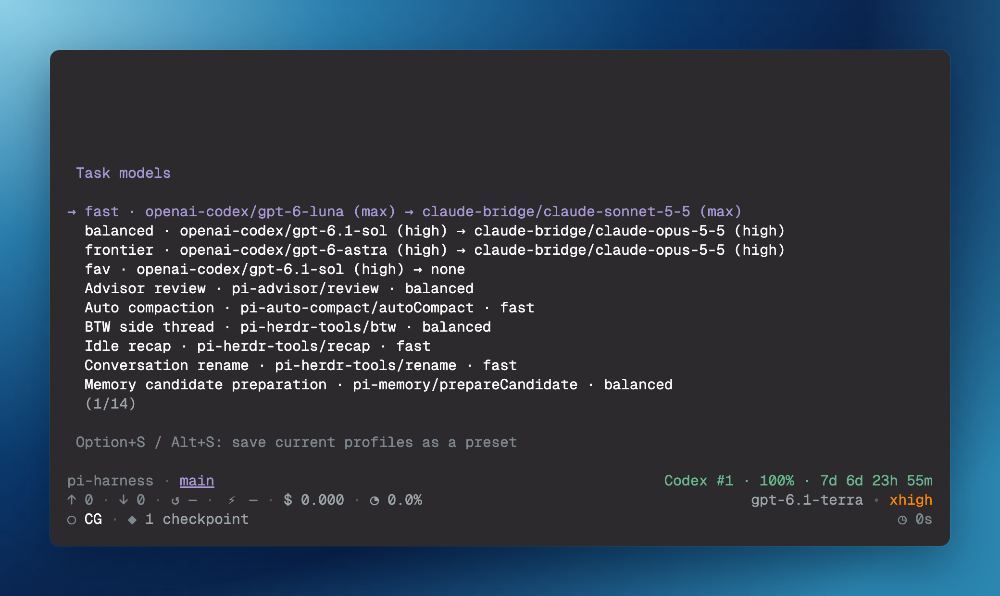
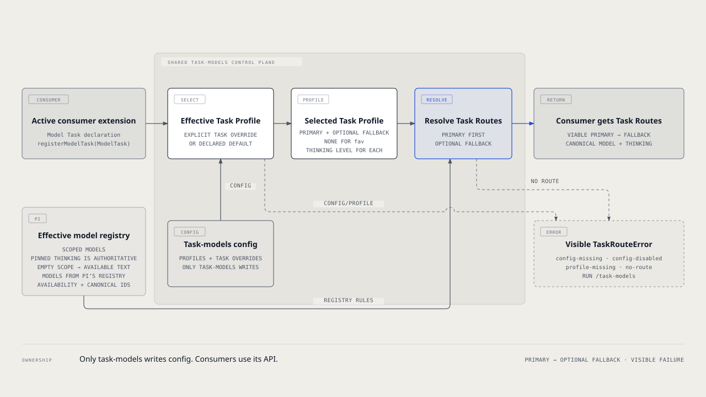

# `@henryqw/pi-task-models`

Configure shared Task Routes for the Task Profiles `fast`, `balanced`, `frontier`, and `fav`. A Task Route is one model and one thinking level. You configure the routes one time, and each extension keeps ownership of its Model Task and default.




## Install

This package requires Pi 1.1.0 or later in the 1.x series. Upgrade Pi before you install version 8.1 or later of this package.

```bash
pi install npm:@henryqw/pi-task-models
```

Run `/task-models` after installation. Configure each profile that your installed consumers require.

## Works with

| Package | Relationship | Purpose |
| --- | --- | --- |
| [`@henryqw/pi-auto-compact`](https://pi.henry.wang/extensions/pi-auto-compact) | Consumer | Its local compaction task defaults to `fast`. |
| [`@henryqw/pi-herdr-tools`](https://pi.henry.wang/extensions/pi-herdr-tools) | Consumer | Its side-thread and rename tasks default to `fast`. |
| [`@henryqw/pi-memory`](https://pi.henry.wang/extensions/pi-memory) | Consumer | Its local candidate-review task defaults to `balanced`. |
| [`@henryqw/pi-multi-codex`](https://pi.henry.wang/extensions/pi-multi-codex) | Improves | Numbered Codex slots become one route. |
| [`@henryqw/pi-prompt-creator`](https://pi.henry.wang/extensions/pi-prompt-creator) | Consumer | Its local prompt-drafting task defaults to `fast`. |
| [`@henryqw/pi-subagent`](https://pi.henry.wang/extensions/pi-subagent) | Consumer | Its local delegation task defaults to `fast`. Callers can declare their own task. |

## Use

Run `/task-models` to complete the first setup:

1. Select `fast`.
2. Choose a primary model from Pi's effective registry. Then choose its thinking level.
3. Choose a different fallback model and thinking level, or choose `None`.
4. Reopen `/task-models`. The `fast` row now shows the saved route instead of `not configured`.

| Surface | Type | Purpose |
| --- | --- | --- |
| `/task-models` | command | For people: configure shared profile routes and assign profiles to active consumer tasks. |
| `/task-models preset` | command | For people: choose a saved setup for any of `fast`, `balanced`, `frontier`, and `fav`. |
| Option+S / Alt+S in `/task-models` | shortcut | For people: save the current profile setup as a named preset in the interactive terminal. |
| Session start | ui | For people: when the shared config is missing, show a warning that points to `/task-models`. |

Repeat these steps for `balanced`, `frontier`, or `fav` when a consumer needs them. The `fav` profile has no fallback.

Select an active task to override its declared profile. If you choose the declared default of that task, `/task-models` removes the override.

## Flow

Consumers register declarations at extension load. When `/task-models` opens, the shared control plane asks active extensions for declarations. Extension load order does not matter.

The control plane lists each active task's effective profile. When you disable a consumer, the control plane hides its explicit assignments but keeps them stored.

Menus and route resolution use `ctx.scopedModels` of the current session, including pinned thinking. An empty scope uses available text models from Pi's registry. The control plane removes duplicate numbered Codex account aliases.

Fallback choices exclude the selected primary. BTW selects the first authenticated viable route before it starts the pane.

## Config

The shared JSON file is at `~/.pi/agent/config/pi-task-models/config.json`. Only explicit `/task-models` actions save it.

The following JSON shows structure only. Every model ID is a placeholder. Do not copy it.

```json
{
  "profiles": {
    "fast": {
      "primary": { "model": "<provider>/<fast-model-from-Pi>", "thinkingLevel": "low" },
      "fallback": { "model": "<provider>/<fallback-model-from-Pi>", "thinkingLevel": "low" }
    },
    "balanced": {
      "primary": { "model": "<provider>/<balanced-model-from-Pi>", "thinkingLevel": "high" }
    },
    "frontier": {
      "primary": { "model": "<provider>/<frontier-model-from-Pi>", "thinkingLevel": "max" }
    },
    "fav": {
      "primary": { "model": "<provider>/<favorite-model-from-Pi>", "thinkingLevel": "high" }
    }
  },
  "tasks": {
    "pi-herdr-btw/btw": "balanced"
  }
}
```

Use exact model IDs offered by `/task-models`. Pi's registry, not this example, defines available models.

| Name | Description | Values | Default |
| --- | --- | --- | --- |
| `profiles` | Stores configured shared routes by profile name. | Object keyed by `fast`, `balanced`, `frontier`, or `fav`. Task Models rejects unknown profile names. | `{}` (no profiles configured) |
| `profiles.<profile>.primary.model` | Selects the primary model. Required within a configured `primary` route. | Canonical `provider/model` reference without whitespace or NUL; available models come from Pi's model registry or session-scoped models. | — |
| `profiles.<profile>.primary.thinkingLevel` | Sets the primary model's thinking level. Required within a configured `primary` route. | `off`, `minimal`, `low`, `medium`, `high`, `xhigh`, or `max`; the model must support the level when the route resolves. | — |
| `profiles.<profile>.fallback` | Sets the route to try when the primary route is unavailable. | Object requiring `model` and `thinkingLevel` under the same rules as `primary`; not allowed for `fav`. | No fallback route. |
| `tasks` | Stores explicit profile overrides by task ID. | Object mapping task IDs (`<package>/<task>`) to profiles. | `{}` |
| `tasks.<taskId>` | Overrides that task's declared profile. | `fast`, `balanced`, `frontier`, or `fav`. | That task declaration's `defaultProfile` |

Pi's model registry, including session-scoped models, is the source of available models. This file does not contain a model catalog.

Task defaults are only in consumer declarations. Existing explicit assignments, including one equal to a declaration's default, remain valid.

Model references use canonical `provider/model`. Pi's registry resolves numbered Codex account aliases (`openai-codex-N`). Task Models stores them canonically as `openai-codex/<model>`.

### Presets

To apply a saved setup, run `/task-models preset`. Then choose a name from the list. All four profiles (`fast`, `balanced`, `frontier`, and `fav`) are optional. An omitted profile keeps its current values. Each included profile replaces its complete routes, including thinking levels and optional fallbacks, in one atomic config update. Task assignments stay unchanged. If you cancel the picker, Task Models writes nothing.

To create a preset, open `/task-models`. In the main menu, press **Option+S** (macOS) or **Alt+S**. Then enter a name. The preset contains all configured profiles with their thinking levels and fallbacks. It does not contain task assignments. You must configure at least one profile. If you use an existing name, Task Models asks for confirmation before it replaces that preset. Other presets stay unchanged. If you cancel either prompt, Task Models writes nothing.

The shortcut requires interactive terminal mode. The terminal must send Option/Alt as Meta (Escape). RPC does not support this shortcut. You can also edit `~/.pi/agent/config/pi-task-models/presets.json` manually. The file maps preset names to any subset of the four profiles. It uses the same route format as the active config:

```json
{
  "my-setup": {
    "fast": {
      "primary": { "model": "<provider>/<fast-model>", "thinkingLevel": "low" }
    },
    "balanced": {
      "primary": { "model": "<provider>/<balanced-model>", "thinkingLevel": "high" },
      "fallback": { "model": "<provider>/<fallback-model>", "thinkingLevel": "medium" }
    }
  },
  "favorite-only": {
    "fav": {
      "primary": { "model": "<provider>/<favorite-model>", "thinkingLevel": "high" }
    }
  }
}
```

Replace every placeholder with an exact reference from `/task-models`. Add more named objects for more setups. For an included profile, omit `fallback` if you want no fallback. `fav` never accepts a fallback. To keep the existing routes of a profile, omit the full profile. Preset names must not be empty, must not start or end with whitespace, and must not contain control characters. The picker shows names in alphabetical order.

A missing, empty, or invalid preset file does not change the active config. The file must be valid UTF-8 JSON and 64 KiB or smaller. If one preset is invalid, the picker does not open. Task Models reports read and save failures. It does not overwrite malformed files. A save creates the preset file if it is missing. The save uses a private atomic write under a lock. If another session saves at the same time, try again after it finishes. When you apply a preset, Task Models can create a missing active config. It cannot overwrite an invalid active config. A preset switch stores routes and does not check current authentication, model availability, or thinking support. When a task runs, the usual scope and route-resolution rules apply.

## API

| Surface | Type | Purpose |
| --- | --- | --- |
| `PROFILE_NAMES` | constant | Lists the shared profiles: `fast`, `balanced`, `frontier`, and `fav`. |
| `THINKING_LEVELS` | constant | Lists supported thinking level names. |
| `ProfileName` | type | Names one shared profile. |
| `ThinkingLevel` | type | Names one thinking level. |
| `ModelTask` | type | Describes a consumer-owned independently executed model operation. |
| `TaskModelRoute` | type | Stores a model reference and thinking level. |
| `TaskModelProfile` | type | Stores a primary route and optional fallback. |
| `TaskModelsConfig` | type | Stores profile routes and explicit task assignments. |
| `AvailableModel` | type | Represents a model from Pi's registry. |
| `ResolvedTaskRoute` | type | Represents a model and thinking level resolved for the current session. |
| `TaskRouteErrorCode` | type | Identifies a route-resolution failure. |
| `TaskRouteError` | type | Carries a route error code and optional profile name. |
| `registerModelTask(pi, task)` | function | Registers a consumer's task declaration at extension load. |
| `loadTaskModelsConfig(agentDir?)` | function | Reads and validates the owner config file when present. |
| `canonicalModelReference(model)` | function | Validates and canonicalizes `provider/model`, including numbered Codex aliases. |
| `modelReference(model)` | function | Formats a model as `provider/model`. |
| `dedupeAvailableModels(models, preferredProvider?)` | function | Removes duplicate canonical model references. Prefers a provider when requested. |
| `resolveAvailableModel(models, reference, preferredProvider?)` | function | Finds a model by reference, including numbered Codex aliases. |
| `availableTaskModels(ctx)` | function | Lists usable text models from the current session scope or, when empty, Pi's registry. |
| `taskThinkingLevels(ctx, model)` | function | Lists supported thinking levels and applies any session-pinned level. |
| `resolveTaskModelRoute(ctx, route, thinking?)` | function | Resolves one route against the current session, if available. |
| `resolveConfiguredTaskRoute(ctx, task, agentDir?, thinking?)` | function | Resolves the first usable route for a task. |
| `resolveConfiguredTaskRoutes(ctx, task, agentDir?, thinking?)` | function | Resolves the task's configured route candidates. |
| `executeTaskRoutes(routes, attempt, { shouldFallback, signal? })` | function | Tries supplied resolved routes in order and returns the first success. |
| `orderedProfileRoutes(profile)` | function | Returns the primary route followed by the optional fallback. |
| `createTaskModelsExtension(pi, options?)` (also the default export) | function | Registers the `/task-models` command and missing-config warning. |

Model and route helpers use only `ctx.model`, `ctx.scopedModels`, and `ctx.modelRegistry.getAvailable()`. They do not require UI methods, so consumers can use different supported Pi 1.x versions.

Consumers do not access the config file directly. `loadTaskModelsConfig()` returns `source` as `"file"` or `"missing"`, so consumers can warn when defaults are in use.

Profile thinking is authoritative. Resolution uses `config.tasks[task.id] ?? task.defaultProfile`.

Consumers never read or write the shared file directly.

## Limits and recovery

`loadTaskModelsConfig()` returns `{ source: "missing", value: { "profiles": {}, "tasks": {} } }` for a missing file. It does not create a file.

At session start, Task Models warns when the shared config is missing. Run `/task-models` to configure task routes.

Malformed JSON, unknown keys, invalid task IDs, unknown profiles, or invalid profile or route values cause the config load to fail. Task Models keeps the file. Repair or restore the file before you open `/task-models` again. `/task-models` cannot load or overwrite an invalid config.

Resolution errors are `TaskRouteError` values. Check `taskRouteCode`:

| Code | Meaning |
| --- | --- |
| `config-missing` | The optional shared config file is absent. |
| `config-read` | Task Models cannot read or validate the existing shared config file. Repair its contents or permissions before you use `/task-models`. |
| `profile-missing` | The selected profile is not configured. Set it in `/task-models`. |
| `no-route` | The selected profile has no available route. Choose an available model and thinking level in `/task-models`. |

For `config-missing`, run `/task-models` to create the file. A consumer may silence only `config-missing` when it has a safe current-session fallback.

`executeTaskRoutes()` uses only caller-supplied resolved routes. It does not resolve routes, authenticate, inspect providers, log, wait, or retry a route.

It rejects empty route lists and checks its optional abort signal before every attempt. It stops on cancellation or when `shouldFallback(error)` returns false.

After allowed failures, it rethrows the final route error unchanged. Each attempt must be atomic and safe to repeat.
