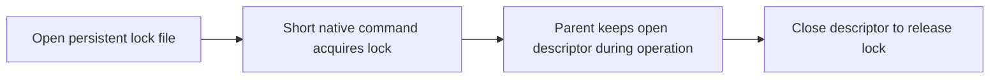

# `@henryqw/pi-herdr`

Call the Herdr command-line interface (CLI) or Unix socket from Node through one shared package. Extension authors share process handling without copying the list of Herdr commands. Pi users usually install a Herdr companion extension instead.

## Install

```bash
npm install @henryqw/pi-herdr
```

Install the Herdr CLI. Make `herdr` available on the calling process's `PATH`. The client requires Herdr 0.9.3 or later. Run `herdr --version` to verify the version.

## Use

Create a Herdr Client. Run a command. The client returns the parsed response.

```ts
import { createHerdrClient } from "@henryqw/pi-herdr";

const herdr = createHerdrClient(pi.exec.bind(pi));
const response = await herdr.json(["agent", "list"], { cwd: ctx.cwd });
```

For a ready-to-use Pi workflow, see [`@henryqw/pi-herdr-tools`](https://pi.henry.wang/extensions/pi-herdr-tools).

## API

| Surface | Type | Purpose |
| --- | --- | --- |
| `exec` | function | Validates string argv and returns the raw process result. |
| `run` | function | Requires a successful exit and returns stdout. |
| `json` | function | Requires a successful exit and parses a JSON object. |
| `hasHerdrErrorCode` | function | Detects structured CLI errors in stdout or stderr. |
| `requestHerdr` | function | Sends one bounded Unix socket request without retries. |
| `HerdrRequestError` | class | Reports a structured error code and whether dispatch was possible. |
| `checkoutAdmission` | function | Shares process-local checkout ownership through Pi's public event bus. |
| `checkoutKey` | function | Resolves the canonical checkout for admission. |
| `checkoutToolCanWrite` | function | Applies the shared Main-tool and direct-request write classification. |
| `registerCheckoutAdmission` | function | Registers the existing direct-writer policy and returns its ownership hold function. |
| `startPiAgent` | function | Validates and runs the shared `agent start --kind pi --pane ... --` boundary after a shell-readiness probe. |

### Socket requests

```ts
import { requestHerdr } from "@henryqw/pi-herdr";

const result = await requestHerdr("session.snapshot", {}, { signal });
```

`requestHerdr(method, params, options)` uses the inherited `HERDR_SOCKET_PATH`, or an explicit `socketPath`. Requests have unique identities; responses must match. The default timeout is 10000 milliseconds, with an allowed range of 1 to 60000. Request and response limits are 262144 and 1048576 bytes. An optional `AbortSignal` stops the local wait.

Errors expose `code` and `dispatched`. If `dispatched` is true, a mutation can have taken effect despite the error. Cancellation, timeout, or a closed connection is not permission to repeat a mutation. This function never retries. Callers validate method-specific results and own durable recovery. The existing CLI client and named-agent startup are unchanged.

### Checkout admission

`checkoutAdmission(pi)` finds one coordinator through Pi's public event bus. Call `install(pi)` to register tool lifecycle guards.

`checkoutKey(pi, ctx)` uses the canonical working directory for a verified non-Git workspace. A Git timeout or an uncertain repository lookup blocks writes. Failed lookups are not cached; the next call tries again.

`guard(name, refresh)` installs an awaited recovery check before writes. The callback receives the exact canonical checkout set after target resolution and before any member is admitted. `reserve` passes its one checkout to the same checks. If recovery fails, no member is admitted. `reserve(owner, checkout)` returns a release function only when no admitted writer or Main write is active.

`restore(owner, checkout)` restores durable ownership. Use `complete(owner)` only after verified terminal proof or a durable, explicit human waiver in the owning workflow. It releases ownership and rejects later restoration or reservation of that owner, including from a stale recovery scan. Use `release(owner)` to release a temporary reservation without marking its owner complete. A missing record is not terminal proof.

`registerCheckoutAdmission(pi, directCanWrite)` keeps the direct-subagent policy: Main writes can overlap, but direct writers must wait for them and exclude other writes. A returned hold function keeps a direct request admitted beyond its tool result. Consumers must restore durable command ownership before allowing writes after restart. These mechanisms do not intercept external processes or provide a sandbox.

Coordinators with `supportsDirectJournal: true` provide `admittedCheckouts(toolCallId)` and `restoreSet(owner, checkouts)`. The first returns the exact admitted set, not a new path lookup. The second restores every member under one durable identity. `complete(owner)` clears that set and rejects stale restoration. These calls do not save state.

`beginReplacement()` refuses replacement while a direct writer is in admission or preflight. Otherwise it synchronously blocks new direct writes until `session_start`. If a later handler cancels replacement, reload before direct writing. The caller must first check durable holds and the exact fork path.

The caller must save admission before allocation and save release before clearing holds. Check the capability and required methods when another installed package can supply an older coordinator.

An optional third argument, `directCheckouts(input, ctx)`, returns additional canonical checkout paths for a direct request. Admission reserves the current checkout and the complete selected set together. A conflict in one member blocks the request without a partial reservation. The caller validates repository selection; the hold function releases the set only after caller-proved worker termination.

### Path locks

`withWorktreeLock(checkout, operation)` resolves an existing file or directory to its real path. It holds a native kernel lock on `<real-path>.lock` until the operation finishes. A competing call fails immediately with `ELOCKED`, the lock-contention error code. A paused process keeps its lock; there is no heartbeat or stale takeover. Existing caller lock order is unchanged.



A descriptor is a process handle for an open file. The native command inherits the parent's descriptor, so its exit does not release the parent's lock.

The callback receives this descriptor as its argument. Do not close or unlock it. Pass it through a local child's `stdio` array when that child must retain the lock if its parent dies. An inherited child copy can keep the lock held after the callback returns.

Each acquisition starts one short process. Acquisition and close use synchronous calls; slow storage or process startup can block the event loop. The native command has a 5-second timeout and an 8192-byte output limit. Callers own any acquisition retries; the helper never repeats the operation.

On macOS, `/usr/bin/lockf` must support descriptor-only mode. The command uses `-t`, which sets the wait timeout, with zero to refuse contention. On Linux, install util-linux `flock`; `-n` disables waiting and `-E` sets contention status 75. Other platforms, missing commands, and unsupported command syntax fail without a lease fallback. The oldest supported macOS release is not established; verify descriptor-only mode on each deployment.

The regular lock file persists after release and checkout removal. Never delete or replace it during normal use: another process could then lock a different file at the same path. Symbolic links and non-regular lock objects are refused.

A legacy lock directory returns `ELOCKED`. Stop all old holders before manual removal of an abandoned directory; age alone is not proof. Old heartbeat clients and directory-lock scripts must migrate together. They cannot share ownership with the new protocol.

Acquisition, operation, and close errors remain visible. If an operation or acquisition fails and close also fails, an `AggregateError` contains both errors. Process death releases the lock after all inherited descriptor copies close. Descriptor inheritance is not automatic: a Git child or a dispatched Herdr request can continue after the parent dies. The helper does not stop or undo that work. Inspect state before a retry.

These advisory locks exclude only cooperating processes on supported local filesystems. Network filesystem behavior is not verified. They are not a global checkout write barrier and do not share the separate `pi-pr` lock namespace.

### `startPiAgent`

On macOS, a shell that starts or runs a prompt hook can lose Enter for a launch command longer than 1024 bytes. The pane then waits forever. To prevent this, the helper first checks `pane process-info`. When the pane shell owns the foreground process group, it runs `pane run <pane> "echo <token>"` and polls `pane read` for up to 20 seconds. The probe passes when the token appears on its own line, with a prompt after it.

The helper skips the probe when the shell does not own the group, so `agent start` reports `agent_pane_busy` for an occupied pane. If the probe fails, the helper returns its result without starting the agent. It retries `agent_pane_busy` up to five tries when the caller's policy permits it, then returns the raw final result.

Callers build Pi-specific arguments and validate responses. Herdr defines the supported commands and response shapes.
